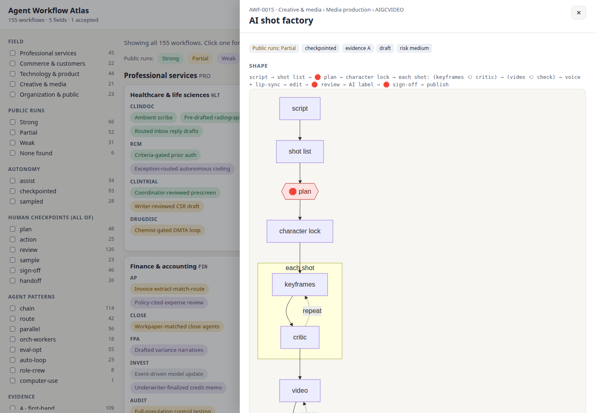

# Agent Workflow Atlas

[English](README.md) · [简体中文](README.zh-CN.md)

**A catalog of how professionals actually run AI agents in production work**, written as step-by-step SOPs you can copy: what goes in, which agents and tools do what, where a person has to approve, and what comes out.

It covers software engineering, product design, research, law, finance, healthcare, education, marketing, sales, support, fiction and screenwriting, and industrialized short-drama production (短剧). Each workflow lists its sources and how strong its evidence is.

**Status:** 215 workflows across 5 fields, 20 professions and 87 categories. Every category has at least one workflow, and 18 more from new fields wait in [unplaced](workflows/unplaced/). Each entry lists its public runs, re-checked against their sources in November 2026. One is `accepted`; the rest stay `draft` until someone adds a real example run. That's the most useful contribution right now ([how](CONTRIBUTING.md#1-add-an-example-run)).



## Browse

- **The catalog site**, in English and 中文: *Start here* (the 10 workflows with agent kits and the best-documented ones), a map of every field, search, filters (autonomy, checkpoints, agent patterns, evidence, risk), and a shareable page for each workflow at `w/<ID>/` (Chinese at `w/<ID>/zh/`, fully translated except the sources) with its route, diagram, steps and sources. Build it with `python scripts/build_site.py` and open `site/index.html`. Once the repository is public it is published to GitHub Pages.
- **Data**: the whole catalog as `catalog.json` and `catalog.csv`, built next to the site, for anyone building on it.
- **[INDEX.md](INDEX.md)**: every workflow, by field, by trait and by strength of public evidence.
- **[workflows/](workflows/)**: one folder per workflow. GitHub renders each one's shape as a diagram.

A sample entry, [AI shot factory](workflows/CRE/MED/AIGCVIDEO/ai-shot-factory/) (`AWF-0015`), turns a short-drama script into a finished AI-generated episode:

```
script → shot list → 🛑 plan → character lock → each shot: (keyframes ⟲ critic) → (video ⟲ check)
       → voice + lip-sync → edit → 🛑 review → AI label → 🛑 sign-off → publish
```

🛑 marks where work stops until a person approves. Each entry spells out who approves what, the tools used at each step, the failure modes, and the regulations that apply.

## Agent kits

Ten workflows come with a copy-paste kit for Claude Code: a `CLAUDE.md` section, a skill, and a slash command whose 🛑 checkpoints stop and wait for you. AGENTS.md-based tools such as Codex CLI and Cursor can use the same files. The kits are starters written from each workflow's sources, not reported runs. If you run one, adding your run as an example is the most useful contribution.

| Workflow | What the kit does |
|---|---|
| [Plan-gated build](workflows/TEC/SWE/FEAT/plan-gated-build/) · [kit](workflows/TEC/SWE/FEAT/plan-gated-build/variants/claude-code.md) | plan → 🛑 approve → tests first → code → review |
| [Fan-out codemod](workflows/TEC/SWE/MAINT/fan-out-codemod/) · [kit](workflows/TEC/SWE/MAINT/fan-out-codemod/variants/claude-code.md) | pilot → 🛑 approve → per-file loop → 🛑 sample → batched PRs |
| [Delegated PR](workflows/TEC/SWE/FEAT/delegated-pr/) · [kit](workflows/TEC/SWE/FEAT/delegated-pr/variants/claude-code.md) | label an issue → agent opens a draft PR in GitHub Actions |
| [Graded PR comments](workflows/TEC/SWE/REVIEW/graded-pr-comments/) · [kit](workflows/TEC/SWE/REVIEW/graded-pr-comments/variants/claude-code.md) | parallel reviewers → confidence grading → inline comments |
| [Reproduce-first bug fix](workflows/TEC/SWE/DEBUG/reproduce-first-bug-fix/) · [kit](workflows/TEC/SWE/DEBUG/reproduce-first-bug-fix/variants/claude-code.md) | reproduce or park → fix → same repro passes → two PRs |
| [Issue-tree research](workflows/ORG/BIZ/STRAT/issue-tree-research/) · [kit](workflows/ORG/BIZ/STRAT/issue-tree-research/variants/claude-code.md) | issue tree → 🛑 approve → parallel research → re-check every number |
| [Daily inbox triage](workflows/ORG/XFN/INBOX/daily-inbox-triage/) · [kit](workflows/ORG/XFN/INBOX/daily-inbox-triage/variants/claude-code.md) | sort → draft replies → brief; you send everything |
| [Bible-driven novel draft](workflows/CRE/WRI/FICTION/bible-driven-novel-draft/) · [kit](workflows/CRE/WRI/FICTION/bible-driven-novel-draft/variants/claude-code.md) | story bible → 🛑 plans → scene drafts → continuity checks |
| [Quote-verified synthesis](workflows/TEC/PRD/UXR/quote-verified-synthesis/) · [kit](workflows/TEC/PRD/UXR/quote-verified-synthesis/variants/claude-code.md) | interviews → themes with quotes → 🛑 verify every quote |
| [Hook-cadence drama script (短剧)](workflows/CRE/WRI/SCREEN/hook-cadence-drama-script/) · [kit](workflows/CRE/WRI/SCREEN/hook-cadence-drama-script/variants/claude-code.md) | setup → 🛑 episode outline → batches of 10 → hook and 卡点 checks |

## How it's organized

Workflows are classified the way biology classifies animals: by **ancestry**, not by shared features.

```
workflows/
  CRE/                     Kingdom: broad field (5)
    MED/                   Phylum: profession (20)
      AIGCVIDEO/           Class: discipline
        ai-shot-factory/   Species: one workflow, with a permanent ID (AWF-0015)
          README.md        the SOP and its metadata
          variants/        toolchain-specific notes (optional)
          examples/        dated real runs, with context files and samples
```

- A workflow is placed by **what profession it comes from and what it delivers**, using a short key where the first match wins.
- **Shared techniques** (generate-and-critique loops, parallel workers, autonomy level) are searchable traits, not folders, because they show up in every field.
- **Tools** are variants at the bottom, so switching from one model or app to another never moves anything.

The full rules fit on one page: [TAXONOMY.md](TAXONOMY.md).

## Keeping it current

AI practice changes every few months, so the catalog has three upkeep loops, described in [MAINTAINING.md](MAINTAINING.md):

- **Monthly freshness report:** an automatic issue listing entries not re-checked in 6 months and source links that broke.
- **Re-checking:** each entry is re-checked against its sources, and its `last_verified` month is updated.
- **Quarterly collection sweep:** parallel research agents look for workflows the catalog is missing, and separate agents re-check every source they cite.

Catalog-level changes are listed in [CHANGELOG.md](CHANGELOG.md).

## Contribute

Good places to start: issues labelled [`good first issue`](../../issues?q=is%3Aissue+is%3Aopen+label%3A%22good+first+issue%22). They include running a kit and adding your run, or finding a first-hand source for a workflow with weak evidence. Read [CONTRIBUTING.md](CONTRIBUTING.md). In short: add an example run of a listed workflow, add a new workflow from the template, or fix a placement. `python scripts/validate.py` checks your entry before you open a pull request.

## Research

- [research/phase1-report.md](research/phase1-report.md): the study this catalog started from, covering the landscape across industries, the classification design, and a log of 31 claims checked against sources.
- [research/2026-11-real-runs.md](research/2026-11-real-runs.md): which workflows have public, first-hand runs, and who to invite to contribute.
- [research/2026-11-new-workflows.md](research/2026-11-new-workflows.md) and [research/2026-11-second-pass.md](research/2026-11-second-pass.md) and [research/2026-11-third-pass.md](research/2026-11-third-pass.md): how workflows 32–215 were collected and checked.

## License

- **Content** (everything under `workflows/`, `research/`, `templates/`, and the docs): [CC BY 4.0](LICENSE-CONTENT). Reuse it freely, with credit to this catalog.
- **Code** (`scripts/`, `.github/`): [MIT](LICENSE).

By contributing, you agree your contribution is shared under the same terms.
