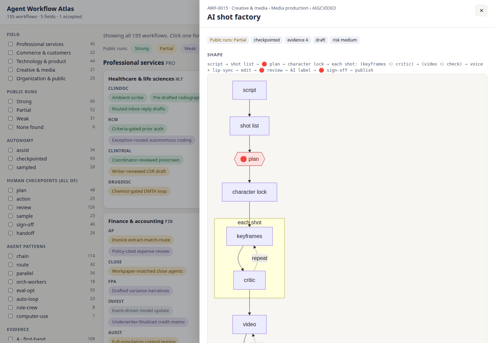

# Agent Workflow Atlas · AI 智能体工作流图谱

[English](README.md) · [简体中文](README.zh-CN.md)

**一份记录各行各业如何在真实生产中使用 AI 智能体的目录。** 每条工作流都写成可照抄的标准作业流程（SOP）：输入什么、哪个智能体和工具做哪一步、哪里必须由人审批，最后交付什么。

覆盖软件工程、产品设计、科研、法律、金融、医疗、教育、保险、营销、销售、客服、零售电商、小说与剧本写作、网文，以及工业化的 **短剧 / AI 漫剧** 生产。每条工作流都列出来源和公开实例，并标注证据强度。

**现状：** 215 条工作流，覆盖 5 个领域、20 个行业、87 个类别，每个类别至少有一条；另有 18 条来自新领域的工作流暂放在 [unplaced](workflows/unplaced/)。所有“公开实例”中的数字都在 2026 年 11 月由独立的核查智能体逐一回到原网页核对过。目前 1 条为 `accepted`，其余为 `draft`：提交一次真实运行记录（example run）就能让它转为 `accepted`，这是现在最有价值的贡献（[怎么做](CONTRIBUTING.md#1-add-an-example-run)）。



## 怎么看

- **目录网站**（中英双语，右上角切换）：“Start here”页列出 10 条带套件的工作流和证据最强的工作流；另有按领域的全景图、搜索（支持中文，如“短剧”“网文”“事前授权”），以及按自主程度、人工检查点、智能体模式、证据、风险筛选。每条工作流在 `w/<ID>/zh/` 有一个可分享的中文独立页面，含流程图、步骤和来源。运行 `python scripts/build_site.py` 后打开 `site/index.html`。仓库公开后会自动发布到 GitHub Pages。
- **数据**：整个目录可导出为 `catalog.json` 和 `catalog.csv`，与网站一起生成，方便二次开发。
- **[INDEX.md](INDEX.md)**：按领域、特征和公开证据强度列出全部工作流。
- **[workflows/](workflows/)**：每条工作流一个文件夹。GitHub 会把它的流程（shape）渲染成图。

以 [AI 镜头工厂](workflows/CRE/MED/AIGCVIDEO/ai-shot-factory/)（`AWF-0015`）为例，它把短剧剧本变成一集 AI 生成的成片：

```
剧本 → 分镜表 → 🛑 计划审批 → 角色定妆 → 每个镜头：(关键帧 ⟲ 评审) → (视频 ⟲ 检查)
     → 配音 + 口型 → 剪辑 → 🛑 审片 → AI 标识 → 🛑 签发 → 发布
```

🛑 表示流程在此停下，等人审批。每条工作流都写明谁审批什么、每一步用什么工具、常见失败方式，以及相关的监管要求（例如国内自 2025 年 9 月 1 日起要求对 AI 生成内容做显式和隐式标识）。

中文创作者可以先看这些：
- [卡点节奏短剧剧本](workflows/CRE/WRI/SCREEN/hook-cadence-drama-script/)：3 秒钩子、反转密度、付费卡点、场次表。
- [网文日更](workflows/CRE/WRI/SERIAL/daily-web-serial/)：大纲 → 卷纲 → 细纲 → 每日章节 → 段评调整。
- [真人短剧 AI 辅助](workflows/CRE/MED/SHORTDRAMA/live-action-assist/)和[分节点审核的 AI 漫剧产线](workflows/CRE/MED/SHORTDRAMA/gated-ai-manju-line/)。
- [短剧出海配音](workflows/CRE/MED/DUB/dubbing-pipeline/)、[术语库驱动的网文出海翻译](workflows/CRE/WRI/TRANS/glossary-backed-mtpe-serial/)和[游戏本地化](workflows/CRE/WRI/TRANS/term-gated-game-localisation/)。

## 智能体套件（Agent kits）

以下 10 条工作流附带可直接复制的 Claude Code 套件：一段 `CLAUDE.md`、一个 skill 和一个斜杠命令。每个 🛑 节点都会停下来等你确认。Codex CLI、Cursor 等支持 AGENTS.md 的工具也能用这些文件。套件是根据各工作流的公开来源写的起步模板，不是实际运行记录。如果你用它跑过一次，把这次运行作为 example 提交上来，就是最有价值的贡献。

| 工作流 | 套件做什么 |
|---|---|
| [Plan-gated build](workflows/TEC/SWE/FEAT/plan-gated-build/) · [套件](workflows/TEC/SWE/FEAT/plan-gated-build/variants/claude-code.md) | 规划 → 🛑 审批 → 先写测试 → 编码 → 评审 |
| [Fan-out codemod](workflows/TEC/SWE/MAINT/fan-out-codemod/) · [套件](workflows/TEC/SWE/MAINT/fan-out-codemod/variants/claude-code.md) | 试点 → 🛑 审批 → 逐文件循环 → 🛑 抽检 → 分批 PR |
| [Delegated PR](workflows/TEC/SWE/FEAT/delegated-pr/) · [套件](workflows/TEC/SWE/FEAT/delegated-pr/variants/claude-code.md) | 给 issue 打标签 → 智能体在 GitHub Actions 中提交草稿 PR |
| [Graded PR comments](workflows/TEC/SWE/REVIEW/graded-pr-comments/) · [套件](workflows/TEC/SWE/REVIEW/graded-pr-comments/variants/claude-code.md) | 并行评审 → 置信度打分 → 行内评论 |
| [Reproduce-first bug fix](workflows/TEC/SWE/DEBUG/reproduce-first-bug-fix/) · [套件](workflows/TEC/SWE/DEBUG/reproduce-first-bug-fix/variants/claude-code.md) | 先复现否则搁置 → 修复 → 同一复现通过 → 两个 PR |
| [Issue-tree research](workflows/ORG/BIZ/STRAT/issue-tree-research/) · [套件](workflows/ORG/BIZ/STRAT/issue-tree-research/variants/claude-code.md) | 议题树 → 🛑 审批 → 并行研究 → 逐个数字回查 |
| [Daily inbox triage](workflows/ORG/XFN/INBOX/daily-inbox-triage/) · [套件](workflows/ORG/XFN/INBOX/daily-inbox-triage/variants/claude-code.md) | 分类 → 起草回复 → 简报；所有邮件由你发送 |
| [Bible-driven novel draft](workflows/CRE/WRI/FICTION/bible-driven-novel-draft/) · [套件](workflows/CRE/WRI/FICTION/bible-driven-novel-draft/variants/claude-code.md) | 故事圣经 → 🛑 大纲审批 → 逐场起草 → 连贯性检查 |
| [Quote-verified synthesis](workflows/TEC/PRD/UXR/quote-verified-synthesis/) · [套件](workflows/TEC/PRD/UXR/quote-verified-synthesis/variants/claude-code.md) | 访谈 → 带引文的主题 → 🛑 逐条核对引文 |
| [Hook-cadence drama script (短剧)](workflows/CRE/WRI/SCREEN/hook-cadence-drama-script/) · [套件](workflows/CRE/WRI/SCREEN/hook-cadence-drama-script/variants/claude-code.md) | 设定 → 🛑 分集大纲 → 每批 10 集 → 钩子与卡点检查 |

## 怎么分类

工作流按生物分类的思路组织：先看“血统”（来自哪个行业、交付什么），而不是表面特征。

```
workflows/
  CRE/                     界（Kingdom）：大领域（5 个）
    MED/                   门（Phylum）：行业（20 个）
      AIGCVIDEO/           纲（Class）：具体工种
        ai-shot-factory/   种（Species）：一条工作流，有永久编号（AWF-0015）
          README.md        SOP 和元数据
          variants/        某个工具链的落地说明，例如 Claude Code 套件
          examples/        有日期的真实运行记录，附上下文文件和样例
```

- 归类只看两点：**来自哪个行业**、**交付什么**。用一张“先匹配先得”的检索表就能定位。
- **通用技巧**（生成-评审循环、并行子智能体、自主程度）是可搜索的特征，不是文件夹，因为它们在每个领域都会出现。
- **工具**放在最底层的 variants，换一个模型或软件不会改变工作流的位置。

完整规则只有一页：[TAXONOMY.md](TAXONOMY.md)（英文）。

## 保持更新

AI 的做法每几个月就会变，所以目录有三个维护循环，详见 [MAINTAINING.md](MAINTAINING.md)：

- **每月新鲜度报告**：自动生成一个 issue，列出超过 6 个月未复核的条目和失效的来源链接。
- **逐条复核**：回到来源重新核对，更新 `last_verified`。
- **每季度收集**：多个研究智能体并行寻找目录里还没有的工作流，再由独立的智能体逐一核对来源。

## 参与贡献

可以从标有 [`good first issue`](../../issues?q=is%3Aissue+is%3Aopen+label%3A%22good+first+issue%22) 的 issue 开始，例如运行一个套件并提交运行记录，或为证据薄弱的工作流找到第一手来源。完整说明见 [CONTRIBUTING.md](CONTRIBUTING.md)（英文）。最有价值的三种贡献：
1. 为已有工作流提交一次真实运行记录。
2. 按模板新增一条工作流。
3. 修正归类或过时的信息。

中文内容同样欢迎，术语可保留中文原文。提交前运行 `python scripts/validate.py` 检查格式。

## 许可

- **内容**（`workflows/`、`research/`、`templates/` 和文档）：[CC BY 4.0](LICENSE-CONTENT)，注明出处即可自由使用。
- **代码**（`scripts/`、`.github/`）：[MIT](LICENSE)。
