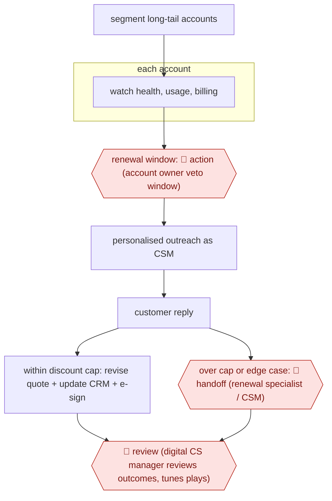

# Autonomous long-tail renewals

`COM › CSX › CS` · sampled · evidence B · **draft: needs a reference example** ([how to add one](../../../../../CONTRIBUTING.md#1-add-an-example-run))

**Shape:** `segment long-tail accounts → each account: watch health, usage, billing → renewal window: 🛑 action (account owner veto window) → personalised outreach as CSM → customer reply → within discount cap: revise quote + update CRM + e-sign | over cap or edge case: 🛑 handoff (renewal specialist / CSM) → 🛑 review (digital CS manager reviews outcomes, tunes plays)`
**Variants:** `gainsight-atlas` · `planhat` · `quivly` · `statisfy`

<!-- shape diagram: generated by scripts/build_diagrams.py from `shape`; don't edit -->

<!-- end shape diagram -->

## Background

A software company sold on yearly subscriptions has to win each customer's renewal before the contract ends. Customer success managers (CSMs) usually do this for the larger accounts: they check how the product is being used, contact the customer weeks or months ahead, answer objections and agree any price change. Hundreds of small accounts, the long tail, often get no such attention because there are too few CSMs, and some are lost simply because nobody wrote to them or a card payment failed. Here the agent watches those small accounts, writes to each customer on the CSM's behalf, and closes renewals that stay within a fixed discount limit. People keep the account owner's right to stop the contact, every request beyond the limit, and the review of how the automated approaches are working, because price concessions cost the company money and every message reaches a paying customer in the company's name.

**Terms:**
- **CSM (customer success manager)**: the person responsible for keeping existing customers and getting them to renew.
- **AE (account executive)**: the salesperson who owns the commercial relationship and the contract.
- **Long-tail accounts**: the many small customers whose individual revenue does not justify a dedicated CSM.
- **Health score**: a rating built from usage, support tickets and billing that estimates how likely a customer is to renew.
- **ARR (annual recurring revenue)**: what one customer's subscription brings in per year.
- **CRM**: the system that records customers, contacts and sales opportunities, here Salesforce.
- **CPQ (configure, price, quote)**: the tool that produces the price quote attached to an opportunity.
- **E-sign**: sending the renewal for electronic signature, here through DocuSign.
- **Digital CS manager**: the person who runs automated, one-to-many customer success programmes instead of a personal book of accounts.
- **Play**: a pre-defined sequence of actions triggered by a signal, such as a reminder 60 days before renewal.

## Build it with an agent

**Form:** `service`. Runs start on renewal milestones and account signals with nobody present, and people see only the pre-notice, the exceptions and the outcome log.

**You need:** read access to the CRM, product usage, support and billing data through MCP connectors; a mail connector that sends from the CSM's mailbox; write access to the CRM opportunity and the quote tool; an e-sign connector; a state store holding each account's stage, the pre-notice sent and the owner's answer; the discount cap and the escalation rules as a reference file the cap check also reads. The agent must not hold payment card details; billing data comes in as status only.

| Step | Built as |
|---|---|
| segment long-tail accounts | A reference file beside the skill lists the tiers and which accounts the agent may work; a person maintains it. |
| each account: watch health, usage, billing | A cloud scheduled task or your own scheduler running `claude -p` daily; a script pulls the signals and selects accounts that reached a milestone (90, 60, 30 days) or crossed a threshold. |
| renewal window: 🛑 action (account owner veto window) | The run posts the pre-notice to the account owner and records it in the state store; a later run continues only if the window has passed with no objection. |
| personalised outreach as CSM → customer reply | The skill drafts the message from the account's history; the mail connector sends it and reads the reply on the next run. |
| within discount cap: revise quote + update CRM + e-sign | CPQ, CRM and e-sign connectors. A `PreToolUse` hook checks every quote and e-sign call against the cap and the state store. |
| over cap or edge case: 🛑 handoff | The account goes to the renewal specialist's queue with the thread, the signals and a drafted reply. |
| 🛑 review (digital CS manager reviews outcomes, tunes plays) | Each run appends to an outcome log; the manager reads it and edits the plays and the cap file. |

**Checkpoints:** `action`: a `PreToolUse` hook blocks the mail send for any account whose pre-notice has no recorded clearance in the state store, so the owner's objection always stops the contact. `handoff`: the `PreToolUse` hook denies any quote or e-sign call above the discount cap, whatever the agent decides, and the skill routes those accounts to a person's queue; the agent cannot change the cap file. `review`: the manager reviews the outcome log and escalated accounts after the fact; the agent has no tool to edit plays.

**Since the sources:** Sources and public runs date from 2026-05 to 2026-11; two Planhat pages are undated. All four are vendor material: a recorded product demo, a vendor blog and two vendor pages, with no customer's account of running the whole loop. The demo shows the pre-notice, the outreach and a renewal closed inside an 8% cap; the other pages describe tiering and triggers in general terms. The build follows the guard the demo states, a cap held outside the prompt, by putting it in a hook. Whether a general agent should send price-bearing messages to customers without a person reading them is the company's decision; a cautious version keeps the send step as a drafted message and makes this the `checkpointed` relative, AWF-0049.

*A design based on this entry's steps and the tool documentation as of 2026-11, not a reported run.*

## Steps

*As reported by the sources.*

1. Customer success leadership draws the coverage line by tier; long-tail accounts get agent-run plays, strategic accounts stay human-led [[2]](#sources)[[3]](#sources).
2. The agent watches each account's health, usage, support and billing signals and triggers on renewal milestones (e.g. 90/60/30 days) [[2]](#sources).
3. 🛑 **Action**: before contacting the customer, the agent messages the AE with the renewal date and expected ARR so they can object; in the Gainsight demo the AE replied 'Looks good. Go ahead.' [[1]](#sources).
4. The agent sends personalised renewal outreach from the CSM's inbox and reads the reply [[1]](#sources)[[4]](#sources).
5. If the requested discount is inside a hard cap (8% in the demo), the agent revises the quote, updates the opportunity in the CRM (Salesforce) and sends the renewal for e-sign through DocuSign/CPQ without a person [[1]](#sources).
6. 🛑 **Handoff**: the agent passes requests over the cap, accounts whose health score stays below threshold after automated attempts, and edge cases to a person with full context and a drafted message [[1]](#sources)[[2]](#sources)[[3]](#sources).
7. 🛑 **Review**: a digital CS manager reviews escalated accounts and the action history, and prunes or tunes plays [[2]](#sources)[[3]](#sources).

**Output:** Renewals closed in CRM for long-tail accounts, plus a ranked queue of accounts that need a person.
**Failure modes → guards:** Agent concedes too much on price → hard discount cap in workflow, not in the prompt [1]. Silent churn in unowned accounts → billing and usage signals feed the trigger [2]. Customers never reach a human → escalate after a fixed number of failed automated attempts [3].
**How it differs:** Nearest is AWF-0049 Renewal-window risk brief: that produces a risk brief and save plan and the CSM approves each outreach. Here the agent runs the renewal conversation and closes within a discount cap; humans see only a pre-notice and exceptions. Deliverable (closed renewal vs brief) and autonomy (sampled vs checkpointed) differ.

## Public runs

Coverage as of 2026-11-13: **Weak**: only anonymous, vendor-linked or journalist-told accounts. Collected and re-checked in [Third collection pass](../../../../../research/2026-11-third-pass.md).

- [Gainsight, Atlas in Action](https://pulselibrary.gainsight.com/video/atlas-in-action/) (2026-05-27). Demo renewal closed by agent after AE pre-notice and a 6% discount request under an 8% cap. "the estimated ARR for this particular renewal was $210,000 US". *First-hand: vendor; confidence: low.*
- [Planhat, Fluxx customer story](https://www.planhat.com/fluxx) (undated). Renewal outreach agent sends on CSMs' behalf across a 100+ account book per CSM. "engaging with renewal conversations six to eight months out". *First-hand: vendor; confidence: med.*

## Sources

1. Gainsight, Atlas in Action (Pulse Library live demo), 2026-05-27. https://pulselibrary.gainsight.com/video/atlas-in-action/
2. Arushi Jain / Quivly, How Do You Cover Long-Tail Accounts Without Hiring a CSM for Every Segment?, 2026-11-08. https://www.quivly.ai/blog/cover-long-tail-accounts-without-hiring-csms
3. Planhat, AI for scaled customer success (editorial), undated. https://www.planhat.com/editorial/ai-for-scaled-customer-success
4. Planhat, How Fluxx Unlocks their Team's Capacity through Agentic Collaboration, undated. https://www.planhat.com/fluxx
