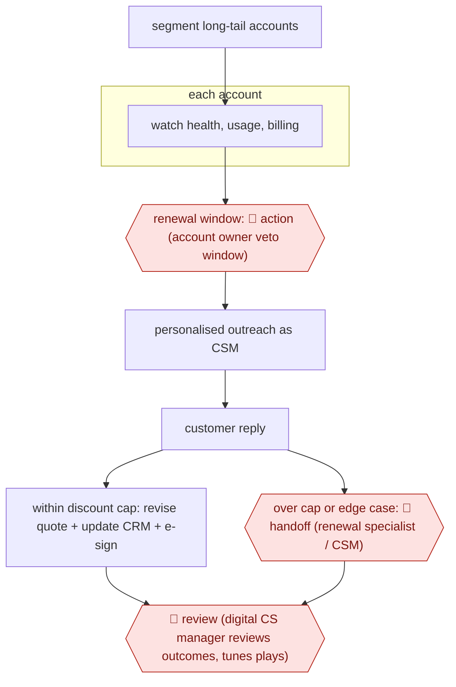

# Autonomous long-tail renewals

`COM › CSX › CS` · sampled · evidence B · **draft: needs a reference example** ([how to add one](../../../../../CONTRIBUTING.md#1-add-an-example-run))

**Shape:** `segment long-tail accounts → each account: watch health, usage, billing → renewal window: 🛑 action (account owner veto window) → personalised outreach as CSM → customer reply → within discount cap: revise quote + update CRM + e-sign | over cap or edge case: 🛑 handoff (renewal specialist / CSM) → 🛑 review (digital CS manager reviews outcomes, tunes plays)`
**How it differs:** Nearest is AWF-0049 Renewal-window risk brief: that produces a risk brief and save plan and the CSM approves each outreach. Here the agent runs the renewal conversation and closes within a discount cap; humans see only a pre-notice and exceptions. Deliverable (closed renewal vs brief) and autonomy (sampled vs checkpointed) differ.
**Variants:** `gainsight-atlas` · `planhat` · `quivly` · `statisfy`

<!-- shape diagram: generated by scripts/build_diagrams.py from `shape`; don't edit -->

<!-- end shape diagram -->

## Steps
1. Draw the coverage line by tier; long-tail accounts get agent-run motions, strategic accounts stay human-led [[2]](#sources)[[3]](#sources).
2. Agent watches each account's health, usage, support and billing signals and triggers on renewal milestones (e.g. 90/60/30 days) [[2]](#sources).
3. 🛑 **Action**: before contacting the customer, the agent messages the account executive with renewal date and expected ARR so they can object; in the Gainsight demo the AE replied 'Looks good. Go ahead.' [[1]](#sources).
4. Agent sends personalised renewal outreach from the CSM's inbox and reads the reply [[1]](#sources)[[4]](#sources).
5. If the requested discount is inside a hard cap (8% in the demo), the agent revises the quote, updates the opportunity in Salesforce and sends via DocuSign/CPQ without a person [[1]](#sources).
6. 🛑 **Handoff**: requests over the cap, health below threshold after automated attempts, or edge cases go to a human with full context and a drafted message [[1]](#sources)[[2]](#sources)[[3]](#sources).
7. 🛑 **Review**: a digital CS manager reviews escalated accounts and the action history, and prunes or tunes plays [[2]](#sources)[[3]](#sources).

**Output:** Renewals closed in CRM for long-tail accounts, plus a ranked queue of accounts that need a person.
**Failure modes → guards:** Agent concedes too much on price → hard discount cap in workflow, not in the prompt [1]. Silent churn in unowned accounts → billing and usage signals feed the trigger [2]. Customers never reach a human → escalate after a fixed number of failed automated attempts [3].

## Public runs

Coverage as of 2026-11-13: **Weak**: only anonymous, vendor-linked or journalist-told accounts. Collected and re-checked in [Third collection pass](../../../../../research/2026-11-third-pass.md).

- [Gainsight, Atlas in Action](https://pulselibrary.gainsight.com/video/atlas-in-action/) (2026-05-27). Demo renewal closed by agent after AE pre-notice and a 6% discount request under an 8% cap. "the estimated ARR for this particular renewal was $210,000 US". *First-hand: vendor; confidence: low.*
- [Planhat, Fluxx customer story](https://www.planhat.com/fluxx) (undated). Renewal outreach agent sends on CSMs' behalf across a 100+ account book per CSM. "engaging with renewal conversations six to eight months out". *First-hand: vendor; confidence: med.*

## Sources

1. Gainsight, Atlas in Action (Pulse Library live demo), 2026-05-27. https://pulselibrary.gainsight.com/video/atlas-in-action/
2. Arushi Jain / Quivly, How Do You Cover Long-Tail Accounts Without Hiring a CSM for Every Segment?, 2026-11-08. https://www.quivly.ai/blog/cover-long-tail-accounts-without-hiring-csms
3. Planhat, AI for scaled customer success (editorial), undated. https://www.planhat.com/editorial/ai-for-scaled-customer-success
4. Planhat, How Fluxx Unlocks their Team's Capacity through Agentic Collaboration, undated. https://www.planhat.com/fluxx
