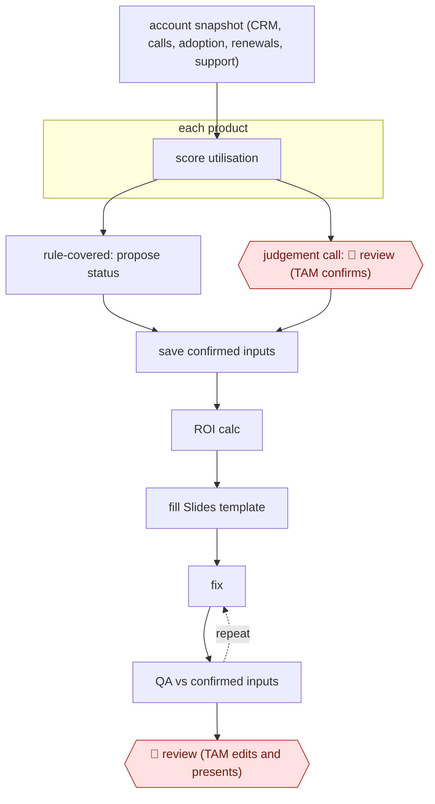

# Confirmed-inputs QBR deck

`COM › CSX › CS` · checkpointed · evidence A · **draft: needs a reference example** ([how to add one](../../../../../CONTRIBUTING.md#1-add-an-example-run))

**Shape:** `account snapshot (CRM, calls, adoption, renewals, support) → each product: score utilisation → rule-covered: propose status | judgement call: 🛑 review (TAM confirms) → save confirmed inputs → ROI calc → fill Slides template → (fix ⟲ QA vs confirmed inputs) → 🛑 review (TAM edits and presents)`
**Variants:** `rippling-ai` · `google-slides` · `salesforce` · `gong`

<!-- shape diagram: generated by scripts/build_diagrams.py from `shape`; don't edit -->

<!-- end shape diagram -->

## Background

A quarterly business review (QBR) is a meeting in which a software company shows a customer how it has used the product over the past quarter, what value it has had and what to do next. The account manager who owns the customer prepares a slide deck for it. Preparation means pulling subscription data from the sales system, reading recent call notes, checking how much of the product is actually in use and rebuilding the same deck with new numbers. It is slow, and the numbers come from several systems that can disagree. Here the agent gathers the data, proposes a status for each product where a written rule covers the case, fills the deck template and checks the finished deck against the decisions the team confirmed. A person still decides every case the rules do not cover (low use of a feature may be a problem or may not matter) and presents the deck to the customer, because the customer holds the company to every claim in it.

**Terms:**
- **TAM (technical account manager)**: the person who looks after a customer's technical use of the product and presents its QBR.
- **Utilisation**: how much of what the customer bought they actually use.
- **Account snapshot**: one combined record of a customer's owner, renewal dates, health signals, subscriptions, support cases and recent activity.
- **CRM**: the system that records customers, contacts and contracts; here Salesforce. Gong is a tool that records and transcribes sales and support calls.
- **ROI (return on investment)**: the value the customer gets from the product set against what it costs them.
- **Rubric**: a list of graded questions about a deck, such as whether every claim can be checked against the customer's own records.

## Build it with an agent

**Form:** `skill`. One account manager prepares one customer's deck at a time and answers the agent's questions in the conversation, so one skill holding the steps, the rules and the template instructions is enough.

**You need:** read access to the CRM, the call recordings or transcripts, the product adoption figures and the support history, through connectors or exported files; the utilisation rules and the product mapping as a reference file beside the skill; a Google Slides template and a connector or script that can write into it; a Drive folder or file where confirmed inputs are saved; if you have one, a rubric as a second reference file. The agent needs no way to send the deck to anyone.

| Step | Built as |
|---|---|
| account snapshot (CRM, calls, adoption, renewals, support) | A script or connectors write one snapshot file for the account. The skill reads only that file, not each system in turn. |
| each product: score utilisation | The skill applies the rules in the reference file. A subagent can take a product each when there are many. |
| rule-covered: propose status \| judgement call: 🛑 review | The skill lists each judgement call with its evidence and asks the TAM to confirm or change it; the rule-covered statuses are shown for a quick look. |
| save confirmed inputs | The skill writes product, status, reason and who confirmed to a file in Drive, so the next session can start from it. |
| ROI calc | A script beside the skill computes it from the snapshot and the confirmed inputs. |
| fill Slides template → (fix ⟲ QA vs confirmed inputs) | The skill writes the deck from per-slide instructions. A subagent that did not write the deck reads it back against the confirmed inputs and the rubric and lists placeholders, mismatched numbers and wrong statuses. Clear fixes are made and rechecked; the rest goes to the TAM. |
| 🛑 review (TAM edits and presents) | See Checkpoints. |

**Checkpoints:** `review`: the skill stops at each judgement call and does not build the deck until the TAM has answered them; it stops again after the read-back and presents the deck with any open points. The agent has no tool to share the deck or email it, so the TAM edits in Slides and presents it themselves.

**Since the sources:** Sources and public runs date from 2026-08 to 2026-10. Both are first-hand accounts by the teams that built the process. Rippling built it on its own data platform and its agent plugins, and Handshake built an agent scored against a rubric; this build replaces the platform with a snapshot file and connectors and does not reproduce either company's tooling. The sources report preparation times; this entry makes no such claim for the build. Whether a rubric as detailed as Handshake's 54 criteria is worth writing is for the team to judge.

*A design based on this entry's steps and the tool documentation as of 2026-11, not a reported run.*

## Steps

*As reported by the sources.*
1. The team prepares the data before the model sees it: it joins Salesforce, Gong calls, adoption metrics, planning docs and support history into one account snapshot (ownership, renewals, health signals, subscriptions, cases, activity) [[1]](#sources).
2. The AI scores product utilisation; where an approved rule covers the case the AI proposes a status, where evidence is incomplete or context-dependent it flags the case [[1]](#sources).
3. 🛑 **Review**: the technical account manager confirms the flagged assessments (e.g. whether low adoption of a feature matters), while mechanical steps run asynchronously [[1]](#sources).
4. The workflow saves the confirmed inputs as structured records (product, status, reason, confirmed_by_team) to a Drive document so work can resume the next day at ROI and deck generation [[1]](#sources).
5. The agent runs separate skills that gather context, analyse calls, evaluate utilisation and calculate ROI; a deck builder writes into a fixed Google Slides template with structured per-slide instructions [[1]](#sources). Handshake's version scores the deck against a 54-criterion rubric built with account managers [[2]](#sources).
6. A QA skill reads the deck back against the confirmed inputs (placeholders, mismatched numbers, wrong statuses); clear fixes are corrected and rechecked, judgement fixes go back to the team [[1]](#sources).
7. 🛑 **Review**: the account manager reviews the finished deck and presents it to the customer [[1]](#sources)[[2]](#sources).

**Output:** A native Slides QBR deck per account, built from confirmed inputs, ready for the TAM to present; confirmed inputs saved in Drive.
**Failure modes → guards:** Stale or conflicting numbers, decisions lost across multi-day sessions, content in wrong slides → single snapshot dataset, structured saved records, fixed template plus QA read-back. Recommending modules the customer already owns → feed owned-product data into the narrative step [2].
**How it differs:** Closest is AWF-0049 Renewal-window risk brief (which mentions a QBR draft). AWF-0049 delivers an internal risk brief and save plan with CSM validation of risk flags and outreach approval; this delivers a customer-facing deck, with a mid-run checkpoint on per-product judgement calls and an automated QA loop before final review. AWF-0174 is an autonomous renewal motion (sampled), with a different deliverable and autonomy.

## Public runs

Coverage as of 2026-11-13: **Strong**: a first-hand, detailed run that matches most of the shape. Collected and re-checked in [Fourth collection pass](../../../../../research/2026-11-fourth-pass.md).

- [Rippling, Taking QBRs from hours to minutes](https://www.rippling.com/blog/taking-qbrs-from-hours-to-minutes) (2026-10-30). Rippling TAMs' QBR workflow with team-confirmed judgement calls and deck QA, tested on 15 accounts. "Across 15 test accounts, prep time fell from two to three hours per review to under 20 minutes.". *First-hand: yes; confidence: high.*
- [Handshake, The QBR agent that gave sellers a week back every quarter](https://joinhandshake.com/blog/enterprise/building-agents-that-require-judgment/) (2026-08-25). Handshake account managers' QBR agent, hill-climbed against a 54-criterion rubric. "our agent reduced preparation time from 45 minutes per account to around 10". *First-hand: yes; confidence: high.*

## Sources

1. Christine Xu, Susie Liu (Rippling), Taking QBRs from hours to minutes, 2026-10-30. https://www.rippling.com/blog/taking-qbrs-from-hours-to-minutes
2. Darshdeep Hora, John Kottlowski, Datta Kaligotla (Handshake), The QBR agent that gave sellers a week back every quarter, 2026-08-25. https://joinhandshake.com/blog/enterprise/building-agents-that-require-judgment/
