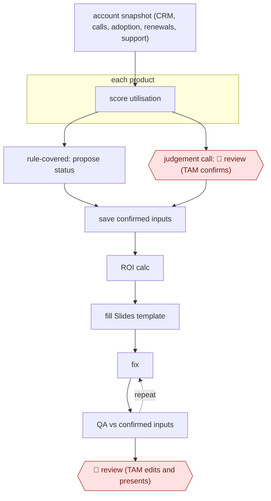

# Confirmed-inputs QBR deck

`COM › CSX › CS` · checkpointed · evidence A · **draft: needs a reference example** ([how to add one](../../../../../CONTRIBUTING.md#1-add-an-example-run))

**Shape:** `account snapshot (CRM, calls, adoption, renewals, support) → each product: score utilisation → rule-covered: propose status | judgement call: 🛑 review (TAM confirms) → save confirmed inputs → ROI calc → fill Slides template → (fix ⟲ QA vs confirmed inputs) → 🛑 review (TAM edits and presents)`
**How it differs:** Closest is AWF-0049 Renewal-window risk brief (which mentions a QBR draft). AWF-0049 delivers an internal risk brief and save plan with CSM validation of risk flags and outreach approval; this delivers a customer-facing deck, with a mid-run checkpoint on per-product judgement calls and an automated QA loop before final review. AWF-0174 is an autonomous renewal motion (sampled), with a different deliverable and autonomy.
**Variants:** `rippling-ai` · `google-slides` · `salesforce` · `gong`

<!-- shape diagram: generated by scripts/build_diagrams.py from `shape`; don't edit -->

<!-- end shape diagram -->

## Steps
1. Prepare data before the model sees it: join Salesforce, Gong calls, adoption metrics, planning docs and support history into one account snapshot (ownership, renewals, health signals, subscriptions, cases, activity) [[1]](#sources).
2. Score product utilisation; where an approved rule covers the case the AI proposes a status, where evidence is incomplete or context-dependent it flags the case [[1]](#sources).
3. 🛑 **Review**: the technical account manager confirms the flagged assessments (e.g. whether low adoption of a feature matters), while mechanical steps run asynchronously [[1]](#sources).
4. Save confirmed inputs as structured records (product, status, reason, confirmed_by_team) to a Drive document so work can resume the next day at ROI and deck generation [[1]](#sources).
5. Separate skills gather context, analyse calls, evaluate utilisation and calculate ROI; a deck builder writes into a fixed Google Slides template with structured per-slide instructions [[1]](#sources). Handshake's version scores the deck against a 54-criterion rubric built with account managers [[2]](#sources).
6. A QA skill reads the deck back against the confirmed inputs (placeholders, mismatched numbers, wrong statuses); clear fixes are corrected and rechecked, judgement fixes go back to the team [[1]](#sources).
7. 🛑 **Review**: the account manager reviews the finished deck and presents it to the customer [[1]](#sources)[[2]](#sources).

**Output:** A native Slides QBR deck per account, built from confirmed inputs, ready for the TAM to present; confirmed inputs saved in Drive.
**Failure modes → guards:** Stale or conflicting numbers, decisions lost across multi-day sessions, content in wrong slides → single snapshot dataset, structured saved records, fixed template plus QA read-back. Recommending modules the customer already owns → feed owned-product data into the narrative step [2].

## Public runs

Coverage as of 2026-11-13: **Strong**: a first-hand, detailed run that matches most of the shape. Collected and re-checked in [Fourth collection pass](../../../../../research/2026-11-fourth-pass.md).

- [Rippling, Taking QBRs from hours to minutes](https://www.rippling.com/blog/taking-qbrs-from-hours-to-minutes) (2026-10-30). Rippling TAMs' QBR workflow with team-confirmed judgement calls and deck QA, tested on 15 accounts. "Across 15 test accounts, prep time fell from two to three hours per review to under 20 minutes.". *First-hand: yes; confidence: high.*
- [Handshake, The QBR agent that gave sellers a week back every quarter](https://joinhandshake.com/blog/enterprise/building-agents-that-require-judgment/) (2026-08-25). Handshake account managers' QBR agent, hill-climbed against a 54-criterion rubric. "our agent reduced preparation time from 45 minutes per account to around 10". *First-hand: yes; confidence: high.*

## Sources

1. Christine Xu, Susie Liu (Rippling), Taking QBRs from hours to minutes, 2026-10-30. https://www.rippling.com/blog/taking-qbrs-from-hours-to-minutes
2. Darshdeep Hora, John Kottlowski, Datta Kaligotla (Handshake), The QBR agent that gave sellers a week back every quarter, 2026-08-25. https://joinhandshake.com/blog/enterprise/building-agents-that-require-judgment/
