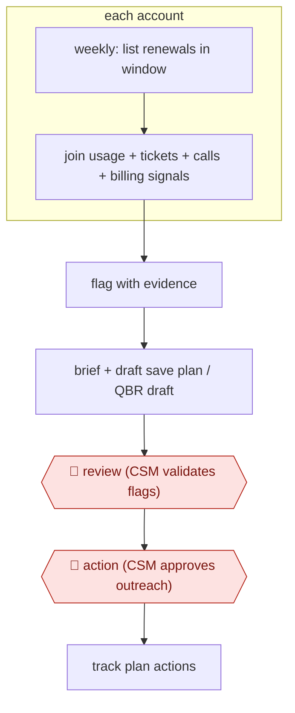

# Renewal-window risk brief

`COM › CSX › CS` · checkpointed · evidence B · **draft: needs a reference example** ([how to add one](../../../../../CONTRIBUTING.md#1-add-an-example-run))

**Shape:** `weekly: list renewals in window → each account: join usage + tickets + calls + billing signals → flag with evidence → brief + draft save plan / QBR draft → 🛑 review (CSM validates flags) → 🛑 action (CSM approves outreach) → track plan actions`
**How it differs:** None close. AWF-0006 Governed query answers analytics questions on demand; this workflow is a scheduled book-wide scan that ends in CSM-approved customer outreach.
**Variants:** `statisfy` · `revllama-pulse` · `kortix-postgres-hubspot-slides`

<!-- shape diagram: generated by scripts/build_diagrams.py from `shape`; don't edit -->

<!-- end shape diagram -->

## Steps
1. On a schedule, list every account renewing in the coming window. In one deployment CSMs get a heads-up three months out [[1]](#sources). Connect sources read-only: CRM, call recorder, product usage, support, billing [[2]](#sources)[[3]](#sources).
2. Join the signals the CSMs already trust for each account, such as champion silence, ticket-severity mix, seat slope and invoice disputes, and raise events with the evidence attached [[2]](#sources).
3. For flagged accounts, draft a save plan with the evidence trail. For accounts due a review, assemble a draft QBR deck and a briefing doc. Never write back to the source systems [[2]](#sources)[[3]](#sources).
4. 🛑 **Review**: the team rates each high-priority event as useful or not and as already known or not. This also tunes the definition of 'at risk', which the VP of CS signs off [[2]](#sources).
5. 🛑 **Action**: the CSM approves the save plan before anything reaches the customer, and edits the QBR draft before presenting it [[2]](#sources)[[3]](#sources).

**Output:** A prioritized renewal-risk list with evidence, plus draft save plans and QBR decks in the CSM's workspace. Approved outreach goes to the customer.
**Failure modes → guards:** A static health score marks accounts green while they churn → join unstructured signals across systems and replay against past churns [[2]](#sources). The agent overreaches → keep it read-only on source systems and draft-only on outputs [[3]](#sources). Too many alerts → have the team rate events as useful or not and tune the rules [[2]](#sources).

## Public runs

Coverage as of 2026-11-06: **Weak**: only anonymous, vendor-linked or journalist-told accounts. Collected and re-checked in [New workflows for empty categories](../../../../../research/2026-11-new-workflows.md).

- [Statisfy, Simpplr customer story](https://www.statisfy.com/customers/simpplr) (2026-07-24). Simpplr CS runs renewal analysis continuously; CSMs warned three months before renewal. "Renewal and risk workflows account for 85% of the agentic workflows the team has run to date.". *First-hand: vendor; confidence: med.*
- [Revllama, enterprise SaaS renewals](https://www.revllama.com/case-studies/enterprise-saas-renewals) (undated). 30-day audit on 500 renewals; CS team rated each event; save plans CSM-approved. "In 30 days Pulse raised 41 high-priority events across the 500 accounts. The team rated 29 useful". *First-hand: vendor; confidence: low.*

## Sources

1. Statisfy, How Simpplr Cut CSM Admin Time by 20% and Dramatically Improved Churn Risk Visibility, 2026-07-24. https://www.statisfy.com/customers/simpplr
2. Revllama, Renewal Risk, Seen 94 Days Earlier (case study), undated. https://www.revllama.com/case-studies/enterprise-saas-renewals
3. Kortix, How we draft QBR decks for key accounts, undated. https://kortix.com/use-cases/qbr-prep
