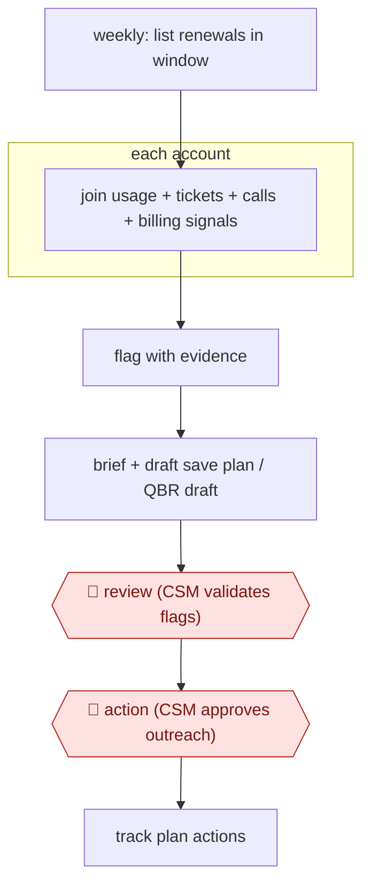

# Renewal-window risk brief

`COM › CSX › CS` · checkpointed · evidence B · **draft: needs a reference example** ([how to add one](../../../../../CONTRIBUTING.md#1-add-an-example-run))

**Shape:** `weekly: list renewals in window → each account: join usage + tickets + calls + billing signals → flag with evidence → brief + draft save plan / QBR draft → 🛑 review (CSM validates flags) → 🛑 action (CSM approves outreach) → track plan actions`
**Variants:** `statisfy` · `revllama-pulse` · `kortix-postgres-hubspot-slides`

<!-- shape diagram: generated by scripts/build_diagrams.py from `shape`; don't edit -->

<!-- end shape diagram -->

## Background

A software company sold on yearly subscriptions has to win each customer's renewal before the contract ends. The customer success manager (CSM) who looks after a customer is meant to see trouble coming: a main contact who has stopped replying, support tickets turning serious, fewer people using the product, an unpaid invoice. Those signals sit in separate systems, and a score built from numbers alone can show a customer as healthy right up to the day it cancels. Here an agent runs every week, reads those systems without changing anything, and writes a short brief with the evidence for each account that looks at risk, plus a draft plan to keep the customer. A person still decides which flags are real and what is said to the customer, because only the CSM knows the relationship and every message goes out in the company's name.

**Terms:**
- **CSM (customer success manager)**: the person responsible for keeping existing customers and getting them to renew.
- **Renewal window**: the period before a contract ends in which the renewal has to be secured.
- **Save plan**: the actions proposed to keep an at-risk customer: who to contact, with what offer or fix.
- **QBR (quarterly business review)**: a meeting where the company shows a customer what the product has delivered over the quarter and what to do next.
- **Health score**: a rating, usually from usage and billing numbers, of how likely a customer is to renew.
- **Champion**: the person at the customer who pushes for the product internally.
- **Seat slope**: the trend in the number of licensed users who are active.
- **CRM**: the system that records customers, contacts and contracts.

## Build it with an agent

**Form:** `service`. The scan starts on a weekly schedule with nobody at the keyboard, and the CSM sees only the briefs and drafts it leaves.

**You need:** read-only connections to the CRM, the call recorder, product usage, support and billing, with no write tool on any of them; a list or query that finds renewals in the coming window; a place where briefs and drafts land, such as a shared folder or the CSM's workspace; a state store recording which accounts were flagged, how the CSM rated each flag and the team's definition of "at risk", kept as a reference file the VP of customer success signs off. The agent needs no email or other tool that reaches the customer.

| Step | Built as |
|---|---|
| weekly: list renewals in window | A cloud scheduled task, or your own scheduler running `claude -p` weekly; a script lists accounts whose renewal falls in the window. |
| each account: join usage + tickets + calls + billing signals | MCP connectors, read-only. Each account is handled by a subagent, run in parallel, that returns the signals it found with their sources. |
| flag with evidence | The skill applies the team's at-risk rules from the reference file and keeps the evidence for each flag. |
| brief + draft save plan / QBR draft | The skill writes a brief and a draft save plan per flagged account, and a draft deck and briefing document for accounts due a review, into the shared folder. |
| 🛑 review (CSM validates flags) | See Checkpoints. |
| 🛑 action (CSM approves outreach) | See Checkpoints. |
| track plan actions | The run appends each plan and its status to the state store and reads it back on the next run. |

**Checkpoints:** `review`: the briefs go to the CSM's queue and nothing further happens to an account until the CSM has marked each flag as useful or not and as already known or not; those ratings are written to the state store and used to adjust the rules. `action`: the agent has no tool that reaches a customer and no write access to the source systems, so approved outreach is sent by the CSM from their own mailbox.

**Since the sources:** Sources and public runs date from 2026-05 to 2026-07; source 1 is dated 2026-07-24 and sources 2 and 3 are listed as undated (the page for source 3 shows 2026-05-20). The Revllama and Statisfy accounts describe vendor products whose internals are not published, and the Kortix page describes a draft-only agent on its own platform; this build follows the same read-only, draft-only limits with generic parts. Cloud scheduled tasks are in research preview as of 2026-11. Source 2 also reports replaying the rules against past churned accounts to test them; the build above does not include that step, and a team could add it as a separate analysis.

*A design based on this entry's steps and the tool documentation as of 2026-11, not a reported run.*

## Steps

*As reported by the sources.*
1. A scheduled job lists every account renewing in the coming window. In one deployment CSMs get a heads-up three months out [[1]](#sources). The agent connects to the sources read-only: CRM, call recorder, product usage, support, billing [[2]](#sources)[[3]](#sources).
2. For each account, the agent joins the signals the CSMs already trust, such as champion silence, ticket-severity mix, seat slope and invoice disputes, and raises events with the evidence attached [[2]](#sources).
3. For flagged accounts, the agent drafts a save plan with the evidence trail. For accounts due a review, it assembles a draft QBR deck and a briefing doc. It never writes back to the source systems [[2]](#sources)[[3]](#sources).
4. 🛑 **Review**: the CS team rates each high-priority event as useful or not and as already known or not. This also tunes the definition of 'at risk', which the VP of CS signs off [[2]](#sources).
5. 🛑 **Action**: the CSM approves the save plan before anything reaches the customer, and edits the QBR draft before presenting it [[2]](#sources)[[3]](#sources).

**Output:** A prioritized renewal-risk list with evidence, plus draft save plans and QBR decks in the CSM's workspace. Approved outreach goes to the customer.
**Failure modes → guards:** A static health score marks accounts green while they churn → join unstructured signals across systems and replay against past churns [[2]](#sources). The agent overreaches → keep it read-only on source systems and draft-only on outputs [[3]](#sources). Too many alerts → have the team rate events as useful or not and tune the rules [[2]](#sources).
**How it differs:** None close. AWF-0006 Governed query answers analytics questions on demand; this workflow is a scheduled book-wide scan that ends in CSM-approved customer outreach.

## Public runs

Coverage as of 2026-11-06: **Weak**: only anonymous, vendor-linked or journalist-told accounts. Collected and re-checked in [New workflows for empty categories](../../../../../research/2026-11-new-workflows.md).

- [Statisfy, Simpplr customer story](https://www.statisfy.com/customers/simpplr) (2026-07-24). Simpplr CS runs renewal analysis continuously; CSMs warned three months before renewal. "Renewal and risk workflows account for 85% of the agentic workflows the team has run to date.". *First-hand: vendor; confidence: med.*
- [Revllama, enterprise SaaS renewals](https://www.revllama.com/case-studies/enterprise-saas-renewals) (undated). 30-day audit on 500 renewals; CS team rated each event; save plans CSM-approved. "In 30 days Pulse raised 41 high-priority events across the 500 accounts. The team rated 29 useful". *First-hand: vendor; confidence: low.*

## Sources

1. Statisfy, How Simpplr Cut CSM Admin Time by 20% and Dramatically Improved Churn Risk Visibility, 2026-07-24. https://www.statisfy.com/customers/simpplr
2. Revllama, Renewal Risk, Seen 94 Days Earlier (case study), undated. https://www.revllama.com/case-studies/enterprise-saas-renewals
3. Kortix, How we draft QBR decks for key accounts, undated. https://kortix.com/use-cases/qbr-prep
