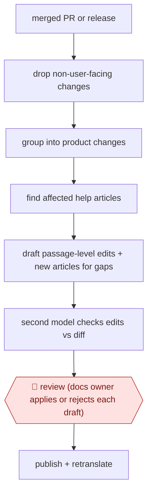

# Code-change doc refresh

`COM › CSX › KB` · checkpointed · evidence B · **draft: needs a reference example** ([how to add one](../../../../../CONTRIBUTING.md#1-add-an-example-run))

**Shape:** `merged PR or release → drop non-user-facing changes → group into product changes → find affected help articles → draft passage-level edits + new articles for gaps → second model checks edits vs diff → 🛑 review (docs owner applies or rejects each draft) → publish + retranslate`
**Variants:** `happysupport` · `ferndesk` · `wonderdesk` · `theneo` · `falconer` · `productlane`

<!-- shape diagram: generated by scripts/build_diagrams.py from `shape`; don't edit -->

<!-- end shape diagram -->

## Background

A company that sells software keeps a help center: public articles that tell customers how the product works. Developers change the product all the time, and each change can make a sentence, a menu name or a screenshot in some article untrue. Nothing fails when that happens, so the error stays until a customer complains. Here the agent starts when a code change is merged, works out what a customer would notice, finds the articles that no longer match, and drafts edits only to the passages that are now wrong. A second model checks each edit against the code change. The person who owns the help center still decides what goes live, because a published article is a statement to customers, and a change may be merged before it is released to them.

**Terms:**
- **Help center**: the public set of support articles, often also used as the source for a support chatbot.
- **PR (pull request)**: a proposed code change, reviewed and then merged into the main code.
- **Diff**: the lines a change adds and removes.
- **Passage-level edit**: a change to the sentences that are wrong, with the rest of the article left alone.
- **Docs owner**: the person responsible for the help center's content.
- **Changelog**: a dated list of what changed in each release.

## Build it with an agent

**Form:** `service`. A merged pull request starts the run with nobody present, and the docs owner sees only a list of drafts waiting for a decision.

**You need:** read access to the code repository, including pull request diffs; read access to the help-center articles, as a Markdown repository or through the help-center tool's connector; a place where drafts land that is not the public site (a draft branch, a draft status or a review queue); a rule for which changes are user-facing, kept as a reference file the docs owner maintains. The agent needs no publishing permission. If the help center is machine-translated, give it no access to the translation tool either.

| Step | Built as |
|---|---|
| merged PR or release | A cloud scheduled task started by a GitHub event, or a CI job that runs `claude -p` after a merge. |
| drop non-user-facing changes → group into product changes | The skill reads the diffs and applies the reference file to drop refactors, tests and dependency bumps, then writes one plain-language description per product change. |
| find affected help articles | The skill searches the articles for the changed feature, setting or label. If the diff cannot be read, it stops and reports that instead of guessing. |
| draft passage-level edits + new articles for gaps | The skill writes edits anchored to the wrong passages, and a draft new article where no article covers the feature. Each draft links to its PR. |
| second model checks edits vs diff | A subagent that has not seen the drafting gets the diff and the edits and removes or flags any edit the diff does not support. |
| 🛑 review (docs owner applies or rejects each draft) | See Checkpoints. |
| publish + retranslate | Done by the docs owner in the help-center tool, which also triggers translation. |

**Checkpoints:** `review`: drafts go to a review queue, one per edit, with the PR and the part of the diff that supports it. The agent has no tool that publishes or changes a live article, so nothing goes live until the docs owner applies it; the owner also decides whether the change has reached customers yet.

**Since the sources:** Sources date from 2026-06; the rest are undated, and there is no public run. All four sources describe vendor products (HappySupport, Ferndesk, Helpin, Productlane), one of them a recipe in a vendor's documentation, so none reports a team's own results. The build follows the shared design, a trigger on merge, passage-level drafts and a human apply or reject, using generic parts. It cannot recapture screenshots from the live product, which the vendors list as a feature. Source 4 notes that Claude Code or Codex can be pointed at a repository to write a help center, through the vendor's connector; that is a different job from keeping existing articles current. No newer account was looked for, because the newest source is under 12 months old.

*A design based on this entry's steps and the tool documentation as of 2026-11, not a reported run.*

## Steps

*As reported by the sources.*
1. The agent watches the repository for merged pull requests (or the changelog) and filters out refactors, tests and dependency bumps [[1]](#sources).
2. The agent groups related PRs into one plain-language product change: what changed and who notices [[1]](#sources).
3. The agent searches the help center for articles the change affects and reads the PR diff; it stops rather than guess if the diff is unavailable [[1]](#sources)[[3]](#sources).
4. The agent drafts edits anchored to the passages the change made wrong, leaving the rest of the article alone, and drafts a new article where no article covers the feature; it recaptures screenshots where supported [[1]](#sources)[[2]](#sources).
5. A second model checks each edit against the code change and removes or flags what it cannot back up [[1]](#sources).
6. 🛑 **Review**: the docs owner reviews marked passages and applies, edits or dismisses each draft; nothing goes live until applied, and unreleased behaviour stays unpublished [[1]](#sources)[[2]](#sources)[[3]](#sources).
7. The docs owner publishes; translations and the help-center chatbot pick up the new version [[1]](#sources).

**Output:** Updated or new help-center articles, each linked to the PR that triggered it.
**Failure modes → guards:** Docs describe unmerged or unreleased behaviour → trigger on merge, publish only when available to customers [3]. Whole-article rewrites hide errors → passage-level diffs plus verifier model [1].
**How it differs:** Nearest is AWF-0048 Gap-match knowledge upkeep: that starts from resolved tickets, clusters them and needs plan + editor + product-owner sign-off; this starts from code changes, finds articles that became false, and has one apply/reject review per draft. Input, deliverable (correction of stale passages) and checkpoints differ.

## Public runs

Coverage as of 2026-11-13: **None found**: no public first-hand run yet. Collected and re-checked in [Third collection pass](../../../../../research/2026-11-third-pass.md).

## Sources

1. HappySupport, Code to Docs (Git Handoff), undated. https://www.happysupport.ai/en/code-to-docs
2. Ferndesk, Self-Updating Help Center, undated. https://ferndesk.com/self-updating-help-center
3. Helpin, Review Help Center docs for every new PR to main (recipe), undated. https://docs.helpin.ai/articles/review-help-center-docs-for-every-new-pr-to-main-fa6b58f7
4. Productlane, Self-updating Help Center (changelog), 2026-06-25. https://productlane.com/changelog/2026-06-25-self-updating-help-center
