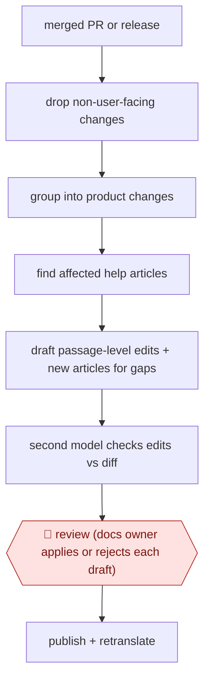

# Code-change doc refresh

`COM › CSX › KB` · checkpointed · evidence B · **draft: needs a reference example** ([how to add one](../../../../../CONTRIBUTING.md#1-add-an-example-run))

**Shape:** `merged PR or release → drop non-user-facing changes → group into product changes → find affected help articles → draft passage-level edits + new articles for gaps → second model checks edits vs diff → 🛑 review (docs owner applies or rejects each draft) → publish + retranslate`
**How it differs:** Nearest is AWF-0048 Gap-match knowledge upkeep: that starts from resolved tickets, clusters them and needs plan + editor + product-owner sign-off; this starts from code changes, finds articles that became false, and has one apply/reject review per draft. Input, deliverable (correction of stale passages) and checkpoints differ.
**Variants:** `happysupport` · `ferndesk` · `wonderdesk` · `theneo` · `falconer` · `productlane`

<!-- shape diagram: generated by scripts/build_diagrams.py from `shape`; don't edit -->

<!-- end shape diagram -->

## Steps
1. Watch the repository for merged pull requests (or the changelog); filter out refactors, tests and dependency bumps [[1]](#sources).
2. Group related PRs into one plain-language product change: what changed and who notices [[1]](#sources).
3. Search the help center for articles the change affects; read the PR diff, and stop rather than guess if the diff is unavailable [[1]](#sources)[[3]](#sources).
4. Draft edits anchored to the passages the change made wrong, leaving the rest of the article alone; draft a new article where no article covers the feature; recapture screenshots where supported [[1]](#sources)[[2]](#sources).
5. A second model checks each edit against the code change and removes or flags what it cannot back up [[1]](#sources).
6. 🛑 **Review**: the docs owner reviews marked passages and applies, edits or dismisses each draft; nothing goes live until applied, and unreleased behaviour stays unpublished [[1]](#sources)[[2]](#sources)[[3]](#sources).
7. Publish; translations and the help-center chatbot pick up the new version [[1]](#sources).

**Output:** Updated or new help-center articles, each linked to the PR that triggered it.
**Failure modes → guards:** Docs describe unmerged or unreleased behaviour → trigger on merge, publish only when available to customers [3]. Whole-article rewrites hide errors → passage-level diffs plus verifier model [1].

## Public runs

Coverage as of 2026-11-13: **None found**: no public first-hand run yet. Collected and re-checked in [Third collection pass](../../../../../research/2026-11-third-pass.md).

## Sources

1. HappySupport, Code to Docs (Git Handoff), undated. https://www.happysupport.ai/en/code-to-docs
2. Ferndesk, Self-Updating Help Center, undated. https://ferndesk.com/self-updating-help-center
3. Helpin, Review Help Center docs for every new PR to main (recipe), undated. https://docs.helpin.ai/articles/review-help-center-docs-for-every-new-pr-to-main-fa6b58f7
4. Productlane, Self-updating Help Center (changelog), 2026-06-25. https://productlane.com/changelog/2026-06-25-self-updating-help-center
