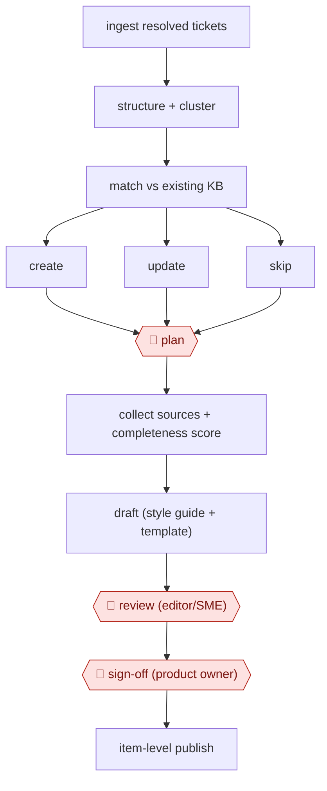

# Gap-match knowledge upkeep

`COM › CSX › KB` · checkpointed · evidence A · **draft: needs a reference example** ([how to add one](../../../../../CONTRIBUTING.md#1-add-an-example-run))

**Shape:** `ingest resolved tickets → structure + cluster → match vs existing KB → create | update | skip → 🛑 plan → collect sources + completeness score → draft (style guide + template) → 🛑 review (editor/SME) → 🛑 sign-off (product owner) → item-level publish`
**How it differs:** AWF-0018 Cluster-brief-draft content clusters search keywords into SEO articles for acquisition. This workflow is driven by resolved tickets, routes each cluster to create, update or skip, and gates on SME validation.
**Variants:** `microsoft-ai-for-knowledge-management` · `supabase-gemini-webflow`

<!-- shape diagram: generated by scripts/build_diagrams.py from `shape`; don't edit -->

<!-- end shape diagram -->

## Steps
1. Ingest resolved tickets. An AI enrichment pass turns noisy notes into structured fields, such as reported vs actual problem and remediation steps [[1]](#sources).
2. Cluster tickets so recurring issues surface and one-off cases stay out [[1]](#sources).
3. Score each cluster's resolution against the existing articles and route it: below 40 percent, create a new article; 40 to 80 percent, update the existing one; above 80 percent, no change [[1]](#sources).
4. 🛑 **Plan**: a person approves which candidates go ahead. In one run, AI triage was about 90% accurate and this gate caught the rest [[2]](#sources).
5. Collect 5–6 sources per article and score completeness (complete / partial / needs a call with the product manager) before drafting. Then draft against the style guide, component library and template [[2]](#sources).
6. 🛑 **Review**: the editor or subject-matter expert checks accuracy and adds detail. SME feedback also tunes the model [[1]](#sources)[[2]](#sources).
7. 🛑 **Sign-off**: the product manager approves. This was the slowest step in practice, at 3–5 days [[2]](#sources). Publish the single item only, never the whole site, and post links back to the ticket [[2]](#sources).

**Output:** New and updated help-center articles in the CMS, each traceable to its source tickets. Updates to existing articles are flagged to their owners.
**Failure modes → guards:** Drafting from thin ticket context produces hallucinated steps → score source completeness first and send weak candidates to a human call [[2]](#sources). One-off fixes clutter the KB → require a cluster before drafting [[1]](#sources). A site-wide publish leaks staging content → publish item by item [[2]](#sources).

## Public runs

Coverage as of 2026-11-06: **Strong**: a first-hand, detailed run that matches most of the shape. Collected and re-checked in [New workflows for empty categories](../../../../../research/2026-11-new-workflows.md).

- [Microsoft Inside Track, AI for Knowledge Management](https://www.microsoft.com/insidetrack/blog/ai-for-knowledge-management-keeping-support-content-up-to-date-at-microsoft/) (2026-07-16). Global Help Desk routes ticket clusters to create/update/no-change; SMEs validate by email. "projects the solution will save them an estimated 16,000 hours annually". *First-hand: yes; confidence: high.*

## Sources

1. Diana Mivelli / Microsoft Inside Track, AI for Knowledge Management: Keeping support content up-to-date at Microsoft, 2026-07-16. https://www.microsoft.com/insidetrack/blog/ai-for-knowledge-management-keeping-support-content-up-to-date-at-microsoft/
2. dasha / dashbuilds, we automated our help desk with 6 serverless agents, 2026-04-04. https://dashbuilds.dev/blog/we-automated-our-help-desk-with-serverless-agents (link redirected to an unrelated site on 2026-11-06; not re-checked)
