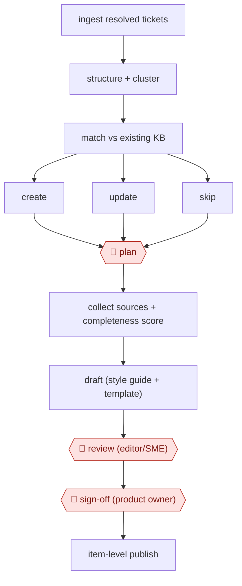

# Gap-match knowledge upkeep

`COM › CSX › KB` · checkpointed · evidence A · **draft: needs a reference example** ([how to add one](../../../../../CONTRIBUTING.md#1-add-an-example-run))

**Shape:** `ingest resolved tickets → structure + cluster → match vs existing KB → create | update | skip → 🛑 plan → collect sources + completeness score → draft (style guide + template) → 🛑 review (editor/SME) → 🛑 sign-off (product owner) → item-level publish`
**Variants:** `microsoft-ai-for-knowledge-management` · `supabase-gemini-webflow`

<!-- shape diagram: generated by scripts/build_diagrams.py from `shape`; don't edit -->

<!-- end shape diagram -->

## Background

A support team answers customers' questions and closes each one as a ticket. A knowledge base (KB) is the set of articles that lets customers, and a support chatbot, find those answers without raising a ticket. Articles go stale or are missing, and the team usually learns that only when someone complains or an agent reports it. The tickets already hold the evidence: the same problem keeps coming back, or the agent's fix is not in any article. Here the agent reads resolved tickets, groups the recurring problems, compares each group with the existing articles and proposes to create an article, update one or leave things as they are. Then it drafts. People approve which candidates go ahead, check the draft for accuracy and sign off before anything is published, because a wrong article sends many customers the wrong way and the article carries the company's name.

**Terms:**
- **Resolved ticket**: a customer request that support has closed, with the agent's notes on what was wrong and what fixed it.
- **KB (knowledge base)**: the collection of help articles.
- **Cluster**: a group of tickets about the same underlying problem.
- **SME (subject-matter expert)**: the person who knows the product well enough to say whether an article is correct.
- **Style guide and template**: the rules for how articles are worded and laid out, and a fixed outline each article follows.
- **CMS (content management system)**: the tool in which the articles are stored and published.
- **Completeness score**: a rating of whether the gathered material is enough to write the article without guessing.

## Build it with an agent

**Form:** `service`. A scheduled run reads the new tickets with nobody present, and people answer three requests later: approve the plan, review the draft and sign off.

**You need:** read access to resolved tickets and to the articles in the KB; a state store listing each candidate, its decision and where it stands, so later runs do not repeat it; the style guide and the article template as reference files; a place where candidate lists and drafts land, such as a ticket queue or draft status in the CMS; names for the three approvers (the person who approves the plan, the editor or SME, the product owner). Remove customers' personal details from ticket text before it reaches the agent, and give it no permission to publish.

| Step | Built as |
|---|---|
| ingest resolved tickets → structure + cluster | A cloud scheduled task, or your own scheduler running `claude -p`, pulls new resolved tickets through an MCP connector. The skill turns each one into fields (reported problem, actual problem, fix steps) and groups similar tickets. |
| match vs existing KB → create \| update \| skip | The skill searches the KB for each cluster, rates how closely an article already covers the fix and routes the cluster by the thresholds the entry reports (below 40 percent create, 40 to 80 percent update, above 80 percent skip). |
| 🛑 plan | See Checkpoints. |
| collect sources + completeness score | For each approved candidate the skill gathers tickets, existing articles and product notes, then marks the candidate complete, partial or in need of a call with the product manager. |
| draft (style guide + template) | The skill drafts from the template and style guide. A subagent that has not seen the drafting checks every step in the draft against the gathered sources. |
| 🛑 review (editor/SME) | See Checkpoints. |
| 🛑 sign-off (product owner) | See Checkpoints. |
| item-level publish | The product owner or editor publishes the single article in the CMS. |

**Checkpoints:** `plan`: the run ends after posting the candidate list with each cluster's route; only candidates a person approves are written up in the next run. `review`: the draft goes to the editor or SME's queue, and their corrections are saved to the state store for the next run. `sign-off`: the agent has no tool that publishes or changes a live article; the product owner approves, and the publish is done in the CMS by a person.

**Since the sources:** Source 1 dates from 2026-07 and source 2 from 2026-04. The link to source 2 led to an unrelated site when last opened, so steps 4, 5 and 7, which rest on it, could not be checked against it in 2026-11. Source 1 describes the ingest, clustering, comparison and expert notification, and does not describe a plan gate or a sign-off. The Microsoft system is an internal platform; this build replaces it with generic parts. The 40 and 80 percent thresholds come from that system and would need calibrating against your own articles. The sources report projected hours saved; this entry makes no claim for the build.

*A design based on this entry's steps and the tool documentation as of 2026-11, not a reported run.*

## Steps

*As reported by the sources.*
1. The system ingests resolved tickets. An AI enrichment pass turns noisy notes into structured fields, such as reported vs actual problem and remediation steps [[1]](#sources).
2. The system clusters tickets so recurring issues surface and one-off cases stay out [[1]](#sources).
3. The system scores each cluster's resolution against the existing articles and route it: below 40 percent, create a new article; 40 to 80 percent, update the existing one; above 80 percent, no change [[1]](#sources).
4. 🛑 **Plan**: a person approves which candidates go ahead. In one run, AI triage was about 90% accurate and this gate caught the rest [[2]](#sources).
5. The agent collects 5–6 sources per article and scores completeness (complete / partial / needs a call with the product manager) before drafting. Then it drafts against the style guide, component library and template [[2]](#sources).
6. 🛑 **Review**: the editor or subject-matter expert checks accuracy and adds detail. SME feedback also tunes the model [[1]](#sources)[[2]](#sources).
7. 🛑 **Sign-off**: the product manager approves. This was the slowest step in practice, at 3–5 days [[2]](#sources). The single item only is published, never the whole site, and links are posted back to the ticket [[2]](#sources).

**Output:** New and updated help-center articles in the CMS, each traceable to its source tickets. Updates to existing articles are flagged to their owners.
**Failure modes → guards:** Drafting from thin ticket context produces hallucinated steps → score source completeness first and send weak candidates to a human call [[2]](#sources). One-off fixes clutter the KB → require a cluster before drafting [[1]](#sources). A site-wide publish leaks staging content → publish item by item [[2]](#sources).
**How it differs:** AWF-0018 Cluster-brief-draft content clusters search keywords into SEO articles for acquisition. This workflow is driven by resolved tickets, routes each cluster to create, update or skip, and gates on SME validation.

## Public runs

Coverage as of 2026-11-06: **Strong**: a first-hand, detailed run that matches most of the shape. Collected and re-checked in [New workflows for empty categories](../../../../../research/2026-11-new-workflows.md).

- [Microsoft Inside Track, AI for Knowledge Management](https://www.microsoft.com/insidetrack/blog/ai-for-knowledge-management-keeping-support-content-up-to-date-at-microsoft/) (2026-07-16). Global Help Desk routes ticket clusters to create/update/no-change; SMEs validate by email. "projects the solution will save them an estimated 16,000 hours annually". *First-hand: yes; confidence: high.*

## Sources

1. Diana Mivelli / Microsoft Inside Track, AI for Knowledge Management: Keeping support content up-to-date at Microsoft, 2026-07-16. https://www.microsoft.com/insidetrack/blog/ai-for-knowledge-management-keeping-support-content-up-to-date-at-microsoft/
2. dasha / dashbuilds, we automated our help desk with 6 serverless agents, 2026-04-04. https://dashbuilds.dev/blog/we-automated-our-help-desk-with-serverless-agents (link redirected to an unrelated site on 2026-11-06; not re-checked)
