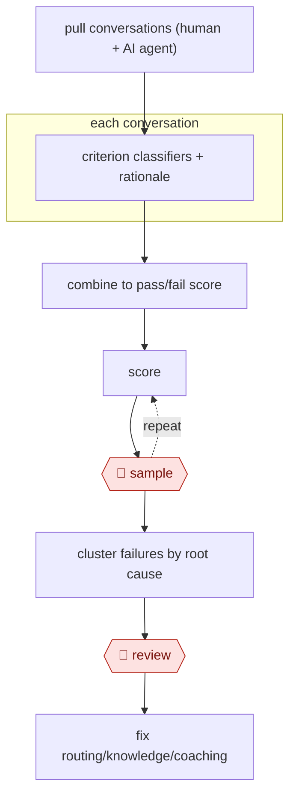

# Calibrated conversation scoring

`COM › CSX › QA` · sampled · evidence A · **draft: needs a reference example** ([how to add one](../../../../../CONTRIBUTING.md#1-add-an-example-run))

**Shape:** `pull conversations (human + AI agent) → each conversation: criterion classifiers + rationale → combine to pass/fail score → (score ⟲ 🛑 sample) → cluster failures by root cause → 🛑 review → fix routing/knowledge/coaching`
**How it differs:** AWF-0028 Anchor-calibrated grader grades student work for teachers to release. Here the input is every support conversation, the output is ops root-cause fixes, and the autonomy is sampled audit instead of a per-batch teacher review. AWF-0021 Procedure agent resolves tickets; this workflow audits them.
**Variants:** `in-house-llm-classifiers` · `instacart-lace` · `amazon-bedrock`

<!-- shape diagram: generated by scripts/build_diagrams.py from `shape`; don't edit -->

<!-- end shape diagram -->

## Steps
1. Define a small set of binary criteria read from the customer's side of the transcript only, ignoring internal notes: issue understood, frustration, resolved or properly escalated, sentiment after the solution [[1]](#sources). Binary criteria held up better than 1–10 scales [[2]](#sources).
2. Score every conversation, whichever channel it came through and whether a human or an AI agent handled it. A conversation passes only if every criterion passes [[1]](#sources). Store the model's rationale next to each score [[2]](#sources).
3. 🛑 **Sample**: quality experts score a selected set of conversations against the same criteria. Compare their scores with the model's. Where they disagree, the humans set the standard: refine the criterion wording or restructure the criteria, then repeat until they align. Rerun this check for every update [[1]](#sources)[[2]](#sources).
4. Combine the scores into one metric. Cluster failing conversations to find emerging issues, such as wrong policy guidance from the AI agent or misrouted cases [[1]](#sources).
5. 🛑 **Review**: the support ops lead takes the clustered findings and fixes routing or knowledge, or coaches agents. Do not discipline individuals on raw scores [[1]](#sources).

**Output:** Per-conversation scores with rationales, a rolled-up experience metric, and a ranked list of root causes for ops, knowledge and coaching owners.
**Failure modes → guards:** The judge drifts from human judgment, or it blurs related criteria and fails several when one is at fault → schedule recalibration against expert scores, and keep the rationale so the main issue can be identified [[1]](#sources)[[2]](#sources). A blended score hides what moved → keep the criteria separate in reporting.

## Public runs

Coverage as of 2026-11-06: **Strong**: a first-hand, detailed run that matches most of the shape. Collected and re-checked in [New workflows for empty categories](../../../../../research/2026-11-new-workflows.md).

- [Oura, How Oura Uses AI to Measure Customer Experience](https://ouraring.com/blog/how-oura-uses-ai-to-measure-customer-experience/) (2026-08-25). Four classifiers score nearly every member interaction; calibrated against quality experts; findings drove routing and policy fixes. "repeated troubleshooting has dropped from 40 percent to around 20 percent". *First-hand: yes; confidence: high.*
- [Instacart, LACE framework](https://company.instacart.com/tech-innovation/turbocharging-customer-support-chatbot-development-with-llm-based-automated-evaluation) (2025-06-11). Binary criteria across five dimensions; human-vs-LACE comparison repeated until aligned. "five key dimensions". *First-hand: yes; confidence: med.*

## Sources

1. John Moses / Oura, How Oura Uses AI to Measure Customer Experience, 2026-08-25. https://ouraring.com/blog/how-oura-uses-ai-to-measure-customer-experience/
2. Jeff Wu / Instacart, Turbocharging Customer Support Chatbot Development with LLM-Based Automated Evaluation, 2025-06-11. https://company.instacart.com/tech-innovation/turbocharging-customer-support-chatbot-development-with-llm-based-automated-evaluation
