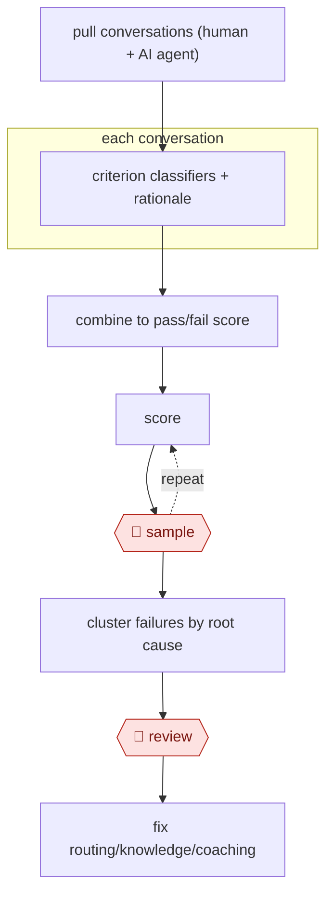

# Calibrated conversation scoring

`COM › CSX › QA` · sampled · evidence A · **draft: needs a reference example** ([how to add one](../../../../../CONTRIBUTING.md#1-add-an-example-run))

**Shape:** `pull conversations (human + AI agent) → each conversation: criterion classifiers + rationale → combine to pass/fail score → (score ⟲ 🛑 sample) → cluster failures by root cause → 🛑 review → fix routing/knowledge/coaching`
**Variants:** `in-house-llm-classifiers` · `instacart-lace` · `amazon-bedrock`

<!-- shape diagram: generated by scripts/build_diagrams.py from `shape`; don't edit -->

<!-- end shape diagram -->

## Background

Support teams check the quality of their work by having a quality expert read a sample of closed conversations and mark them against a checklist. A team can read only a small fraction this way, so most conversations, including those handled by an AI agent, are never looked at, and problems such as a wrong policy answer or a case sent to the wrong queue go unseen. Here the agent scores every conversation against a few yes-or-no questions, keeps its reasoning, and groups the failures by their underlying cause. People keep two jobs. Quality experts score a sample themselves and compare their scores with the agent's; where they disagree the experts set the standard and the criteria are reworded. The support operations lead decides what to fix, because the fixes change routing, the knowledge base or how agents are coached, and a score alone must not be used to discipline someone.

**Terms:**
- **Criterion (binary)**: one yes-or-no question about a conversation, such as "was the issue understood?".
- **Classifier**: a prompt that has the model answer one criterion for one conversation.
- **Rationale**: the model's written reason for its answer, stored with the score.
- **Calibration**: comparing the model's scores with experts' scores on the same conversations and adjusting until they agree.
- **Root cause**: the underlying reason several conversations failed, such as one wrong knowledge-base article.
- **Routing**: the rules that decide which team or agent receives a case.
- **Knowledge base**: the articles that agents and customers draw on for answers.

## Build it with an agent

**Form:** `service`. Scoring runs on a schedule over every new conversation with nobody present, and people see only the audit sample and the clustered findings.

**You need:** read access to the conversation transcripts from every channel, for human-handled and AI-handled cases alike, through a connector or an export; the criteria with their exact wording as a reference file; a state store for scores, rationales and the experts' scores on the sample; a review queue or sheet where the audit sample and the cluster report land. The agent only reads transcripts and writes scores; it has no access to the support system's write functions, and personal data in transcripts is redacted according to your privacy rules before scoring.

| Step | Built as |
|---|---|
| pull conversations (human + AI agent) | A cloud scheduled task, or your own scheduler running `claude -p` or an Agent SDK program, fetches new transcripts and keeps only the customer's side of each. |
| each conversation: criterion classifiers + rationale | One subagent per criterion, or one call per criterion in a script, each answering yes or no with a rationale from the criterion's wording in the reference file. |
| combine to pass/fail score | A script: a conversation passes only if every criterion passes. Criteria stay separate in the stored record. |
| (score ⟲ 🛑 sample) | See Checkpoints. |
| cluster failures by root cause | The skill groups failing conversations by their rationales and writes a report of clusters with example conversations. |
| 🛑 review | See Checkpoints. |
| fix routing/knowledge/coaching | Done by the owners of routing, the knowledge base and coaching. The agent proposes, and has no tool to change them. |

**Checkpoints:** `sample`: a fixed share of scored conversations is copied to quality experts, who score them without seeing the agent's scores; the comparison is written to the state store, and a disagreement leads to a change in the criterion's wording in the reference file, which the person who owns the file makes. The comparison is repeated after every change to the criteria or the model. `review`: the cluster report goes to the support operations lead's queue; the agent has no tool that changes routing, the knowledge base or an agent's record, so fixes and coaching are carried out by people.

**Since the sources:** Sources and public runs date from 2025-06 to 2026-11. They come from three companies' own accounts (Oura, Instacart, a vendor's test) and two vendor blog posts. They use their own classifiers and tooling; this build reproduces the structure (binary criteria, rationale, expert calibration, clustering) with generic parts and runs no model other than the one the agent uses. The vendor accounts report agreement rates and improvements; this entry makes no such claim for the build. Where the sources use a different model per criterion, nothing here requires it.

*A design based on this entry's steps and the tool documentation as of 2026-11, not a reported run.*

## Steps

*As reported by the sources.*
1. The support team defines a small set of binary criteria read from the customer's side of the transcript only, ignoring internal notes: issue understood, frustration, resolved or properly escalated, sentiment after the solution [[1]](#sources). Binary criteria held up better than 1–10 scales [[2]](#sources).
2. The model scores every conversation, whichever channel it came through and whether a human or an AI agent handled it. A conversation passes only if every criterion passes [[1]](#sources). The model's rationale is stored next to each score [[2]](#sources).
3. 🛑 **Sample**: quality experts score a selected set of conversations against the same criteria. Compare their scores with the model's. Where they disagree, the humans set the standard: refine the criterion wording or restructure the criteria, then repeat until they align. Rerun this check for every update [[1]](#sources)[[2]](#sources).
4. The system combines the scores into one metric and clusters failing conversations to find emerging issues, such as wrong policy guidance from the AI agent or misrouted cases [[1]](#sources).
5. 🛑 **Review**: the support ops lead takes the clustered findings and fixes routing or knowledge, or coaches agents. Individuals are not disciplined on raw scores [[1]](#sources).

**Output:** Per-conversation scores with rationales, a rolled-up experience metric, and a ranked list of root causes for ops, knowledge and coaching owners.
**Failure modes → guards:** The judge drifts from human judgment, or it blurs related criteria and fails several when one is at fault → schedule recalibration against expert scores, and keep the rationale so the main issue can be identified [[1]](#sources)[[2]](#sources). A blended score hides what moved → keep the criteria separate in reporting.

**Recent practice (2026):**
- Score ⟲ sample loop: trace every human/AI disagreement to its cause (wrong document retrieved, ambiguous criterion wording, bad reasoning) before changing the prompt; re-sample after each policy or model change (Revelir, 2026-11-03). [[4]](#sources)
- Note from Booth's test: the AI was stricter on unkept commitments, and the human was stricter where context lived outside the ticket; score full threads, since tickets can change after the audit date.

**How it differs:** AWF-0028 Anchor-calibrated grader grades student work for teachers to release. Here the input is every support conversation, the output is ops root-cause fixes, and the autonomy is sampled audit instead of a per-batch teacher review. AWF-0021 Procedure agent resolves tickets; this workflow audits them.

## Public runs

Coverage as of 2026-11-06: **Strong**: a first-hand, detailed run that matches most of the shape. Collected and re-checked in [New workflows for empty categories](../../../../../research/2026-11-new-workflows.md). More runs added in [Third collection pass](../../../../../research/2026-11-third-pass.md).

- [Oura, How Oura Uses AI to Measure Customer Experience](https://ouraring.com/blog/how-oura-uses-ai-to-measure-customer-experience/) (2026-08-25). Four classifiers score nearly every member interaction; calibrated against quality experts; findings drove routing and policy fixes. "repeated troubleshooting has dropped from 40 percent to around 20 percent". *First-hand: yes; confidence: high.*
- [Instacart, LACE framework](https://company.instacart.com/tech-innovation/turbocharging-customer-support-chatbot-development-with-llm-based-automated-evaluation) (2025-06-11). Binary criteria across five dimensions; human-vs-LACE comparison repeated until aligned. "five key dimensions". *First-hand: yes; confidence: med.*
- [Jen Spencer / Booth, We Scored Every Support Ticket. Here's What the Audit Missed](https://hirebooth.com/blog/we-scored-support-ticket-heres-what-the-audit-missed) (2026-11-12). AI scoring vs a trained QA analyst's audit on 20 tickets using the analyst's own scorecard. "The automated scoring agreed with the human on 96% of individual checks (192 of 200).". *First-hand: vendor; confidence: med.*

## Sources

1. John Moses / Oura, How Oura Uses AI to Measure Customer Experience, 2026-08-25. https://ouraring.com/blog/how-oura-uses-ai-to-measure-customer-experience/
2. Jeff Wu / Instacart, Turbocharging Customer Support Chatbot Development with LLM-Based Automated Evaluation, 2025-06-11. https://company.instacart.com/tech-innovation/turbocharging-customer-support-chatbot-development-with-llm-based-automated-evaluation
3. Revelir AI, Calibrating AI QA to match a human reviewer, 2026-10-15. https://www.revelir.ai/blog/calibrating-ai-qa-to-match-a-human-reviewer-not-just-to-score-every-ticket
4. Revelir AI, Build vs buy AutoQA, 2026-11-03. https://www.revelir.ai/blog/build-vs-buy-autoqa-should-your-cx-team-prompt-its-own-llm-to-score-tickets-or-deploy-an-auto-qa-platform-calibrated-to
