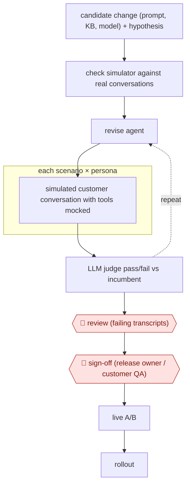

# Simulation release gate

`COM › CSX › QA` · checkpointed · evidence A · **draft: needs a reference example** ([how to add one](../../../../../CONTRIBUTING.md#1-add-an-example-run))

**Shape:** `candidate change (prompt, KB, model) + hypothesis → check simulator against real conversations → (revise agent ⟲ each scenario × persona: simulated customer conversation with tools mocked → LLM judge pass/fail vs incumbent) → 🛑 review (failing transcripts) → 🛑 sign-off (release owner / customer QA) → live A/B → rollout`
**How it differs:** Nearest is AWF-0047 Calibrated conversation scoring: that scores live conversations after the fact and samples them; this tests a change before any customer sees it, ending in a release sign-off and A/B test. Deliverable (release decision vs QA findings) and checkpoint (pre-launch sign-off vs ongoing sample) differ.
**Variants:** `snowglobe` · `intercom-fin-evals` · `claude-code`

<!-- shape diagram: generated by scripts/build_diagrams.py from `shape`; don't edit -->

<!-- end shape diagram -->

## Steps
1. State the change under test (prompt, knowledge base, model) and a pre-agreed success criterion, e.g. fewer unnecessary transfers to humans [[2]](#sources).
2. Check the simulator before trusting it: split real conversations into a development set (configure simulator) and a test set, and confirm simulated scores rank already-shipped versions the same way production did [[2]](#sources). DoorDash compared 302 simulated vs 175 production conversations and saw similar escalation rates [[1]](#sources).
3. Generate multi-turn conversations from scenarios and personas (late delivery, policy edge cases, language switching); mock tool outputs so no production backend or customer record is touched [[1]](#sources)[[2]](#sources)[[4]](#sources).
4. Score each conversation with binary pass/fail rubrics defined by the owning team; compare candidate vs incumbent and repeat changes until the pass rate meets exit criteria [[1]](#sources)[[2]](#sources).
5. 🛑 **Review**: engineers read failing transcripts and the expected-vs-actual trace to find the fix [[3]](#sources).
6. 🛑 **Sign-off**: the customer's QA team (Delight.ai) or the business owner (Telonic: front office manager) approves the release after trying it in a test environment [[3]](#sources)[[4]](#sources).
7. Only clear winners go to a live A/B test on self-service rate and satisfaction, then roll out [[2]](#sources).

**Output:** A go/no-go decision for one agent change, with stored simulated transcripts and judge results for regression tracking.
**Failure modes → guards:** Simulated customers do not behave like real ones → validate the simulator against shipped versions first; Nubank's blinded reviewers still spotted most simulations, so ranking agreement is the test that matters [2][5]. Judge drift → fixed regression suite plus feature-specific rubrics [1].

## Public runs

Coverage as of 2026-11-13: **Strong**: a first-hand, detailed run that matches most of the shape. Collected and re-checked in [Third collection pass](../../../../../research/2026-11-third-pass.md).

- [DoorDash, one-click simulation and evaluation platform](https://careersatdoordash.com/blog/doordashs-one-click-simulation-and-evaluation-platform-for-support-chatbots/) (2026-06-01). Simulated order-status conversations matched production escalation rate; used as pre-production gate. "Simulation: 302 conversations in five minutes, with a 46% escalation rate". *First-hand: yes; confidence: high.*
- [Nubank, arXiv 2609.30137](https://arxiv.org/html/2609.30137v1) (2026-09-24). Simulation-screened Card Management agent then won a live A/B test and rolled out. "Simulation-guided iteration increased transactional net promoter score (tNPS) by 36.69 points in a live A/B test". *First-hand: yes; confidence: high.*
- [Anthropic, Delight.ai case study](https://claude.com/customers/delightai-qa) (undated). Persona+scenario regression run for every customer's agent; customer QA team gives go-ahead. "it used to take us about a week to fix issues, test, and deploy. Now it takes just one or two days max". *First-hand: vendor; confidence: med.*

## Sources

1. Chenran Gong, Aditi Bamba / DoorDash, Inside DoorDash's one-click simulation and evaluation platform for support chatbots, 2026-06-01. https://careersatdoordash.com/blog/doordashs-one-click-simulation-and-evaluation-platform-for-support-chatbots/
2. Edesio Alcobaça et al. / Nubank, Screen Before You Serve: Simulation for Production Customer Experience AI Agents at 140M Scale, arXiv 2609.30137, 2026-09-24. https://arxiv.org/html/2609.30137v1
3. Anthropic, Delight.ai Claude Code case study (interview with Park), undated. https://claude.com/customers/delightai-qa
4. Telonic, Testing before every release (docs), undated. https://docs.telonic.ai/en/governance/testing-before-release
5. Rushil Shah / Twarx, Nubank AI Agent Simulation: 21.2 to 4.4 Day Release Cycles, 2026-11-09. https://twarx.com/case-studies/nubank-synthetic-customer-simulation-support-agents
