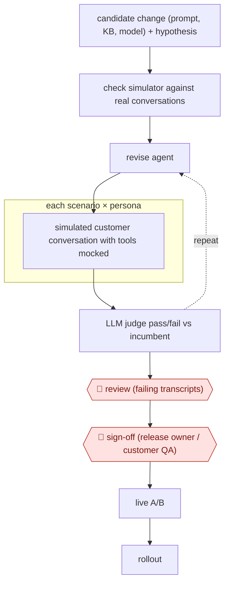

# Simulation release gate

`COM › CSX › QA` · checkpointed · evidence A · **draft: needs a reference example** ([how to add one](../../../../../CONTRIBUTING.md#1-add-an-example-run))

**Shape:** `candidate change (prompt, KB, model) + hypothesis → check simulator against real conversations → (revise agent ⟲ each scenario × persona: simulated customer conversation with tools mocked → LLM judge pass/fail vs incumbent) → 🛑 review (failing transcripts) → 🛑 sign-off (release owner / customer QA) → live A/B → rollout`
**Variants:** `snowglobe` · `intercom-fin-evals` · `claude-code`

<!-- shape diagram: generated by scripts/build_diagrams.py from `shape`; don't edit -->

<!-- end shape diagram -->

## Background

Many companies now let an AI agent answer customers' support questions. Each change to that agent (a new instruction prompt, an edited help article it draws on, a different underlying model) can make it better in one area and worse in another, and the only way to find out used to be to release it and watch real customers. Here the team tests each change first. The agent plays both sides: a second model acts as the customer, following a scenario such as a late delivery, and the support agent answers using fake versions of its tools, so no real order or account is touched. A judge model then marks each conversation pass or fail and compares the new version with the one now in use. People still read the failures, because only they know what a wrong answer costs, and a named owner signs off the release. The agent cannot approve its own change, and the simulated customers are not real ones.

**Terms:**
- **Incumbent**: the version of the support agent that is live now, which any change must at least match.
- **Scenario and persona**: a situation (a late delivery, a refund outside the policy) and a type of customer (impatient, writes in another language) combined to make one test conversation.
- **Simulator**: the model that plays the customer.
- **Mocked tools**: stand-ins that return made-up results where the agent would normally look up an order or change an account.
- **LLM judge and rubric**: a model that marks a conversation against a list of yes-or-no questions the owning team wrote.
- **Regression**: something that used to work and breaks after a change.
- **A/B test**: showing the new version to a share of real customers and the old one to the rest, to compare results.
- **Knowledge base (KB)**: the help articles the agent answers from.

## Build it with an agent

**Form:** `project`. A skill could run the steps, but two things have to hold every time: the simulated runs must never reach production systems, and the judge must not have seen how the change was made. That needs a hook or permission rule and a custom subagent for the judge, plus parallel workers for the conversations.

**You need:** the support agent's definition (prompt, knowledge base, model setting) kept as files in a repository, so the candidate and the incumbent can both be run; a set of real conversations, redacted of personal details, split into a set for setting up the simulator and a set for testing it; scenarios and personas written by the owning team; the rubrics; mocked versions of every tool the support agent calls; a place to store transcripts and judge results. Give the testing agent no credentials for production systems.

| Step | Built as |
|---|---|
| candidate change (prompt, KB, model) + hypothesis | The engineer writes the change and its success criterion in a file the skill reads first. |
| check simulator against real conversations | A skill runs the simulator on the test set of real conversations and checks that it ranks already-shipped versions the way production did; it stops if it does not. |
| each scenario × persona: simulated customer conversation with tools mocked | A dynamic workflow, or one subagent per conversation, runs each scenario and persona against the candidate and the incumbent. A `PreToolUse` hook denies every tool call that is not one of the mocks. |
| LLM judge pass/fail vs incumbent | A custom read-only subagent that sees only the transcript and the rubric marks each conversation and compares the candidate with the incumbent. |
| (revise agent ⟲ ...) | The main conversation edits the candidate's files and reruns, until the pass rate meets the exit criteria. |
| 🛑 review (failing transcripts) | See Checkpoints. |
| 🛑 sign-off (release owner / customer QA) | See Checkpoints. |
| live A/B → rollout | The live traffic split is made in the support platform by a person. |

**Checkpoints:** `review`: the skill stops after the loop and shows the failing transcripts with expected against actual behaviour; an engineer reads them before another round. `sign-off`: the agent has no tool that changes the live support agent or its traffic split, and the hook denies production tools; the release owner or customer QA team tries the candidate in a test environment, approves, and makes the release themselves.

**Since the sources:** Sources and public runs date from 2026-06 to 2026-11, apart from two undated pages. Source 1 (DoorDash) refused the page reader in 2026-11, so its figures were not re-opened. Sources 2 to 5 describe teams that built their own simulators (Nubank, DoorDash) or used a vendor's (Snowglobe, Telonic's test sets); this build assumes you write the simulator as prompts and mocks. Source 3 (Delight.ai) describes using Claude Code to build this kind of tooling, which is the closest to this design. Nubank's blinded reviewers could still tell most simulated conversations from real ones, so the real test of the simulator is whether it ranks shipped versions as production did, and a pass here does not replace the live A/B test. The sources report release-cycle and metric changes; this entry makes no such claim for the build.

*A design based on this entry's steps and the tool documentation as of 2026-11, not a reported run.*

## Steps

*As reported by the sources.*
1. The team states the change under test (prompt, knowledge base, model) and a pre-agreed success criterion, e.g. fewer unnecessary transfers to humans [[2]](#sources).
2. The team checks the simulator before trusting it: it splits real conversations into a development set (configure simulator) and a test set, and confirms that simulated scores rank already-shipped versions the same way production did [[2]](#sources). DoorDash compared 302 simulated vs 175 production conversations and saw similar escalation rates [[1]](#sources).
3. A simulator model generates multi-turn conversations from scenarios and personas (late delivery, policy edge cases, language switching); tool outputs are mocked so no production backend or customer record is touched [[1]](#sources)[[2]](#sources)[[4]](#sources).
4. A judge model scores each conversation with binary pass/fail rubrics defined by the owning team; it compares candidate with incumbent, and the team repeats changes until the pass rate meets exit criteria [[1]](#sources)[[2]](#sources).
5. 🛑 **Review**: engineers read failing transcripts and the expected-vs-actual trace to find the fix [[3]](#sources).
6. 🛑 **Sign-off**: the customer's QA team (Delight.ai) or the business owner (Telonic: front office manager) approves the release after trying it in a test environment [[3]](#sources)[[4]](#sources).
7. Only clear winners go to a live A/B test on self-service rate and satisfaction, then roll out [[2]](#sources).

**Output:** A go/no-go decision for one agent change, with stored simulated transcripts and judge results for regression tracking.
**Failure modes → guards:** Simulated customers do not behave like real ones → validate the simulator against shipped versions first; Nubank's blinded reviewers still spotted most simulations, so ranking agreement is the test that matters [2][5]. Judge drift → fixed regression suite plus feature-specific rubrics [1].
**How it differs:** Nearest is AWF-0047 Calibrated conversation scoring: that scores live conversations after the fact and samples them; this tests a change before any customer sees it, ending in a release sign-off and A/B test. Deliverable (release decision vs QA findings) and checkpoint (pre-launch sign-off vs ongoing sample) differ.

## Public runs

Coverage as of 2026-11-13: **Strong**: a first-hand, detailed run that matches most of the shape. Collected and re-checked in [Third collection pass](../../../../../research/2026-11-third-pass.md).

- [DoorDash, one-click simulation and evaluation platform](https://careersatdoordash.com/blog/doordashs-one-click-simulation-and-evaluation-platform-for-support-chatbots/) (2026-06-01). Simulated order-status conversations matched production escalation rate; used as pre-production gate. "Simulation: 302 conversations in five minutes, with a 46% escalation rate". *First-hand: yes; confidence: high.*
- [Nubank, arXiv 2609.30137](https://arxiv.org/html/2609.30137v1) (2026-09-24). Simulation-screened Card Management agent then won a live A/B test and rolled out. "Simulation-guided iteration increased transactional net promoter score (tNPS) by 36.69 points in a live A/B test". *First-hand: yes; confidence: high.*
- [Anthropic, Delight.ai case study](https://claude.com/customers/delightai-qa) (undated). Persona+scenario regression run for every customer's agent; customer QA team gives go-ahead. "it used to take us about a week to fix issues, test, and deploy. Now it takes just one or two days max". *First-hand: vendor; confidence: med.*

## Sources

1. Chenran Gong, Aditi Bamba / DoorDash, Inside DoorDash's one-click simulation and evaluation platform for support chatbots, 2026-06-01. https://careersatdoordash.com/blog/doordashs-one-click-simulation-and-evaluation-platform-for-support-chatbots/
2. Edesio Alcobaça et al. / Nubank, Screen Before You Serve: Simulation for Production Customer Experience AI Agents at 140M Scale, arXiv 2609.30137, 2026-09-24. https://arxiv.org/html/2609.30137v1
3. Anthropic, Delight.ai Claude Code case study (interview with Park), undated. https://claude.com/customers/delightai-qa
4. Telonic, Testing before every release (docs), undated. https://docs.telonic.ai/en/governance/testing-before-release
5. Rushil Shah / Twarx, Nubank AI Agent Simulation: 21.2 to 4.4 Day Release Cycles, 2026-11-09. https://twarx.com/case-studies/nubank-synthetic-customer-simulation-support-agents
