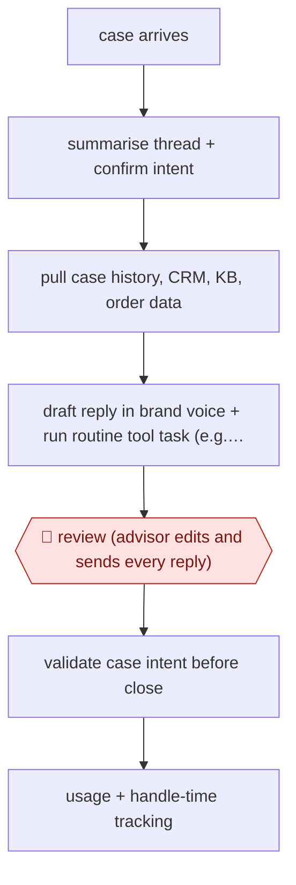

# Human-sent reply drafting

`COM › CSX › RESOLVE` · assist · evidence A · **draft: needs a reference example** ([how to add one](../../../../../CONTRIBUTING.md#1-add-an-example-run))

**Shape:** `case arrives → summarise thread + confirm intent → pull case history, CRM, KB, order data → draft reply in brand voice + run routine tool task (e.g. promo code) → 🛑 review (advisor edits and sends every reply) → validate case intent before close → usage + handle-time tracking`
**Variants:** `salesforce-agentforce-service` · `dynamics-365-copilot-service` · `zendesk-agent-copilot`

<!-- shape diagram: generated by scripts/build_diagrams.py from `shape`; don't edit -->

<!-- end shape diagram -->

## Background

When a customer writes to a company's support team, the message becomes a case in a service desk, and a customer care advisor answers it. Before replying, the advisor reads the thread, looks up the customer's history and order, finds the right help article, writes the email in the brand's voice and sometimes does a small side task, such as creating a discount code. Each of those takes time and clicking between screens. Here the agent does the reading and preparation: it summarises the thread, pulls the records, drafts the reply and runs the routine task. The advisor still reads, edits and sends every reply, because the reply goes to a customer in the brand's name, and the advisor is the one who handles judgement, empathy and exceptions.

**Terms:**
- **Case**: one customer request, with its thread of messages, held in the service desk.
- **Advisor**: the support employee who answers cases.
- **Case intent**: the label saying what the customer is asking for (a return, a delivery problem); it is chosen when the case is handled and used for reporting.
- **CRM**: the system holding what is known about each customer; **ERP** holds orders and stock.
- **KB (knowledge base)**: the approved help articles the replies must follow.
- **Brand voice**: how each brand writes to customers, set down as instructions.
- **Handle time**: how long a case takes from opening to closing.

## Build it with an agent

**Form:** `skill`. One advisor handles one case at a time and is in the conversation when the draft appears, so a single skill holding the steps and the brand's voice instructions is enough.

**You need:** read access to the case thread, case history, CRM records, the knowledge articles and order data, through connectors; the brand's voice instructions and the list of case intents as reference files beside the skill; a tool for the routine task (for example creating a promotional code) with its limits set in the tool, not in the skill's text. The agent needs no tool that sends a message to the customer. Keep payment details and unneeded personal data out of what the agent can read.

| Step | Built as |
|---|---|
| case arrives → summarise thread + confirm intent | The advisor opens the skill on the case. It reads the thread, writes a short summary and states what the customer appears to be asking, for the advisor to correct. |
| pull case history, CRM, KB, order data | MCP connectors, read-only. The skill cites which record each fact in the draft came from. |
| draft reply in brand voice + run routine tool task (e.g. promo code) | The skill drafts from the voice instructions and the retrieved articles. The routine task runs through its connector, and the result is shown to the advisor next to the draft. |
| 🛑 review (advisor edits and sends every reply) | See Checkpoints. |
| validate case intent before close | The skill compares the chosen intent with the conversation and says if they do not match. |
| usage + handle-time tracking | The desk's own reporting. The skill does not track itself. |

**Checkpoints:** `review`: the skill ends by presenting the draft and any code it generated, and stops. The agent has no tool that sends email or replies in the service desk, so the advisor edits the draft and sends it from the desk.

**Since the sources:** Source 1 is a 2025-02 journal article and source 2 a 2026-09 vendor customer story. The journal page refused the page reader in 2026-11, so source 1 was not re-opened. Source 2 describes a vendor's assistant built into its service desk and grounded in its data platform; this build takes the steps out of that product and runs them in a general agent through connectors, without the in-desk panel that shows suggestions as the advisor types. The sources report time and productivity changes; this entry makes no such claim for the build. The failure modes below record that the most experienced agents lose some quality when they follow suggestions, so letting an advisor ignore the draft is part of the design.

*A design based on this entry's steps and the tool documentation as of 2026-11, not a reported run.*

## Steps

*As reported by the sources.*
1. As each case arrives, the assistant summarises the conversation so far and confirms what the consumer is asking for before work starts [[2]](#sources).
2. The service desk grounds the assistant in case history, CRM records and knowledge articles, plus order data from the ERP, so drafts reflect current promotions and order status [[2]](#sources).
3. The assistant drafts the first version of the reply using the brand's own voice instructions and that brand's knowledge. In the studied deployment, suggestions appear in real time and the agent decides whether to use them [[1]](#sources)[[2]](#sources).
4. The assistant runs routine in-case tasks from a prompt, such as generating a promotional code, which replaces about 15 screens of manual navigation [[2]](#sources).
5. 🛑 **Review**: the human advisor reviews the draft, edits it and sends it. No reply reaches the customer without a person sending it [[2]](#sources).
6. Before closing, the assistant checks that the selected case intent matches the conversation, so intents stay consistent across the team [[2]](#sources).
7. The team rolls out one brand and market at a time to learn which intents work, then expands [[2]](#sources). It tracks handle time, resolutions per hour and quality, broken down by agent tenure [[1]](#sources).

**Output:** Replies sent by human agents, plus case summaries and validated intent labels written to the service desk. These feed KB-gap and QA work.
**Failure modes → guards:** Most experienced agents lose some quality when they follow suggestions → measure by agent skill level and let experts ignore suggestions [[1]](#sources). Drafts invent specifics such as order numbers or dates → ground drafts in live CRM/order data and keep the human send step [[2]](#sources).
**How it differs:** AWF-0021 Procedure agent: there the agent answers customers and acts autonomously, with sampled QA. Here a human sends every reply (assist autonomy, per-reply review). The deliverable is an agent-sent reply, not an autonomous resolution.

## Public runs

Coverage as of 2026-11-06: **Weak**: only anonymous, vendor-linked or journalist-told accounts. Collected and re-checked in [Second collection pass](../../../../../research/2026-11-second-pass.md).

- [Brynjolfsson, Li, Raymond, Generative AI at Work (QJE)](https://academic.oup.com/qje/article/140/2/889/7990658) (2025-02-04). Staggered rollout of an AI assistant to 5,172 support agents at a Fortune 500 software firm. "increases worker productivity, as measured by issues resolved per hour, by 15% on average". *First-hand: study (field study at an unnamed firm); confidence: high.*
- [Salesforce, L'Oréal customer story](https://www.salesforce.com/eu/customer-stories/loreal/agentic-service-advisor-assistance/) (2026-09-11). Advisors review and send AI drafts; pilot in Canada with one brand, now 25 brands. "cutting the time to resolve a case from about 7 minutes to about 2.5 minutes". *First-hand: vendor; confidence: med.*

## Sources

1. Brynjolfsson, Li, Raymond, Generative AI at Work, Quarterly Journal of Economics 140(2), 2025-02-04. https://academic.oup.com/qje/article/140/2/889/7990658
2. Salesforce, L'Oréal handles consumer support cases 64% faster with Agentforce, 2026-09-11. https://www.salesforce.com/eu/customer-stories/loreal/agentic-service-advisor-assistance/
