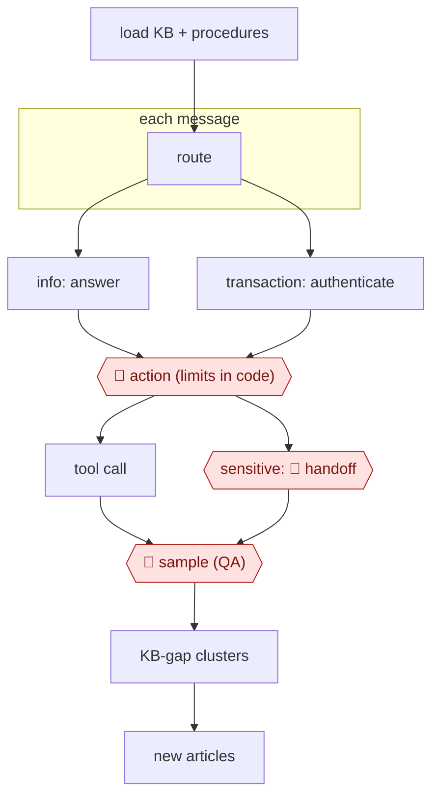

# Procedure agent

`COM › CSX › RESOLVE` · sampled · evidence A · **draft: needs a reference example** ([how to add one](../../../../../CONTRIBUTING.md#1-add-an-example-run))

**Shape:** `load KB + procedures → each message: route → info: answer | transaction: authenticate → 🛑 action (limits in code) → tool call | sensitive: 🛑 handoff → 🛑 sample (QA) → KB-gap clusters → new articles`

<!-- shape diagram: generated by scripts/build_diagrams.py from `shape`; don't edit -->

<!-- end shape diagram -->

## Background

A retailer or software company takes customer questions in a chat window: where is my order, can I change my address, my card was charged twice, how do I return this. Most are answered from a help centre; a minority need an action in a system — a refund, a cancellation, an address change — and only after the person asking has proved they own the account. Support leaders write the answers and the rules down as procedures, and an agent can now work through them in the chat: it answers from the articles, and for a transaction it authenticates, calls the system and tells the customer what happened. Three things keep a person in the loop. Money-moving actions must be capped, and a cap written in a prompt is only a suggestion, so the limits live in the tool itself. Cases the procedure does not cover — a threatened chargeback, a bereavement, a legal threat — go to a human with a summary. And because a resolved-looking conversation can still be a wrong one, quality staff score conversations and read the flagged and the sampled. What the sources call the resolution rate is the number the whole arrangement is judged on, and every vendor defines it differently.

**Terms:**
- **KB (knowledge base)**: the help-centre articles the agent answers from.
- **procedure**: a written routine with conditions and limits, such as "refund if the parcel is more than ten days late and the value is under the cap".
- **route**: deciding which kind of message this is before answering it.
- **authenticate**: proving the person owns the account before any account action.
- **tool call**: the agent's action in an outside system, such as issuing a refund.
- **handoff**: passing the conversation to a person, with a summary.
- **QA sampling**: scoring every conversation and having people re-read a share of them.
- **deflection vs resolution**: a conversation the customer gave up on versus one whose problem was actually solved; only the second is resolution.

## Build it with an agent

**Form:** `service`. Customers write at any hour and the agent answers without anyone starting it; people appear only at the exceptions, the handoffs and the sample.

**You need:** the KB and the procedures as files the run loads, one procedure per intent with its conditions and its limits written as numbers; account tools — refund, cancel, address change — exposed through an MCP connector, with the caps enforced inside those tools; an authentication step whose result the tools require; a store outside the conversation for what the current case has established; a queue for handoffs and a review queue for sampled conversations. The agent must have no tool that can exceed a cap and no channel to a customer other than the chat itself.

| Step | Built as |
|---|---|
| load KB + procedures | The Skill's first instruction: read the route table and load the procedure for this intent only, so the limits in force are the ones written for the case at hand. |
| each message: route | A small classifier in the calling program picks from a fixed intent list; anything the list does not cover becomes a handoff, not a free-form answer. |
| info: answer | Retrieval over the KB with the article cited in the reply; a question it cannot ground goes to the gap log instead of being answered from general knowledge. |
| transaction: authenticate | The authentication tool returns a session token that the account tools require; without it every account call fails closed. |
| 🛑 action (limits in code) | The refund and cancellation tools enforce their own ceilings and refuse anything above them; the agent chooses whether to refund, never how high the cap is. |
| tool call | MCP connectors to the order, billing and CRM systems, each returning a structured result that goes into the reply and the log. |
| sensitive: 🛑 handoff | A handoff tool that packages the transcript, the identity state, what was tried and why it stopped into the queue of the right team. |
| 🛑 sample (QA) | Every conversation is scored, and a fixed share plus anything flagged goes to a reviewer; the scores drive procedure edits, not the agent. |
| KB-gap clusters → new articles | A scheduled pass clusters the unanswered questions weekly and proposes article drafts for the content team to accept. |

**Checkpoints:** `action`: the ceiling is a property of the tool, so no wording in a prompt can raise it, and a failed authentication has no path to an account action. `handoff`: the only route to a person is the handoff tool, which ends the run and leaves a decision packet rather than a bare transfer. `sample`: the review share is set by the programme, not by the agent, and the scored conversations are what changes to the procedures are based on.

**Since the sources:** Sources date from 2023 to 2026-10: two first-hand engineering accounts, a vendor case study, a practitioner forum thread and a 2026 customer story. The 2026 benchmark round-up and the Aircall story were opened this month; the older forum thread was not re-opened. What has changed since: how the headline number is counted. The 2026 round-up reports platform averages from 52% to 76% and states that [every published figure is self-reported under a definition its publisher wrote](https://www.lorikeetcx.ai/articles/resolution-rate-ai-customer-support-benchmarks-2026), with one vendor counting a completed procedure or a handoff as a resolution and another counting only conversations that end without escalation. That makes the metric caution in this entry more relevant, not less: the build should fix its definition of resolution per intent before it is measured, or the number will move when a vendor's definition changes rather than when the service does. The fixed attempt limit before escalation, recorded as 2026 recent practice, is unchanged in the newer account.

*A design based on this entry's steps and the tool documentation as of 2026-11, not a reported run.*

## Steps

*As reported by the sources.*

1. Rewrite tribal knowledge as natural-language procedures with explicit conditions and limits. Decagon AOPs compile these into workflows where refunds and identity checks run in code [[21]](#sources). Intercom Fin Procedures and Sierra journeys are equivalent variants.
2. Route each message by intent.
3. Authenticate before any account action.
4. 🛑 **Action**: limits are enforced in code, not in the prompt.
5. 🛑 **Handoff**: hand off with a summary.
6. 🛑 **Sample**: QA scores every conversation; humans review flagged and random ones.
7. Turn weekly KB-gap clusters into new articles.

**Metric caution:** resolution rates aren't defined the same way across vendors. Fin's site reportedly claims a 76% average, while independent and small-business tests cluster at 38–53% [[22]](#sources). Decagon customer figures above 70% come from an analyst write-up [[21]](#sources). All are evidence B.

**Recent practice (2026):**
- Handoff: a fixed attempt limit (TripCity: three) before escalating, with an AI-written summary handed to the live agent (Aircall, 2026-10-29). [[23]](#sources)

## Public runs

Coverage as of 2026-11-06: **Strong**: a first-hand, detailed run that matches most of the shape. From [Where are the real runs?](../../../../../research/2026-11-real-runs.md); every number was re-checked against its page. More runs added in [Third collection pass](../../../../../research/2026-11-third-pass.md).

- [Gupta et al., Nubank, arXiv 2606.08867](https://arxiv.org/abs/2606.08867) (2026-06). Five production deployments: routines, tools behind identity checks, escalation, human-labelled evaluation. "37 percentage-point improvement in AI transactional Net Promoter Score". *First-hand: yes; confidence: high.*
- [Jackson Gold, Pinecone](https://www.pinecone.io/blog/support-agent-nexus/) (2026-09-01). Ticket routing → account lookups → investigation → escalation brief for refunds and limits. "resolves 55.1% of the tickets"; "27 of the 49". *First-hand: yes (early, small sample); confidence: high.*
- [Decagon, Tremendous case study](https://decagon.ai/case-studies/tremendous) (undated). Two-factor ownership check → resend, cancel or exchange → escalate with context. "92% CSAT… compared with 86% for its BPO team". *First-hand: vendor; confidence: med.*
- [Intercom Community, Fin resolution thread](https://community.intercom.com/questions/3622) (2023–2026). Practitioners report resolution rates and how they maintain their knowledge base. "around 55-60% from the past week, in around 3000 conversations". *First-hand: yes (forum); confidence: low.*
- [Aircall, How TripCity cut live call volume in half with AI Voice Agent "Miles"](https://aircall.io/customer-stories/tripcity/) (2026-10-29). Voice-channel procedure agent on three phone lines; three resolution attempts before escalation to a live agent. "87% of calls resolved without escalation to live agents". *First-hand: vendor; confidence: med.*

## Sources

21. Decagon, *AOP*. https://decagon.ai/product/aop · Futurum Group (August 2025). https://futurumgroup.com/press-release/decagon-aims-to-simplify-ai-agent-development-with-natural-language/
22. Fin resolution-rate discussion: https://community.intercom.com/questions/3622 · https://superframeworks.com/articles/best-ai-customer-support-tools
23. Aircall, TripCity customer story, 2026-10-29. https://aircall.io/customer-stories/tripcity/
