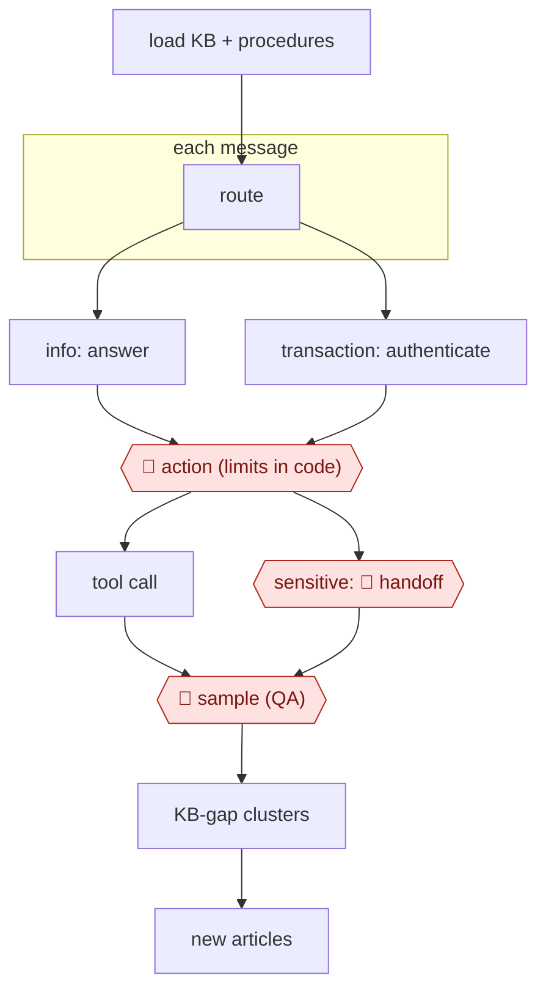

# Procedure agent

`COM › CSX › RESOLVE` · sampled · evidence A · **draft: needs a reference example** ([how to add one](../../../../../CONTRIBUTING.md#1-add-an-example-run))

**Shape:** `load KB + procedures → each message: route → info: answer | transaction: authenticate → 🛑 action (limits in code) → tool call | sensitive: 🛑 handoff → 🛑 sample (QA) → KB-gap clusters → new articles`

<!-- shape diagram: generated by scripts/build_diagrams.py from `shape`; don't edit -->

<!-- end shape diagram -->

## Steps
1. Rewrite tribal knowledge as natural-language procedures with explicit conditions and limits. Decagon AOPs compile these into workflows where refunds and identity checks run in code [[21]](#sources). Intercom Fin Procedures and Sierra journeys are equivalent variants.
2. Route each message by intent.
3. Authenticate before any account action.
4. 🛑 **Action**: limits are enforced in code, not in the prompt.
5. 🛑 **Handoff**: hand off with a summary.
6. 🛑 **Sample**: QA scores every conversation; humans review flagged and random ones.
7. Turn weekly KB-gap clusters into new articles.

**Metric caution:** resolution rates aren't defined the same way across vendors. Fin's site reportedly claims a 76% average, while independent and small-business tests cluster at 38–53% [[22]](#sources). Decagon customer figures above 70% come from an analyst write-up [[21]](#sources). All are evidence B.

## Public runs

Coverage as of 2026-11-06: **Strong**: a first-hand, detailed run that matches most of the shape. From [Where are the real runs?](../../../../../research/2026-11-real-runs.md); every number was re-checked against its page.

- [Gupta et al., Nubank, arXiv 2606.08867](https://arxiv.org/abs/2606.08867) (2026-06). Five production deployments: routines, tools behind identity checks, escalation, human-labelled evaluation. "37 percentage-point improvement in AI transactional Net Promoter Score". *First-hand: yes; confidence: high.*
- [Jackson Gold, Pinecone](https://www.pinecone.io/blog/support-agent-nexus/) (2026-09-01). Ticket routing → account lookups → investigation → escalation brief for refunds and limits. "resolves 55.1% of the tickets"; "27 of the 49". *First-hand: yes (early, small sample); confidence: high.*
- [Decagon, Tremendous case study](https://decagon.ai/case-studies/tremendous) (undated). Two-factor ownership check → resend, cancel or exchange → escalate with context. "92% CSAT… compared with 86% for its BPO team". *First-hand: vendor; confidence: med.*
- [Intercom Community, Fin resolution thread](https://community.intercom.com/questions/3622) (2023–2026). Practitioners report resolution rates and how they maintain their knowledge base. "around 55-60% from the past week, in around 3000 conversations". *First-hand: yes (forum); confidence: low.*

## Sources

21. Decagon, *AOP*. https://decagon.ai/product/aop · Futurum Group (August 2025). https://futurumgroup.com/press-release/decagon-aims-to-simplify-ai-agent-development-with-natural-language/
22. Fin resolution-rate discussion: https://community.intercom.com/questions/3622 · https://superframeworks.com/articles/best-ai-customer-support-tools
