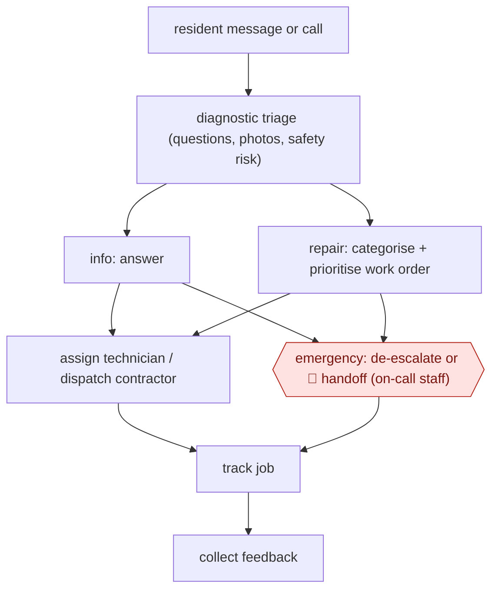

# Resident maintenance triage

`COM › CSX › RESOLVE` · sampled · evidence B · **draft: needs a reference example** ([how to add one](../../../../../CONTRIBUTING.md#1-add-an-example-run))

**Shape:** `resident message or call → diagnostic triage (questions, photos, safety risk) → info: answer | repair: categorise + prioritise work order → assign technician / dispatch contractor | emergency: de-escalate or 🛑 handoff (on-call staff) → track job → collect feedback`
**How it differs:** Same class as AWF-0021, but here the transaction is a physical dispatch to technicians or contractors, not an account action.
**Variants:** `eliseai` · `qed-labs`

<!-- shape diagram: generated by scripts/build_diagrams.py from `shape`; don't edit -->

<!-- end shape diagram -->

## Steps
1. Triage the request with structured questions and photos, and assess safety risk [[2]](#sources).
2. Answer status questions without a work order (44% at L1 Property) [[2]](#sources).
3. Create categorised work orders and de-escalate false 'emergencies' [[1]](#sources).
4. Auto-assign or dispatch contractors, then track the job lifecycle [[2]](#sources).
5. 🛑 **Handoff**: genuine emergencies and complex cases go to staff [[1]](#sources).

**Output:** Dispatched and tracked work orders, plus resident updates.
**Failure modes → guards:** Real emergency mis-triaged → safety-risk questions and an escalation path. The handoff design is thinly described in the sources.

## Public runs

Coverage as of 2026-11-06: **Weak**: only anonymous, vendor-linked or journalist-told accounts. Collected and re-checked in [Second collection pass](../../../../../research/2026-11-second-pass.md). More runs added in [Third collection pass](../../../../../research/2026-11-third-pass.md).

- [EliseAI, Summit Property Management](https://eliseai.com/customer-stories/how-summit-property-management-reinvented-their-management-model-with-ai-and-centralization) (n.d.). 10,000+ apartment homes; maintenance triage. "MaintenanceAI generated 9,760 categorized work orders and de-escalated 34% of “emergencies,”". *First-hand: vendor; confidence: med.*
- [QED Labs, L1 Property](https://qedlabs.co.uk/case-studies/l1-property) (n.d.). 603 units; 765 jobs dispatched to 36 contractors. "66% Increase in first-time fix rate". *First-hand: vendor; confidence: low.*
- [EliseAI, Woodward Properties](https://eliseai.com/customer-stories/how-woodward-properties-built-a-24-7-operating-model-with-eliseai) (n.d.; data Apr-May 2026). ~2,300-unit operator; emergency triage + auto-assignment; quotes CEO and staff. "a 50% reduction in after-hours emergency dispatches". *First-hand: vendor; confidence: med.*

## Sources

1. EliseAI, Summit Property Management success story. https://eliseai.com/customer-stories/how-summit-property-management-reinvented-their-management-model-with-ai-and-centralization
2. QED Labs, L1 Property case study. https://qedlabs.co.uk/case-studies/l1-property
3. EliseAI, How Woodward Properties Built a 24/7 Operating Model with EliseAI (data 2026-04-01 to 2026-05-31). https://eliseai.com/customer-stories/how-woodward-properties-built-a-24-7-operating-model-with-eliseai
