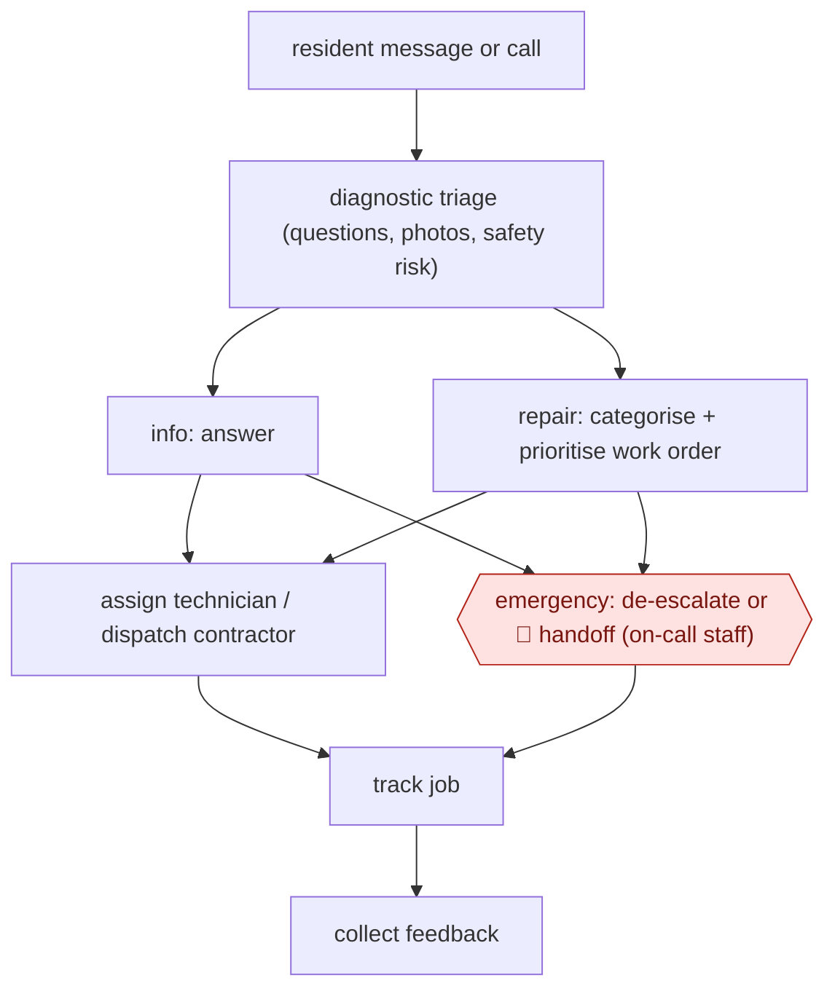

# Resident maintenance triage

`COM › CSX › RESOLVE` · sampled · evidence B · **draft: needs a reference example** ([how to add one](../../../../../CONTRIBUTING.md#1-add-an-example-run))

**Shape:** `resident message or call → diagnostic triage (questions, photos, safety risk) → info: answer | repair: categorise + prioritise work order → assign technician / dispatch contractor | emergency: de-escalate or 🛑 handoff (on-call staff) → track job → collect feedback`
**Variants:** `eliseai` · `qed-labs`

<!-- shape diagram: generated by scripts/build_diagrams.py from `shape`; don't edit -->

<!-- end shape diagram -->

## Background

A landlord or property manager is responsible for keeping hundreds of flats in repair, and residents report faults as they happen: a tap dripping at noon, a burst pipe at two in the morning. Someone has to take each report, work out how serious it is, turn it into a work order that names the right trade, and get it to a technician or an outside contractor — and in the middle of the night someone has to decide whether a resident's "emergency" justifies waking a duty engineer. Human staff do this well but only while they are awake, and the cost of both errors is high: a real flood queued until morning ruins two flats, while every false alarm spends an on-call engineer's night and money. Here an agent takes the report by message or call, asks the questions the trade would ask, reads the photos, classifies urgency against the landlord's written rules, raises the work order and dispatches it. Genuine emergencies are handed to the duty person with everything needed to act, and the resident is told what to do meanwhile. The rules — what counts as an emergency, who gets woken, what may be said — stay the landlord's, because habitability and safety are legal duties, and a mis-triage is a liability, not a service annoyance.

**Terms:**
- **work order**: the record of a repair: property, unit, fault, trade, priority, access details.
- **triage**: sorting a report into urgency and responsibility before any repair is attempted.
- **de-escalate**: calming a report that presents as an emergency but is not one, and giving a realistic timeline.
- **duty / on-call engineer**: the person who takes emergencies outside office hours.
- **habitability**: the conditions a landlord must legally maintain, such as heat, water and safety.
- **dispatch**: sending the job to a named technician or contractor, with the authority to attend.
- **first-time fix rate**: the share of jobs completed on the first visit, which is what complete intake protects.

## Build it with an agent

**Form:** `service`. Reports arrive around the clock and no one starts the run; people appear at the emergencies and, later, in the sample of transcripts.

**You need:** the landlord's emergency rubric written as observable conditions — water actively flowing, no heat below a stated temperature, smell of gas, no running water, a lock that will not secure the property — with an owner and a next step per category; the unit and tenancy records, so the agent can identify the property and the access arrangements; the work-order system and the contractor list, through an MCP connector or the platform's API; photos, where the channel carries them; the duty rota, and a paging channel with an acknowledgement. The agent must not be able to dispatch a job above a stated cost without a person, and must not give repair instructions that the landlord has not approved in writing.

| Step | Built as |
|---|---|
| resident message or call | A webhook on the message channel, or the voice platform's call-ended event, starts one run per report; the voice case needs the speech layer described in AWF-0175. |
| diagnostic triage (questions, photos, safety risk) | The Skill asks only the questions that change urgency, access or the next action, in a fixed order per fault type, and reads any photo; it records the answers as fields, not as prose. |
| info: answer | Status questions are answered from the open work order, with no new order created. |
| repair: categorise + prioritise work order | The Skill writes the order — fault category, priority from the rubric, access notes, pets — and cites the rubric line that set the priority. |
| assign technician / dispatch contractor | A dispatch tool picks from the approved contractor list by trade and area; above a cost threshold the tool requires an approval reference that the run cannot mint. |
| emergency: de-escalate or 🛑 handoff (on-call staff) | Genuine emergencies page the duty person with a decision packet — who, where, what, which rule fired, what the resident was told — and the run waits for an acknowledgement; a report that is not an emergency gets a calm timeline instead of a page. |
| track job → collect feedback | The Skill follows the order's status and sends the resident an update at each state change; feedback is collected after completion and kept against the contractor. |

**Checkpoints:** `handoff`: the paging tool is the only route to a duty engineer, and it carries the facts rather than a request to call back. Two things are enforced in code rather than asked for in the prompt: the emergency rubric is applied by a classifier over the structured answers, so a resident insisting on urgency cannot raise the category, and the page is not sent until the packet is complete — property, unit, hazard, rule, instruction given. The agent has no way to dispatch above the cost threshold, so a large emergency job still needs a person's approval reference.

**Since the sources:** Sources are three vendor case studies, one of them with data from April to May 2026; all three were opened this month. None of them describes the handoff in detail, which is why the build above specifies a decision packet and a rubric. What has changed since: the design of that handoff has become the published part. A 2026 practitioner guide sets out [an escalation configuration with named recipients, a consolidation rule so that twelve calls about one burst riser produce one alert, and two metrics to tune the rubric against — the false-emergency rate and the missed-emergency rate](https://oncallclerk.com/blog/property-management-maintenance-call-triage). That is the part of this entry the sources left thin, and it fits the build as configuration plus a monthly review rather than as anything the agent decides. The vendor claims about de-escalation shares remain vendor claims; nothing opened this month measures them independently.

*A design based on this entry's steps and the tool documentation as of 2026-11, not a reported run.*

## Steps

*As reported by the sources.*

1. Triage the request with structured questions and photos, and assess safety risk [[2]](#sources).
2. Answer status questions without a work order (44% at L1 Property) [[2]](#sources).
3. Create categorised work orders and de-escalate false 'emergencies' [[1]](#sources).
4. Auto-assign or dispatch contractors, then track the job lifecycle [[2]](#sources).
5. 🛑 **Handoff**: genuine emergencies and complex cases go to staff [[1]](#sources).

**Output:** Dispatched and tracked work orders, plus resident updates.
**Failure modes → guards:** Real emergency mis-triaged → safety-risk questions and an escalation path. The handoff design is thinly described in the sources.
**How it differs:** Same class as AWF-0021, but here the transaction is a physical dispatch to technicians or contractors, not an account action.

## Public runs

Coverage as of 2026-11-06: **Weak**: only anonymous, vendor-linked or journalist-told accounts. Collected and re-checked in [Second collection pass](../../../../../research/2026-11-second-pass.md). More runs added in [Third collection pass](../../../../../research/2026-11-third-pass.md).

- [EliseAI, Summit Property Management](https://eliseai.com/customer-stories/how-summit-property-management-reinvented-their-management-model-with-ai-and-centralization) (n.d.). 10,000+ apartment homes; maintenance triage. "MaintenanceAI generated 9,760 categorized work orders and de-escalated 34% of “emergencies,”". *First-hand: vendor; confidence: med.*
- [QED Labs, L1 Property](https://qedlabs.co.uk/case-studies/l1-property) (n.d.). 603 units; 765 jobs dispatched to 36 contractors. "66% Increase in first-time fix rate". *First-hand: vendor; confidence: low.*
- [EliseAI, Woodward Properties](https://eliseai.com/customer-stories/how-woodward-properties-built-a-24-7-operating-model-with-eliseai) (n.d.; data Apr-May 2026). ~2,300-unit operator; emergency triage + auto-assignment; quotes CEO and staff. "a 50% reduction in after-hours emergency dispatches". *First-hand: vendor; confidence: med.*

## Sources

1. EliseAI, Summit Property Management success story. https://eliseai.com/customer-stories/how-summit-property-management-reinvented-their-management-model-with-ai-and-centralization
2. QED Labs, L1 Property case study. https://qedlabs.co.uk/case-studies/l1-property
3. EliseAI, How Woodward Properties Built a 24/7 Operating Model with EliseAI (data 2026-04-01 to 2026-05-31). https://eliseai.com/customer-stories/how-woodward-properties-built-a-24-7-operating-model-with-eliseai
