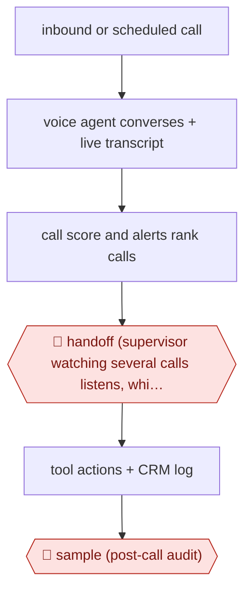

# Supervised voice agent

`COM › CSX › RESOLVE` · sampled · evidence B · **draft: needs a reference example** ([how to add one](../../../../../CONTRIBUTING.md#1-add-an-example-run))

**Shape:** `inbound or scheduled call → voice agent converses + live transcript → call score and alerts rank calls → 🛑 handoff (supervisor watching several calls listens, whispers, takes over, hands back) → tool actions + CRM log → 🛑 sample (post-call audit)`
**Variants:** `sanas` · `cloneops` · `heyrevia` · `livekit`

<!-- shape diagram: generated by scripts/build_diagrams.py from `shape`; don't edit -->

<!-- end shape diagram -->

## Background

Some service lines are still run on the phone: a delivery is late, an appointment must move, a bill is disputed. A voice agent can now answer those calls, hold a natural conversation, look things up and act, and most callers never learn it is not a person. The risk is the call that starts well and then goes wrong — a caller who becomes angry, asks for a human three times, or describes something the script does not cover — and no post-hoc audit helps the person on the line at that moment. So the arrangement is a control room, not a queue: one supervisor sits with a dashboard of live calls, each carrying a running score of how badly it needs a person, and can listen silently, whisper guidance to the agent, take the call over, and hand it back once the tricky part is done, without the caller restarting. Everything the agent and the human do is logged to a CRM record, and finished calls are audited afterwards, which for routine outbound follow-ups is the only human attention they get. The supervisor is not a fallback for a broken agent: the share of calls they have to enter is the measure of where the agent's own escalation rules are wrong.

**Terms:**
- **voice agent**: software that holds a spoken conversation using speech recognition, a language model and speech synthesis.
- **live transcript**: the running text of the call, which the supervisor reads instead of listening to everything.
- **whisper**: private guidance to the agent that the caller does not hear.
- **barge-in / take over**: the supervisor joining the call audibly and speaking to the caller.
- **hand back**: returning control to the agent mid-call, so the caller does not have to repeat anything.
- **warm transfer**: passing a call to a person with the context attached, as opposed to a blind transfer.
- **post-call audit**: reviewing the transcript and actions after the call ends.
- **intervention rate**: how often supervisors have to step into calls; a design signal, not a target.

## Build it with an agent

**Form:** `platform`. The call itself is audio in real time — recognition, turn-taking, interruption and an audible take-over need the speech models and telephony a general agent does not have; the reasoning, the rubric, the post-call audit and the CRM write can be a general agent's work, and that is the part this build specifies.

**You need:** a voice platform with sub-second turn-taking, barge-in and a supervisor console that can whisper, take over and hand back — the platforms named in `variants` are of this kind; the call-flow policy as a document the agent follows, with the escalation triggers written out; a live scoring feed the dashboard can sort on; the CRM and the order or billing systems behind tool calls, with authentication for the caller done before any account action; a per-call record that holds the transcript, every action and who took it. Nothing in the build may let the agent speak a promise about money the tools cannot keep, and nothing may let a supervisor take a call without the caller being told.

| Step | Built as |
|---|---|
| inbound or scheduled call | The platform's telephony answers or dials; the agent's instructions and the escalation triggers are loaded per campaign, so a scheduled follow-up runs a narrower policy than an inbound complaint line. |
| voice agent converses + live transcript | The platform's speech loop, with the agent's turns generated by the model and the transcript streamed to the console as it forms. |
| call score and alerts rank calls | A scoring job that turns transcript signals — sentiment, a request for a human, a keyword, silence, elapsed time — into one rank per call, so the supervisor's attention goes to the top of a list rather than to all of it. |
| 🛑 handoff (supervisor watching several calls listens, whispers, takes over, hands back) | The console's controls are a platform permission, given per supervisor and per line; the take-over is announced to the caller and logged, and the hand-back leaves the agent with the state the human established. |
| tool actions + CRM log | MCP connectors for the CRM and the operational systems, each write carrying the call id and whether a person or the agent authorised it. |
| 🛑 sample (post-call audit) | An agent-run audit over a fixed share of finished calls plus every call a supervisor entered, scoring the transcript against the same rubric and writing findings back for the policy to be edited. |

**Checkpoints:** `handoff`: the supervisor's controls are the checkpoint — the agent cannot hand a call to itself, the console is the only place a take-over can be initiated, and every intervention is logged with who did it and when, so a call cannot be joined silently. Cap the calls per supervisor, because the intervention model fails by inattention rather than by tooling. `sample`: the post-call audit is a separate pass with its own rubric, run over a fixed share and over every call a supervisor entered, and its findings change the escalation triggers rather than the transcript.

**Since the sources:** Sources date from 2025-02 to 2026-10, with two undated vendor pages, all opened this month. What has changed since: live supervision has been written up as an operating model rather than a feature. A 2026 practitioner guide describes [the monitor seat as a staffing and process decision — who sits there, what pulls their attention to a call, and how a barge-in joins the existing escalation route — and argues that a high intervention rate is a signal that the agent's own escalation rules are failing, not a reason to grow the team](https://www.dilr.ai/blog/voice-ai-live-monitoring-supervisor-dashboard-enterprise). It also states the rule the build above enforces: a take-over should be announced and logged, not silent. The platforms in `variants` remain separate products with different control surfaces, so the console's permission model is the part to check before adopting any of them.

*A design based on this entry's steps and the tool documentation as of 2026-11, not a reported run.*

## Steps

*As reported by the sources.*

1. Voice agent takes inbound calls or launches scheduled outbound calls and transcribes in real time to a supervisor dashboard [[2]](#sources)[[3]](#sources).
2. Each call gets a running score of how badly it needs a person; worse calls rise to the top; alerts fire on frustration, requests for a human, keywords or long duration [[2]](#sources)[[4]](#sources).
3. 🛑 **Handoff**: one supervisor follows several calls (Sanas: up to four; HeyRevia demo: 10-15) and can listen, privately guide the AI, take over mid-call and hand control back, so the caller does not restart [[1]](#sources)[[5]](#sources).
4. Agent completes tool actions and logs every AI and human action to an audit trail and CRM [[1]](#sources)[[3]](#sources).
5. 🛑 **Sample**: completed calls are audited afterwards; for routine outbound follow-ups the audit is the only human input [[2]](#sources).

**Output:** Calls resolved by the agent or by a supervisor who joined live, with transcript and action log.
**Failure modes → guards:** Supervisor attention is finite and alerts get ignored → cap calls per supervisor and tune alerts [1][4]. Abrupt voice change confuses callers → 'smooth' takeover where the AI introduces a colleague [4].
**How it differs:** Nearest is AWF-0021 Procedure agent: there a sensitive case is handed off to a human who was not present and QA samples afterwards. Here a human watches calls live and can step in and back within the same call; the checkpoint is continuous live supervision, not a transfer queue.

## Public runs

Coverage as of 2026-11-13: **Weak**: only anonymous, vendor-linked or journalist-told accounts. Collected and re-checked in [Third collection pass](../../../../../research/2026-11-third-pass.md).

- [ZenML LLMOps Database, HeyRevia](https://www.zenml.io/llmops-database/ai-powered-call-center-agents-for-healthcare-operations) (undated). Supervisor monitors concurrent AI calls to payers and takes over mid-conversation. "the presentation shows 10-15 concurrent calls". *First-hand: vendor; confidence: low.*

## Sources

1. Sanas, Supervised AI: A Human in Command of AI Voice Agents, undated. https://www.sanas.ai/supervised-ai
2. Matt Herr / FreightWaves, Monitor and manage multiple calls with the CloneOps.ai voice agent, 2025-02-25. https://www.freightwaves.com/news/monitor-and-manage-multiple-calls-with-the-cloneops-ai-voice-agent
3. ZenML LLMOps Database, HeyRevia: AI-Powered Call Center Agents for Healthcare Operations, undated. https://www.zenml.io/llmops-database/ai-powered-call-center-agents-for-healthcare-operations
4. Celphix, AI to Human Handoff: AI and People on One Call, 2026-04-23. https://celphix.com/blog/the-technology/ai-human-handoff
5. Timothy Bell / BriefGlance, The 1-to-4 Cockpit, 2026-10-08. https://briefglance.com/articles/the-1-to-4-cockpit-inside-the-shift-from-call-center-rep-to-bot-supervisor
