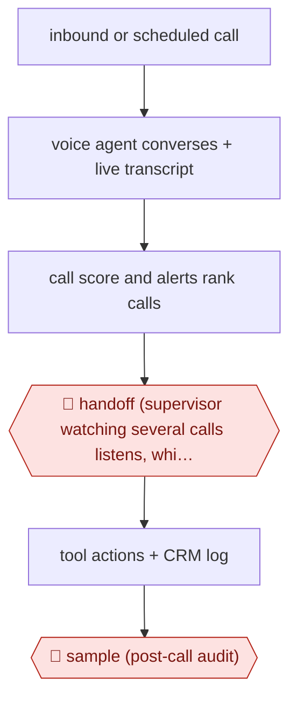

# Supervised voice agent

`COM › CSX › RESOLVE` · sampled · evidence B · **draft: needs a reference example** ([how to add one](../../../../../CONTRIBUTING.md#1-add-an-example-run))

**Shape:** `inbound or scheduled call → voice agent converses + live transcript → call score and alerts rank calls → 🛑 handoff (supervisor watching several calls listens, whispers, takes over, hands back) → tool actions + CRM log → 🛑 sample (post-call audit)`
**How it differs:** Nearest is AWF-0021 Procedure agent: there a sensitive case is handed off to a human who was not present and QA samples afterwards. Here a human watches calls live and can step in and back within the same call; the checkpoint is continuous live supervision, not a transfer queue.
**Variants:** `sanas` · `cloneops` · `heyrevia` · `livekit`

<!-- shape diagram: generated by scripts/build_diagrams.py from `shape`; don't edit -->

<!-- end shape diagram -->

## Steps
1. Voice agent takes inbound calls or launches scheduled outbound calls and transcribes in real time to a supervisor dashboard [[2]](#sources)[[3]](#sources).
2. Each call gets a running score of how badly it needs a person; worse calls rise to the top; alerts fire on frustration, requests for a human, keywords or long duration [[2]](#sources)[[4]](#sources).
3. 🛑 **Handoff**: one supervisor follows several calls (Sanas: up to four; HeyRevia demo: 10-15) and can listen, privately guide the AI, take over mid-call and hand control back, so the caller does not restart [[1]](#sources)[[5]](#sources).
4. Agent completes tool actions and logs every AI and human action to an audit trail and CRM [[1]](#sources)[[3]](#sources).
5. 🛑 **Sample**: completed calls are audited afterwards; for routine outbound follow-ups the audit is the only human input [[2]](#sources).

**Output:** Calls resolved by the agent or by a supervisor who joined live, with transcript and action log.
**Failure modes → guards:** Supervisor attention is finite and alerts get ignored → cap calls per supervisor and tune alerts [1][4]. Abrupt voice change confuses callers → 'smooth' takeover where the AI introduces a colleague [4].

## Public runs

Coverage as of 2026-11-13: **Weak**: only anonymous, vendor-linked or journalist-told accounts. Collected and re-checked in [Third collection pass](../../../../../research/2026-11-third-pass.md).

- [ZenML LLMOps Database, HeyRevia](https://www.zenml.io/llmops-database/ai-powered-call-center-agents-for-healthcare-operations) (undated). Supervisor monitors concurrent AI calls to payers and takes over mid-conversation. "the presentation shows 10-15 concurrent calls". *First-hand: vendor; confidence: low.*

## Sources

1. Sanas, Supervised AI: A Human in Command of AI Voice Agents, undated. https://www.sanas.ai/supervised-ai
2. Matt Herr / FreightWaves, Monitor and manage multiple calls with the CloneOps.ai voice agent, 2025-02-25. https://www.freightwaves.com/news/monitor-and-manage-multiple-calls-with-the-cloneops-ai-voice-agent
3. ZenML LLMOps Database, HeyRevia: AI-Powered Call Center Agents for Healthcare Operations, undated. https://www.zenml.io/llmops-database/ai-powered-call-center-agents-for-healthcare-operations
4. Celphix, AI to Human Handoff: AI and People on One Call, 2026-04-23. https://celphix.com/blog/the-technology/ai-human-handoff
5. Timothy Bell / BriefGlance, The 1-to-4 Cockpit, 2026-10-08. https://briefglance.com/articles/the-1-to-4-cockpit-inside-the-shift-from-call-center-rep-to-bot-supervisor
