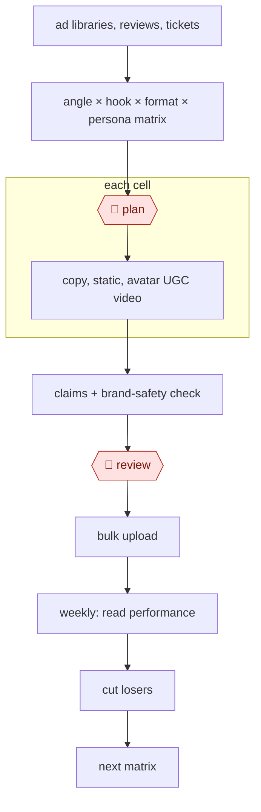

# Ad variant matrix

`COM › MKT › ADS` · checkpointed · evidence B · **draft: needs a reference example** ([how to add one](../../../../../CONTRIBUTING.md#1-add-an-example-run))

**Shape:** `ad libraries, reviews, tickets → angle × hook × format × persona matrix → 🛑 plan → each cell: copy, static, avatar UGC video → claims + brand-safety check → 🛑 review → bulk upload → weekly: read performance → cut losers → next matrix`

<!-- shape diagram: generated by scripts/build_diagrams.py from `shape`; don't edit -->

<!-- end shape diagram -->

## Public runs

Coverage as of 2026-11-06: **None found**: no public first-hand run yet. A real example run would be the first. From [Where are the real runs?](../../../../../research/2026-11-real-runs.md); every number was re-checked against its page.

- [Angad Singh, Segwise, on Curtis Howland's test](https://segwise.ai/blog/115k-ai-ugc-platform-test-findings.md) (2026-03-23). Five AI-avatar UGC tools on the same offers and audiences. "2.42x ROAS at a $70 CPA"; "$115k experiment". *First-hand: no (second-hand); confidence: low.*
- [Arcads, Teknasyon use case](https://www.arcads.ai/usecases/teknasyon) (2025-12-17). Bulk avatars to test angles, then scale the winners. "76% drop in Cost per Purchase and a 40% ROAS uplift". *First-hand: vendor; confidence: low.*

