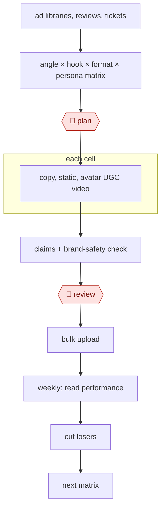

# Ad variant matrix

`COM › MKT › ADS` · checkpointed · evidence B · **draft: needs a reference example** ([how to add one](../../../../../CONTRIBUTING.md#1-add-an-example-run))

**Shape:** `ad libraries, reviews, tickets → angle × hook × format × persona matrix → 🛑 plan → each cell: copy, static, avatar UGC video → claims + brand-safety check → 🛑 review → bulk upload → weekly: read performance → cut losers → next matrix`

<!-- shape diagram: generated by scripts/build_diagrams.py from `shape`; don't edit -->

<!-- end shape diagram -->

## Background

Companies that sell online through paid social ads, mostly on Meta's Facebook and Instagram, need a steady supply of new ads, because the same ad shown to the same people for weeks stops working and costs rise. A performance marketer or a small agency team decides which messages to test, gets each one made as written copy, a still image and a short video, launches them in small test budgets and keeps the few that pay for themselves. By hand the volume is the problem: dozens of variants a week, each needing words, a brief and footage, and most of them will lose. The agent drafts the research summary, the test matrix, the copy and the creative briefs, and screens scripts for claims the product cannot support. The images and avatar videos come from generation tools. A marketer still chooses what runs and approves every ad before upload, because each ad spends the company's money and makes public promises in its name that consumer-protection law holds it to.

**Terms:**
- **Angle**: the reason to buy an ad leads with, such as a pain, an aspiration, social proof or an answer to an objection.
- **Hook**: the opening line or first seconds of an ad, meant to stop someone scrolling.
- **Persona**: a typical kind of buyer the ad is written for.
- **Matrix (cell)**: the grid of angles, hooks, formats and personas to test; a cell is one combination.
- **Static**: a still-image ad.
- **UGC (user-generated content)**: video in the style of an ordinary customer talking to camera; **avatar UGC** uses an AI-generated presenter instead of a real creator.
- **Creative brief**: instructions for making an ad: scene, talent direction, visual cues.
- **Claims check, brand safety**: checking that an ad promises nothing the product does not deliver and that nothing in it would embarrass the brand.
- **Ad set, bulk upload**: the unit in Meta's ad manager that holds ads with one budget and audience; loading many ads into ad sets at once.
- **Learning phase**: the period after launch while Meta's delivery system is still working out who to show an ad to.
- **CPA, ROAS, CPM, CTR, frequency**: cost per acquisition (per sale or sign-up), return on ad spend, cost per thousand impressions, click-through rate, and the average number of times one person has seen the ad.
- **Creative fatigue**: falling results as the same audience sees an ad too often.
- **"Use Existing Post"**: a Meta setting that runs a new ad on an existing post, so it keeps that post's likes and comments.
- **FTC**: the US Federal Trade Commission, which enforces truth-in-advertising rules.

## Build it with an agent

**Form:** `platform`. The statics and avatar videos come from image and avatar-video generation tools, and the ads go live in Meta's ad manager; a general agent can run the research, matrix, copy, briefs and claims check as a `skill` for one marketer working one week's matrix in the conversation.

**You need:** the product and offer description; exported customer reviews, forum posts and testimonials; the brand voice and the list of claims the product may make, as reference files beside the skill; last week's performance export from the ad manager; accounts on an image tool and an avatar-video tool. Give the agent no ad-manager tool that can create, upload or fund ads.

| Step | Built as |
|---|---|
| ad libraries, reviews, tickets | The skill reads the exported reviews and testimonials and runs the product interview in the conversation, then writes a positioning brief. |
| angle × hook × format × persona matrix → 🛑 plan | The skill writes the matrix as a table file, with the number of cells sized to the week's test budget, and stops. |
| each cell: copy, static, avatar UGC video | Built-in subagents write copy and a creative brief per cell. The images and avatar videos are made on the generation tools, through their API if they have one, or by a person. |
| claims + brand-safety check | A subagent that has not seen the drafting checks each script against the claims file and confirms the AI disclosure is present. |
| 🛑 review | See Checkpoints. |
| bulk upload | A person uploads in the ad manager. The skill can write the upload sheet with the tags (concept, format, persona, publisher identity). |
| weekly: read performance → cut losers → next matrix | The skill reads the performance export, applies the winner rule from its reference file, lists which ads to cut and which to keep, and starts the next matrix from the winners. |

**Checkpoints:** `plan`: the skill stops after writing the matrix file and drafts copy only for the cells the marketer approves. `review`: the skill stops after presenting the variants with the claims-check results, and the marketer picks the ones to test. The agent has no tool that uploads ads or changes budgets, so no ad spends money or reaches the public until a person loads it in the ad manager.

**Since the sources:** Sources date from 2025-12 to 2026-07; source 1 is undated. Source 1 is a Claude Code workflow covering the research, angles, copy and briefs only. Sources 2 and 4 describe teams using avatar-video tools and source 3 an agency's testing rules; none reports an agent running the matrix through upload and the weekly cut. The video step depends on the generation tools, so the build leaves it there. Mining competitors' ad libraries and support tickets is in the shape but no source describes it.

*A design based on this entry's steps and the tool documentation as of 2026-11, not a reported run.*

## Steps

*As reported by the sources.*

1. The marketer has Claude mine buyer language from customer reviews, forum posts and testimonials, and Claude runs a structured interview on the product and offer to produce a positioning brief. Claude can then roleplay the ideal customer to pressure-test messaging before any ads are written [[1]](#sources). Scripts built from real reviews use the words buyers use [[2]](#sources).
2. The agent builds the matrix. It maps 8–12 angles (pain, aspiration, social proof, objection handling) against audience segments [[1]](#sources). The team orders the axes by impact on Meta: concept, then format, then buyer persona, then publishing identity, then hook, then copy. Hook-only or copy-only swaps on one concept read as the same ad [[3]](#sources). A brand can sustain 3–5 persona tracks with 2–3 ads each [[3]](#sources).
3. 🛑 **Plan**: a marketer approves which cells run this week, sized to the hit rate. Around 5–7% of tested ads become winners, so plan 5–10 concepts a week with 2–3 variants each, and an 80/20 split of spend between proven winners and tests [[3]](#sources).
4. For each cell, the agent generates copy (primary text, headlines and descriptions in UGC, long-form story and direct-response formats) and a creative brief with scene, talent direction and visual cues [[1]](#sources). The team then makes statics with an image model and avatar UGC video with tools such as Arcads, Argil, Creatify, HeyGen or Mirage Studio, varying scenes, camera angles and backgrounds rather than running a single static avatar shot [[1]](#sources) [[2]](#sources).
5. The team checks claims and brand safety: scripts must not promise more than the product delivers, and every avatar ad carries an upfront AI-generated disclaimer, given FTC enforcement on undisclosed AI content [[2]](#sources).
6. 🛑 **Review**: a person filters AI output, typically 10–20 variations down to the 3–5 worth testing, and owns the brief and the final selection. Publishing AI output without review is the named failure mode [[3]](#sources).
7. The team bulk uploads, one ad set per test arm when comparing tools or concepts on the same offers, scripts and audiences [[2]](#sources), and tags each asset by concept, format, persona and publisher identity in a creative library [[3]](#sources).
8. Each week, the marketer reads performance. A winner holds CPA at or below target for 7 days after the learning phase, with 1–2 conversions a day. The marketer cuts the rest and promotes winners with Meta's "Use Existing Post" so they keep their engagement [[3]](#sources), and scales a winning type with new avatars and scripts [[4]](#sources).
9. The marketer plans the next matrix, rotating scaling creatives when frequency passes 3.0, CPM rises more than 20% or CTR falls more than 15% (healthy accounts refresh every 7–14 days), and every 90 days feeding the concept archetypes with the best win rates back into the brief template [[3]](#sources).

**Output:** A reviewed set of tagged ad variants live in ad sets, plus a weekly winners/losers readout and a creative library that seeds the next matrix.
**Failure modes → guards:** Uncanny or static single-scene avatars, which read as AI and fatigue fast → high-realism tools, plus scene and angle changes [[2]](#sources). Overpromising scripts that look good on ROAS but lead to returns and bad reviews later → a claims check before review [[2]](#sources). Undisclosed AI content → a mandatory disclaimer [[2]](#sources). Many hook variants on one persona that cap out within months → expand personas and concepts instead [[3]](#sources). Over-segmented campaigns that keep stalling in learning → fewer, broader campaigns [[3]](#sources). Duplicating winners, which resets social proof → "Use Existing Post" [[3]](#sources). Unreviewed AI output → the human review step [[3]](#sources). Not supported by the sources: competitor ad-library mining and support tickets as inputs. Neither documented run describes them.

## Public runs

Coverage as of 2026-11-06: **None found**: no public first-hand run yet. A real example run would be the first. From [Where are the real runs?](../../../../../research/2026-11-real-runs.md); every number was re-checked against its page.

- [Angad Singh, Segwise, on Curtis Howland's test](https://segwise.ai/blog/115k-ai-ugc-platform-test-findings.md) (2026-03-23). Five AI-avatar UGC tools on the same offers and audiences. "2.42x ROAS at a $70 CPA"; "$115k experiment". *First-hand: no (second-hand); confidence: low.*
- [Arcads, Teknasyon use case](https://www.arcads.ai/usecases/teknasyon) (2025-12-17). Bulk avatars to test angles, then scale the winners. "76% drop in Cost per Purchase and a 40% ROAS uplift". *First-hand: vendor; confidence: low.*

## Sources

1. Authority Hacker, *AI Meta Ads Generation* (workflow page, undated). https://www.authorityhacker.com/workflows/ai-meta-ads-generation/
2. Angad Singh (Segwise), *$115k AI UGC platform test findings* (on Curtis Howland's MisfitMarketing test), 2026-03-23. https://segwise.ai/blog/115k-ai-ugc-platform-test-findings.md
3. Opascope, *Meta Creative Testing: A Practical Framework for Variants, Budget, and Hit Rate*, 2026-07-17. https://opascope.com/insights/facebook-ads-creative-testing/
4. Arcads (vendor), *Teknasyon use case*, 2025-12-17. https://www.arcads.ai/usecases/teknasyon
