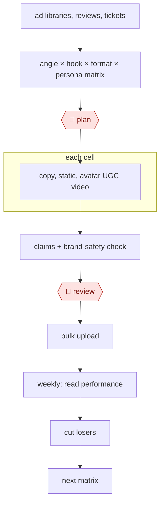

# Ad variant matrix

`COM › MKT › ADS` · checkpointed · evidence B · **draft: needs a reference example** ([how to add one](../../../../../CONTRIBUTING.md#1-add-an-example-run))

**Shape:** `ad libraries, reviews, tickets → angle × hook × format × persona matrix → 🛑 plan → each cell: copy, static, avatar UGC video → claims + brand-safety check → 🛑 review → bulk upload → weekly: read performance → cut losers → next matrix`

<!-- shape diagram: generated by scripts/build_diagrams.py from `shape`; don't edit -->

<!-- end shape diagram -->

## Steps
1. Mine buyer language from customer reviews, forum posts and testimonials, and run a structured interview on the product and offer to produce a positioning brief. Claude can then roleplay the ideal customer to pressure-test messaging before any ads are written [[1]](#sources). Scripts built from real reviews use the words buyers use [[2]](#sources).
2. Build the matrix. Map 8–12 angles (pain, aspiration, social proof, objection handling) against audience segments [[1]](#sources). Order the axes by impact on Meta: concept, then format, then buyer persona, then publishing identity, then hook, then copy. Hook-only or copy-only swaps on one concept read as the same ad [[3]](#sources). A brand can sustain 3–5 persona tracks with 2–3 ads each [[3]](#sources).
3. 🛑 **Plan**: a marketer approves which cells run this week, sized to the hit rate. Around 5–7% of tested ads become winners, so plan 5–10 concepts a week with 2–3 variants each, and an 80/20 split of spend between proven winners and tests [[3]](#sources).
4. For each cell, generate copy (primary text, headlines and descriptions in UGC, long-form story and direct-response formats) and a creative brief with scene, talent direction and visual cues [[1]](#sources). Then make statics with an image model and avatar UGC video with tools such as Arcads, Argil, Creatify, HeyGen or Mirage Studio, varying scenes, camera angles and backgrounds rather than running a single static avatar shot [[1]](#sources) [[2]](#sources).
5. Check claims and brand safety: make sure scripts don't promise more than the product delivers, and put an upfront AI-generated disclaimer on every avatar ad, given FTC enforcement on undisclosed AI content [[2]](#sources).
6. 🛑 **Review**: a person filters AI output, typically 10–20 variations down to the 3–5 worth testing, and owns the brief and the final selection. Publishing AI output without review is the named failure mode [[3]](#sources).
7. Bulk upload, one ad set per test arm when comparing tools or concepts on the same offers, scripts and audiences [[2]](#sources). Tag each asset by concept, format, persona and publisher identity in a creative library [[3]](#sources).
8. Each week, read performance. A winner holds CPA at or below target for 7 days after the learning phase, with 1–2 conversions a day. Cut the rest, and promote winners with Meta's "Use Existing Post" so they keep their engagement [[3]](#sources). Scale a winning type with new avatars and scripts [[4]](#sources).
9. Plan the next matrix. Rotate scaling creatives when frequency passes 3.0, CPM rises more than 20% or CTR falls more than 15% (healthy accounts refresh every 7–14 days), and every 90 days feed the concept archetypes with the best win rates back into the brief template [[3]](#sources).

**Output:** A reviewed set of tagged ad variants live in ad sets, plus a weekly winners/losers readout and a creative library that seeds the next matrix.
**Failure modes → guards:** Uncanny or static single-scene avatars, which read as AI and fatigue fast → high-realism tools, plus scene and angle changes [[2]](#sources). Overpromising scripts that look good on ROAS but lead to returns and bad reviews later → a claims check before review [[2]](#sources). Undisclosed AI content → a mandatory disclaimer [[2]](#sources). Many hook variants on one persona that cap out within months → expand personas and concepts instead [[3]](#sources). Over-segmented campaigns that keep stalling in learning → fewer, broader campaigns [[3]](#sources). Duplicating winners, which resets social proof → "Use Existing Post" [[3]](#sources). Unreviewed AI output → the human review step [[3]](#sources). Not supported by the sources: competitor ad-library mining and support tickets as inputs. Neither documented run describes them.

## Public runs

Coverage as of 2026-11-06: **None found**: no public first-hand run yet. A real example run would be the first. From [Where are the real runs?](../../../../../research/2026-11-real-runs.md); every number was re-checked against its page.

- [Angad Singh, Segwise, on Curtis Howland's test](https://segwise.ai/blog/115k-ai-ugc-platform-test-findings.md) (2026-03-23). Five AI-avatar UGC tools on the same offers and audiences. "2.42x ROAS at a $70 CPA"; "$115k experiment". *First-hand: no (second-hand); confidence: low.*
- [Arcads, Teknasyon use case](https://www.arcads.ai/usecases/teknasyon) (2025-12-17). Bulk avatars to test angles, then scale the winners. "76% drop in Cost per Purchase and a 40% ROAS uplift". *First-hand: vendor; confidence: low.*

## Sources

1. Authority Hacker, *AI Meta Ads Generation* (workflow page, undated). https://www.authorityhacker.com/workflows/ai-meta-ads-generation/
2. Angad Singh (Segwise), *$115k AI UGC platform test findings* (on Curtis Howland's MisfitMarketing test), 2026-03-23. https://segwise.ai/blog/115k-ai-ugc-platform-test-findings.md
3. Opascope, *Meta Creative Testing: A Practical Framework for Variants, Budget, and Hit Rate*, 2026-07-17. https://opascope.com/insights/facebook-ads-creative-testing/
4. Arcads (vendor), *Teknasyon use case*, 2025-12-17. https://www.arcads.ai/usecases/teknasyon
