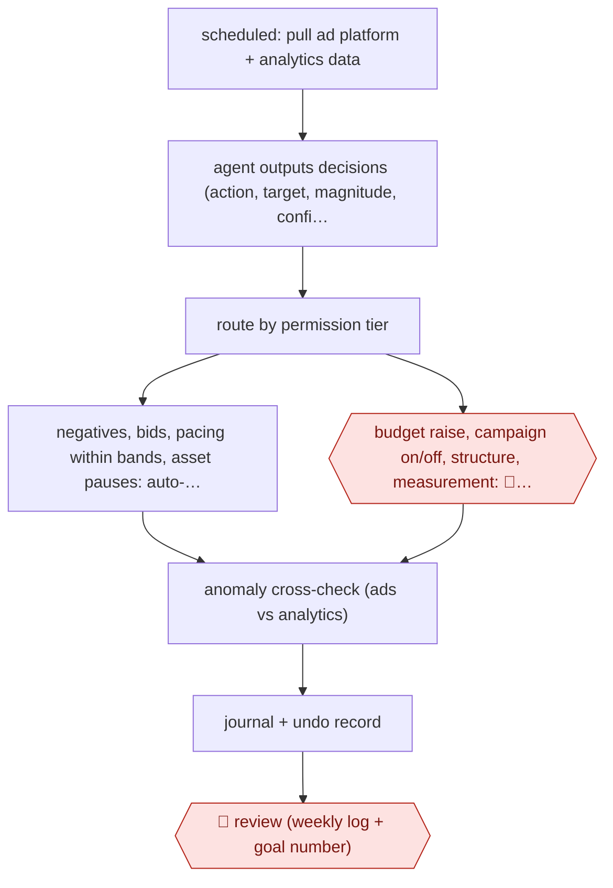

# Tiered-permission ads optimizer

`COM › MKT › ADS` · checkpointed · evidence A · **draft: needs a reference example** ([how to add one](../../../../../CONTRIBUTING.md#1-add-an-example-run))

**Shape:** `scheduled: pull ad platform + analytics data → agent outputs decisions (action, target, magnitude, confidence, reason) → route by permission tier → negatives, bids, pacing within bands, asset pauses: auto-execute + log with prior state | budget raise, campaign on/off, structure, measurement: 🛑 action → anomaly cross-check (ads vs analytics) → journal + undo record → 🛑 review (weekly log + goal number)`
**Variants:** `google-ads-api` · `ga4` · `claude-code` · `n8n` · `github-issues`

<!-- shape diagram: generated by scripts/build_diagrams.py from `shape`; don't edit -->

<!-- end shape diagram -->

## Background

Companies that pay for search ads (the ads Google shows above results when someone types a query) keep an account of campaigns, each with a budget, the amounts it will bid for a click, and lists of words it does and does not want to appear for. A paid-search specialist looks at the account every day or week: which search phrases brought wasted clicks, which ads are tiring, whether spend is on pace, and whether the sales data in the analytics tool agrees with the ad platform's own count. Most of this is small, repeated adjustment, and it is skipped when people are busy. The agent runs on a schedule, reads both data sources and makes the small reversible changes itself, logging how to undo each. A person still decides anything that raises total spend, switches a campaign on or off, restructures the account or changes how sales are counted, because those decisions move real money and a wrong one is hard to spot.

**Terms:**
- **Negative keyword**: a word or phrase added to an account so ads stop showing for searches containing it.
- **Bid, pacing**: the amount offered for a click; and whether a budget is being spent evenly across the period.
- **Band**: a preset range within which the agent may change a bid or a daily budget without asking.
- **Conversion, measurement**: a recorded sale or sign-up, and the tracking setup that counts them. A fault in tracking can make a good campaign look broken.
- **GA4**: Google's web analytics tool, used here as a second count to check the ad platform against.
- **SQL (sales-qualified lead)**: a sign-up the sales team accepts as worth pursuing; one source sets its goal as dollars per SQL.
- **Sprint, pass**: in one source, a sprint is a written work item with a goal, a deadline and a list of things the agent may change; a pass is one run of the agent against it.
- **Audit journal**: the running record of every change, the reason for it and how to reverse it.

## Build it with an agent

**Form:** `service`. A scheduled job starts each run with nobody present, and people see only the approval queue and the weekly log.

**You need:** read access to the ad platform's reporting and to the analytics data, through one small script per system or through MCP connectors; a second set of scripts that can make only the allowed low-risk changes (add a negative keyword, move a bid or budget inside its band, pause an ad or asset), each saving the prior state; the goal number, the bands and the name of the person who says yes, kept in a reference file; a store for the journal and the pending decisions (a repository or a database table); API access to the ad account that the platform has approved for live accounts. Give the agent no script that raises the total budget, switches a campaign, restructures the account or edits conversion settings.

| Step | Built as |
|---|---|
| scheduled: pull ad platform + analytics data | A cloud scheduled task, or your own scheduler starting `claude -p` or an Agent SDK program. Read-only scripts or MCP connectors return the data as structured rows. |
| agent outputs decisions → route by permission tier | The skill's instruction: read the rules file and the open items, then write one decision per line in a fixed format (action, target, magnitude, confidence, reason). A script assigns each action its tier from a table. |
| negatives, bids, pacing within bands, asset pauses: auto-execute + log with prior state | The scoped mutation scripts. Each writes the prior state to the journal before it changes anything, and refuses a change outside its band. |
| budget raise, campaign on/off, structure, measurement: 🛑 action | See Checkpoints. |
| anomaly cross-check (ads vs analytics) | A subagent, or a script, compares conversions in the ad platform with the analytics tool and holds any decision that rests on a gap between them. |
| journal + undo record → 🛑 review | The skill's last step writes the run to the journal and an undo script per change; a weekly run summarises the journal against the goal number. |

**Checkpoints:** `action`: the agent has no tool for the four gated kinds of change. It writes each as a pending item with its reason, and the run ends; a person says yes in the queue, and silence is no. The limits on what runs without a person (the bands, the list of allowed action types) belong in the mutation scripts or in a `PreToolUse` hook, where they cannot be skipped, and not in the skill's text. `review`: the weekly run posts the change log and the goal-number table to the person named in the rules file, who reads them and resets the numbers.

**Since the sources:** Sources date from 2026-08 to 2026-10. Source 1 used Claude Code as the reasoning step with n8n for scheduling and approval gates, and source 2 used an hourly script that wakes the agent only when a sprint is due or a limit breaks; a cloud scheduled task (research preview as of 2026-11) or `claude -p` can now supply the schedule without either. The sources are two practitioners' own accounts of running the method on their own accounts; this build is a design that follows them and has not been run. Source 1 says its evaluation harness, which replays past account states against the agent's decisions, should have been built first; this build does not include one. Source 1 also says the approach is hard to justify on accounts with little conversion volume.

*A design based on this entry's steps and the tool documentation as of 2026-11, not a reported run.*

## Steps

*As reported by the sources.*

1. A human sets the goal number (e.g. dollars per sales-qualified lead) and the spending limits, and names the person who says 'yes' [[2]](#sources).
2. A scheduled job (every morning, or an hourly watch script that wakes the agent only when a sprint is due or a limit breaks) gives the agent ad-platform and analytics data as typed tools [[1]](#sources)[[2]](#sources).
3. The agent reads the rules and open work, then outputs decisions in a fixed machine-parseable format with a plain-language reason for each [[1]](#sources)[[2]](#sources).
4. The agent makes low-risk, reversible changes without approval: search-term negatives, bids and pacing within preset bands, ad/asset pauses. Each change is logged with its prior state so it can be undone in one step [[1]](#sources)[[2]](#sources).
5. 🛑 **Action**: a person must give an explicit yes before the agent raises the total budget, turns campaigns on or off, makes structural or measurement/conversion changes, or touches brand messaging. Silence counts as no [[1]](#sources)[[2]](#sources).
6. The agent checks ad-platform signals against analytics and queues any decision that looks like it rests on a tracking glitch [[1]](#sources).
7. 🛑 **Review**: each week the person reviews the change log and journal, and rebuilds the goal-number table [[1]](#sources)[[2]](#sources).

**Output:** Live ad-account changes with a full audit journal and undo scripts; a weekly goal-number report and a queue of decisions awaiting approval.
**Failure modes → guards:** A conversion-tracking glitch makes the best campaign look broken and the agent proposes a sharp budget cut → Ads-vs-GA4 anomaly check queues it, and measurement changes stay permanently human [[1]](#sources). Scope creep in the task frame → a sprint never grants budget raises or campaign switches [[2]](#sources).
**How it differs:** AWF-0019 Ad variant matrix: that produces creative variants for review and bulk upload. This one manages the live account (bids, budgets, negatives), executing low-risk changes without per-item approval and gating spend and structure. The deliverable is account changes, not creative; the autonomy split is per-action permission tiers.

## Public runs

Coverage as of 2026-11-06: **Strong**: a first-hand, detailed run that matches most of the shape. Collected and re-checked in [Second collection pass](../../../../../research/2026-11-second-pass.md).

- [Hammad Yousuf, SARA](https://withhammad.com/blog/how-i-built-an-autonomous-google-ads-optimization-system-sara) (2026-08-09). Production agent with three permission tiers; a tracking-glitch budget cut was caught by the gate. "weekly optimization went from 9 hours to 2, with +18% ROAS QoQ". *First-hand: yes; confidence: high.*
- [Anton Patrai, AI agent for Google Ads](https://apatrai.com/posts/how-to-set-up-an-ai-agent-for-google-ads) (2026-10-21). B2B software company, Sep–Oct 2026; sprints as GitHub issues, journal of every pass. "$273 spent on 77 people from ads, one SQL, 19 passes that moved a sprint and 41 that recorded why nothing moved". *First-hand: anon (company not named); confidence: high.*

## Sources

1. Hammad Yousuf, How I built an autonomous Google Ads optimization system (SARA), 2026-08-09. https://withhammad.com/blog/how-i-built-an-autonomous-google-ads-optimization-system-sara
2. Anton Patrai, How to set up an AI agent that runs your Google Ads, 2026-10-21. https://apatrai.com/posts/how-to-set-up-an-ai-agent-for-google-ads
