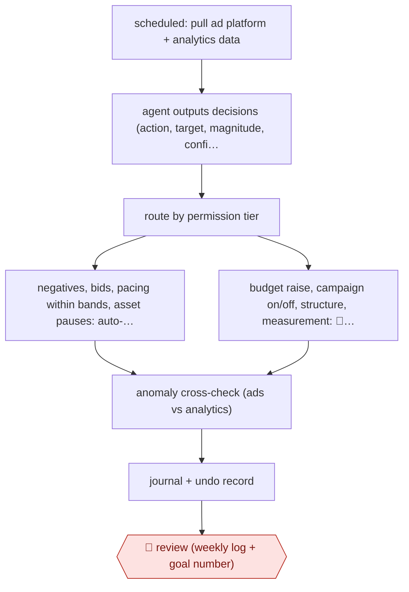

# Tiered-permission ads optimizer

`COM › MKT › ADS` · checkpointed · evidence A · **draft: needs a reference example** ([how to add one](../../../../../CONTRIBUTING.md#1-add-an-example-run))

**Shape:** `scheduled: pull ad platform + analytics data → agent outputs decisions (action, target, magnitude, confidence, reason) → route by permission tier → negatives, bids, pacing within bands, asset pauses: auto-execute + log with prior state | budget raise, campaign on/off, structure, measurement: 🛑 action → anomaly cross-check (ads vs analytics) → journal + undo record → 🛑 review (weekly log + goal number)`
**How it differs:** AWF-0019 Ad variant matrix: that produces creative variants for review and bulk upload. This one manages the live account (bids, budgets, negatives), executing low-risk changes without per-item approval and gating spend and structure. The deliverable is account changes, not creative; the autonomy split is per-action permission tiers.
**Variants:** `google-ads-api` · `ga4` · `claude-code` · `n8n` · `github-issues`

<!-- shape diagram: generated by scripts/build_diagrams.py from `shape`; don't edit -->

<!-- end shape diagram -->

## Steps
1. A human sets the goal number (e.g. dollars per sales-qualified lead) and the spending limits, and names the person who says 'yes' [[2]](#sources).
2. On a schedule (every morning, or an hourly watch script that wakes the agent only when a sprint is due or a limit breaks), pull ad-platform and analytics data as typed tools [[1]](#sources)[[2]](#sources).
3. The agent reads the rules and open work, then outputs decisions in a fixed machine-parseable format with a plain-language reason for each [[1]](#sources)[[2]](#sources).
4. Low-risk, reversible changes run without approval: search-term negatives, bids and pacing within preset bands, ad/asset pauses. Each mutation is logged with its prior state so it can be undone in one step [[1]](#sources)[[2]](#sources).
5. 🛑 **Action**: raising the total budget, turning campaigns on or off, structural changes, measurement/conversion changes and brand messaging need an explicit human yes. Silence counts as no [[1]](#sources)[[2]](#sources).
6. An anomaly check compares ad-platform and analytics signals and queues any decision that looks like it rests on a tracking glitch [[1]](#sources).
7. 🛑 **Review**: each week the human reviews the change log and journal, and rebuilds the goal-number table [[1]](#sources)[[2]](#sources).

**Output:** Live ad-account changes with a full audit journal and undo scripts; a weekly goal-number report and a queue of decisions awaiting approval.
**Failure modes → guards:** A conversion-tracking glitch makes the best campaign look broken and the agent proposes a sharp budget cut → Ads-vs-GA4 anomaly check queues it, and measurement changes stay permanently human [[1]](#sources). Scope creep in the task frame → a sprint never grants budget raises or campaign switches [[2]](#sources).

## Public runs

Coverage as of 2026-11-06: **Strong**: a first-hand, detailed run that matches most of the shape. Collected and re-checked in [Second collection pass](../../../../../research/2026-11-second-pass.md).

- [Hammad Yousuf, SARA](https://withhammad.com/blog/how-i-built-an-autonomous-google-ads-optimization-system-sara) (2026-08-09). Production agent with three permission tiers; a tracking-glitch budget cut was caught by the gate. "weekly optimization went from 9 hours to 2, with +18% ROAS QoQ". *First-hand: yes; confidence: high.*
- [Anton Patrai, AI agent for Google Ads](https://apatrai.com/posts/how-to-set-up-an-ai-agent-for-google-ads) (2026-10-21). B2B software company, Sep–Oct 2026; sprints as GitHub issues, journal of every pass. "$273 spent on 77 people from ads, one SQL, 19 passes that moved a sprint and 41 that recorded why nothing moved". *First-hand: anon (company not named); confidence: high.*

## Sources

1. Hammad Yousuf, How I built an autonomous Google Ads optimization system (SARA), 2026-08-09. https://withhammad.com/blog/how-i-built-an-autonomous-google-ads-optimization-system-sara
2. Anton Patrai, How to set up an AI agent that runs your Google Ads, 2026-10-21. https://apatrai.com/posts/how-to-set-up-an-ai-agent-for-google-ads
