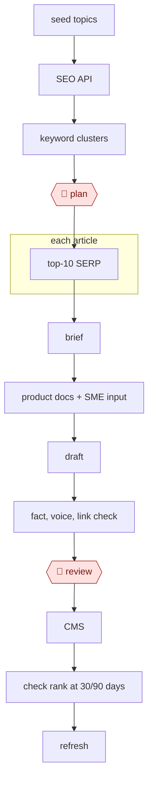

# Cluster-brief-draft content

`COM › MKT › CONTENT` · checkpointed · evidence A · **draft: needs a reference example** ([how to add one](../../../../../CONTRIBUTING.md#1-add-an-example-run))

**Shape:** `seed topics → SEO API → keyword clusters → 🛑 plan → each article: top-10 SERP → brief → product docs + SME input → draft → fact, voice, link check → 🛑 review → CMS → check rank at 30/90 days → refresh`
**Constraint:** Google's March 2024 "scaled content abuse" policy targets mass-generated pages made mainly to rank, without adding value, whether automated or not [[19]](#sources). That's why the SME-input step and editor review are part of this species, not optional.

<!-- shape diagram: generated by scripts/build_diagrams.py from `shape`; don't edit -->

<!-- end shape diagram -->

## Steps
1. Pull seed topics and search data. One run calls the Google Search Console API through an MCP server (`mcp-server-gsc`) from Claude Code and saves the raw JSON to disk [[20]](#sources). Another feeds target keywords to SEO tools (Semrush ContentShake, Also Asked) and has an AI group large keyword lists by intent [[21]](#sources).
2. Build keyword clusters and a page plan. A script computes deltas and maps queries to pages, and a separate agent reads unmatched queries to flag gaps that need new pages [[20]](#sources).
3. 🛑 **Plan**: an editor approves which clusters and pages get written or changed. Only what adds value beyond ranking goes ahead, per Google's scaled-content policy [[19]](#sources).
4. For each article, study the top-ranking results and write a brief: target keywords, the questions users ask, competitor angles and word-count guidance. A detailed brief produces much better drafts than a bare topic prompt [[21]](#sources).
5. Add product docs and SME input: proprietary examples, client outcomes, original figures [[21]](#sources). Draft in a general LLM (Claude or ChatGPT) with the brief as context, treating the result as raw material [[21]](#sources).
6. Check facts, voice and links. Verify every claim against primary sources, strip stock AI phrasing, score term coverage against top pages (Surfer, Clearscope) without stuffing keywords, match the format to search intent, and add AI-suggested internal links [[21]](#sources).
7. 🛑 **Review**: an editor reviews the draft before it is published. In FutureSearch's loop, proposed changes arrive as a PR with a report, and a non-technical team member spends about 20 minutes choosing which to apply. Nothing applies automatically [[20]](#sources).
8. Publish to the CMS with generated metadata [[21]](#sources).
9. Check ranks at 30 and 90 days and refresh. Log each change to a per-page `experiment_history` with before/after data and an outcome (improved, flat or regressed), and have the next run read that history before proposing new changes [[20]](#sources).

**Output:** Published, editor-approved articles in the CMS, plus a per-page experiment log that drives the next refresh cycle.
**Failure modes → guards:** Invented facts, such as a nonexistent Ethereum upgrade or features credited to the wrong chain → mandatory fact-checks against primary sources or an expert [[21]](#sources). Pages rank, then drop when engagement exposes an intent mismatch → choose the format from search intent [[21]](#sources). Generic pages that blend into competitors, or mass pages made mainly to rank → SME input and original data [[19]](#sources) [[21]](#sources). Keyword stuffing from aggressive tool suggestions → natural coverage and a readability check [[21]](#sources). Formulaic titles across the site → rotate title formats [[20]](#sources). Agents changing live pages unreviewed → changes go through a PR that a person applies [[20]](#sources).

## Public runs

Coverage as of 2026-11-06: **Partial**: first-hand runs that cover part of the shape or put checkpoints elsewhere. From [Where are the real runs?](../../../../../research/2026-11-real-runs.md); every number was re-checked against its page.

- [Daniel Hnyk, FutureSearch](https://futuresearch.ai/blog/self-optimizing-seo-pipeline/) (2026-03-18). Search Console → per-page analyzer agents → PR; a person picks which changes to make. "69 changes proposed"; "The human spends 20 minutes deciding". *First-hand: yes; confidence: high.*
- [Victoria Olsina, *AI for SEO Content: 6-Month Test*](https://victoriaolsina.com/blog/ai-seo-content/) (2025-12-26). Brief → AI draft → founder input → human edit and fact-check. "from 2-3 to 8-10 long-form articles monthly". *First-hand: yes (site not named); confidence: med.*
- [The SEO Agent Team](https://www.theseoagent.ai/blog/ai-seo-case-study) (updated 2026-09-19). Keyword queue → 8 clusters → drafts → checks → published with no human gate stated. "61 new pages in roughly fifteen weeks". *First-hand: vendor (own site); confidence: med.*

## Sources

19. Google Search Central, *March 2024 core update and new spam policies*. https://developers.google.com/search/blog/2024/03/core-update-spam-policies
20. Daniel Hnyk (FutureSearch), *Self-optimizing SEO pipeline*, 2026-03-18. https://futuresearch.ai/blog/self-optimizing-seo-pipeline/
21. Victoria Olsina, *AI for SEO Content: 6-Month Test*, 2025-12-26. https://victoriaolsina.com/blog/ai-seo-content/
