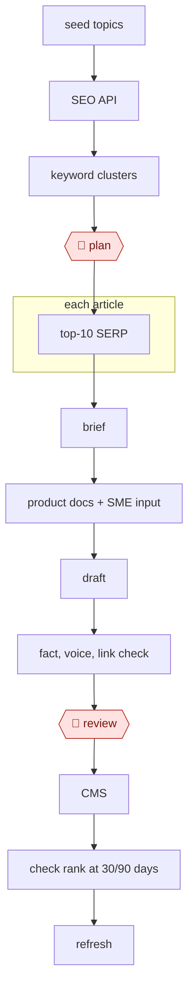

# Cluster-brief-draft content

`COM › MKT › CONTENT` · checkpointed · evidence A · **draft: needs a reference example** ([how to add one](../../../../../CONTRIBUTING.md#1-add-an-example-run))

**Shape:** `seed topics → SEO API → keyword clusters → 🛑 plan → each article: top-10 SERP → brief → product docs + SME input → draft → fact, voice, link check → 🛑 review → CMS → check rank at 30/90 days → refresh`
**Constraint:** Google's March 2024 "scaled content abuse" policy targets mass-generated pages made mainly to rank, without adding value, whether automated or not [[19]](#sources). That's why the SME-input step and editor review are part of this species, not optional.

<!-- shape diagram: generated by scripts/build_diagrams.py from `shape`; don't edit -->

<!-- end shape diagram -->

## Background

Many companies publish articles on their own website so that people searching for a topic find them, a practice called search engine optimisation (SEO). A content marketer picks which topics to cover by looking at what people search for, groups related searches so that one article answers each group, studies what the pages already ranking first say, writes a brief for the article, gets facts and examples from someone who knows the product, and publishes it. Weeks later they check whether the page rose in the rankings and rework it if not. By hand this is slow, and the shortcut of generating many pages from keywords alone is exactly what Google's spam policy targets. The agent does the grouping, the competitor reading, the briefs, the drafts and the checks. A person still approves which topics are written, because pages made only to rank can be penalised, and an editor reviews each article before it is published, because the company stands behind every claim on its site.

**Terms:**
- **SEO**: shaping a website's pages so search engines show them for relevant searches.
- **Search Console**: Google's free tool that shows a site's owner which searches brought people to which pages.
- **Keyword cluster**: a group of related searches that one page can answer.
- **SERP (search engine results page)**: the list of results for a search; "top-10" means the ten pages ranking first.
- **Search intent**: what the searcher wants (an answer, a comparison, a product to buy), which decides what kind of page ranks.
- **Brief**: the instructions for one article: target keywords, the questions readers ask, what competitors cover, length.
- **SME (subject-matter expert)**: someone inside or close to the company who knows the product and can supply real examples and figures.
- **Term coverage**: how fully an article uses the words and topics that the top-ranking pages use, scored by tools such as Surfer or Clearscope.
- **Internal links**: links from one page of the site to another.
- **CMS**: the content management system in which the site's pages are edited and published.
- **PR (pull request)**: a proposed change published for review before it is applied.
- **Scaled content abuse**: Google's name for mass-producing pages mainly to rank, without helping readers.

## Build it with an agent

**Form:** `skill`. An editor works through one set of topics in the conversation: the plan is approved once, and each article's brief, draft and checks run for the editor to read before anything is published.

**You need:** access to search data, either Search Console through an MCP connector or an SEO tool's export; the product documentation and any SME notes, interviews or original figures as files; the site's voice guide and a list of approved internal-link targets, as reference files beside the skill; a place to keep a per-page log of changes and rank checks. The agent has no publish access to the CMS.

| Step | Built as |
|---|---|
| seed topics → SEO API → keyword clusters | The skill pulls search data through the connector or reads an export, and writes the clusters and the page plan to a file. |
| 🛑 plan | See Checkpoints. |
| each article: top-10 SERP → brief | Built-in subagents, one per approved article, read the top-ranking pages and return a brief. |
| product docs + SME input → draft | The main conversation drafts from the brief, the product docs and the SME material. The skill stops and asks the editor where SME input is missing. |
| fact, voice, link check | A subagent that has not seen the drafting checks each claim against the sources, the draft against the voice guide, and the links against the approved list. |
| 🛑 review → CMS | See Checkpoints. |
| check rank at 30/90 days → refresh | A later session of the same skill reads Search Console and the per-page log, then proposes changes with before and after figures. |

**Checkpoints:** `plan`: the skill writes the cluster and page plan to a file and stops. It drafts only the pages the editor marks as approved, and the plan notes why each adds value beyond ranking. `review`: the skill stops after presenting the draft and the check results. The agent has no tool that publishes to the CMS, so an editor publishes, and a refresh change reaches a live page only when a person applies it.

**Since the sources:** Sources date from 2025-12 to 2026-09; the Google policy page dates from 2024-03 and is not a run. Source 20 (FutureSearch) ran its refresh loop as a scheduled job with proposed changes as a pull request. The same loop can run as a cloud scheduled task (research preview as of 2026-11), but this build keeps the whole workflow in one session for an editor. Source 21 (Olsina) describes a person using AI tools for brief, draft and edit with no agent running the process, and one public run (The SEO Agent Team) states no human gate; this build adds the stops the entry's steps call for. The build contains no step that selects keywords by tool score alone.

*A design based on this entry's steps and the tool documentation as of 2026-11, not a reported run.*

## Steps

*As reported by the sources.*

1. The agent pulls seed topics and search data. One run calls the Google Search Console API through an MCP server (`mcp-server-gsc`) from Claude Code and saves the raw JSON to disk [[20]](#sources). Another feeds target keywords to SEO tools (Semrush ContentShake, Also Asked) and has an AI group large keyword lists by intent [[21]](#sources).
2. The agent builds keyword clusters and a page plan. A script computes deltas and maps queries to pages, and a separate agent reads unmatched queries to flag gaps that need new pages [[20]](#sources).
3. 🛑 **Plan**: an editor approves which clusters and pages get written or changed. Only what adds value beyond ranking goes ahead, per Google's scaled-content policy [[19]](#sources).
4. For each article, the agent studies the top-ranking results and writes a brief: target keywords, the questions users ask, competitor angles and word-count guidance. A detailed brief produces much better drafts than a bare topic prompt [[21]](#sources).
5. The agent adds product docs and SME input (proprietary examples, client outcomes, original figures) [[21]](#sources). It drafts in a general LLM (Claude or ChatGPT) with the brief as context, treating the result as raw material [[21]](#sources).
6. The agent and the editor check facts, voice and links. Every claim is verified against primary sources, stock AI phrasing is stripped, term coverage is scored against top pages (Surfer, Clearscope) without stuffing keywords, the format is matched to search intent, and AI-suggested internal links are added [[21]](#sources).
7. 🛑 **Review**: an editor reviews the draft before it is published. In FutureSearch's loop, proposed changes arrive as a PR with a report, and a non-technical team member spends about 20 minutes choosing which to apply. Nothing applies automatically [[20]](#sources).
8. The team publishes to the CMS with generated metadata [[21]](#sources).
9. The agent checks ranks at 30 and 90 days and refreshes the page. It logs each change to a per-page `experiment_history` with before/after data and an outcome (improved, flat or regressed), and the next run reads that history before proposing new changes [[20]](#sources).

**Output:** Published, editor-approved articles in the CMS, plus a per-page experiment log that drives the next refresh cycle.
**Failure modes → guards:** Invented facts, such as a nonexistent Ethereum upgrade or features credited to the wrong chain → mandatory fact-checks against primary sources or an expert [[21]](#sources). Pages rank, then drop when engagement exposes an intent mismatch → choose the format from search intent [[21]](#sources). Generic pages that blend into competitors, or mass pages made mainly to rank → SME input and original data [[19]](#sources) [[21]](#sources). Keyword stuffing from aggressive tool suggestions → natural coverage and a readability check [[21]](#sources). Formulaic titles across the site → rotate title formats [[20]](#sources). Agents changing live pages unreviewed → changes go through a PR that a person applies [[20]](#sources).

## Public runs

Coverage as of 2026-11-06: **Partial**: first-hand runs that cover part of the shape or put checkpoints elsewhere. From [Where are the real runs?](../../../../../research/2026-11-real-runs.md); every number was re-checked against its page.

- [Daniel Hnyk, FutureSearch](https://futuresearch.ai/blog/self-optimizing-seo-pipeline/) (2026-03-18). Search Console → per-page analyzer agents → PR; a person picks which changes to make. "69 changes proposed"; "The human spends 20 minutes deciding". *First-hand: yes; confidence: high.*
- [Victoria Olsina, *AI for SEO Content: 6-Month Test*](https://victoriaolsina.com/blog/ai-seo-content/) (2025-12-26). Brief → AI draft → founder input → human edit and fact-check. "from 2-3 to 8-10 long-form articles monthly". *First-hand: yes (site not named); confidence: med.*
- [The SEO Agent Team](https://www.theseoagent.ai/blog/ai-seo-case-study) (updated 2026-09-19). Keyword queue → 8 clusters → drafts → checks → published with no human gate stated. "61 new pages in roughly fifteen weeks". *First-hand: vendor (own site); confidence: med.*

## Sources

19. Google Search Central, *March 2024 core update and new spam policies*. https://developers.google.com/search/blog/2024/03/core-update-spam-policies
20. Daniel Hnyk (FutureSearch), *Self-optimizing SEO pipeline*, 2026-03-18. https://futuresearch.ai/blog/self-optimizing-seo-pipeline/
21. Victoria Olsina, *AI for SEO Content: 6-Month Test*, 2025-12-26. https://victoriaolsina.com/blog/ai-seo-content/
