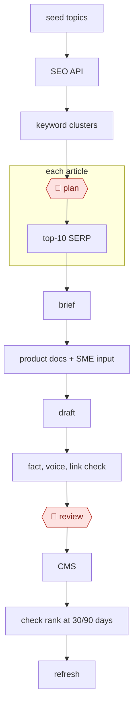

# Cluster-brief-draft content

`COM › MKT › CONTENT` · checkpointed · evidence A · **draft: needs a reference example** ([how to add one](../../../../../CONTRIBUTING.md#1-add-an-example-run))

**Shape:** `seed topics → SEO API → keyword clusters → 🛑 plan → each article: top-10 SERP → brief → product docs + SME input → draft → fact, voice, link check → 🛑 review → CMS → check rank at 30/90 days → refresh`
**Constraint:** Google's March 2024 "scaled content abuse" policy targets mass-generated pages made mainly to rank, without adding value, whether automated or not [[19]](#sources). That's why the SME-input step and editor review are part of this species, not optional.

<!-- shape diagram: generated by scripts/build_diagrams.py from `shape`; don't edit -->

<!-- end shape diagram -->

## Public runs

Coverage as of 2026-11-06: **Partial**: first-hand runs that cover part of the shape or put checkpoints elsewhere. From [Where are the real runs?](../../../../../research/2026-11-real-runs.md); every number was re-checked against its page.

- [Daniel Hnyk, FutureSearch](https://futuresearch.ai/blog/self-optimizing-seo-pipeline/) (2026-03-18). Search Console → per-page analyzer agents → PR; a person picks which changes to make. "69 changes proposed"; "The human spends 20 minutes deciding". *First-hand: yes; confidence: high.*
- [Victoria Olsina, *AI for SEO Content: 6-Month Test*](https://victoriaolsina.com/blog/ai-seo-content/) (2025-12-26). Brief → AI draft → founder input → human edit and fact-check. "from 2-3 to 8-10 long-form articles monthly". *First-hand: yes (site not named); confidence: med.*
- [The SEO Agent Team](https://www.theseoagent.ai/blog/ai-seo-case-study) (updated 2026-09-19). Keyword queue → 8 clusters → drafts → checks → published with no human gate stated. "61 new pages in roughly fifteen weeks". *First-hand: vendor (own site); confidence: med.*

## Sources

19. Google Search Central, *March 2024 core update and new spam policies*. https://developers.google.com/search/blog/2024/03/core-update-spam-policies
