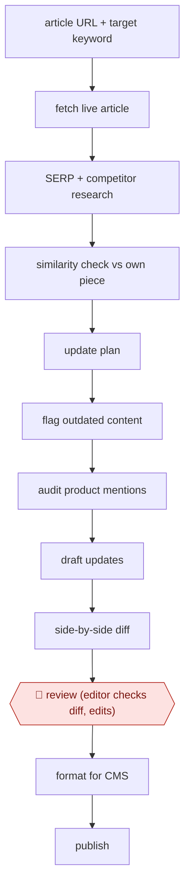

# Diffed article refresh

`COM › MKT › CONTENT` · checkpointed · evidence A · **draft: needs a reference example** ([how to add one](../../../../../CONTRIBUTING.md#1-add-an-example-run))

**Shape:** `article URL + target keyword → fetch live article → SERP + competitor research → similarity check vs own piece → update plan → flag outdated content → audit product mentions → draft updates → side-by-side diff → 🛑 review (editor checks diff, edits) → format for CMS → publish`
**Variants:** `claude-code` · `n8n` · `rag`

<!-- shape diagram: generated by scripts/build_diagrams.py from `shape`; don't edit -->

<!-- end shape diagram -->

## Background

A company blog accumulates hundreds or thousands of articles, and over time they go stale: a product gains features, competitors publish better pages, the search results change and the article slips down. A content editor or SEO specialist (search engine optimisation: making pages show up when people search) refreshes the worst ones. That means working out what is out of date, seeing what the pages now ranking first cover, and rewriting the article in its original voice without breaking what still works. Done by hand, it costs as much editor time as writing a new piece. The agent researches, drafts the updates and shows exactly what it changed. An editor still reads those changes against the original and publishes, because a fluent draft can describe features that do not exist, and the company is responsible for what its pages say.

**Terms:**
- **SERP (search engine results page)**: the list of results for a search; the research step reads the top-ranking pages on it.
- **Target keyword**: the search phrase the article is meant to rank for.
- **Semantic similarity check**: a comparison of how closely the meaning and topics of the article match those of the competing pages.
- **Style guide**: the company's written rules for voice, structure and wording.
- **Product mention audit**: checking each place the article describes the company's product against what the product actually does.
- **Diff**: a side-by-side view of the original and the new text with each change highlighted.
- **CMS**: the content management system in which the site's pages are edited and published.
- **Shortcodes, schema markup**: special tags inside a page that the CMS or search engines read, such as an embedded widget or structured data; an edit that damages them breaks the page.

## Build it with an agent

**Form:** `skill`. An editor refreshes one article at a time and stays in the conversation to read the diff, so one skill holding the procedure, the style guide and the past drafts is enough.

**You need:** the article's live URL and its target keyword; a way to fetch search results and competitor pages (an SEO tool's API or export, or the agent's own web access); the style guide and a few past approved drafts as reference files beside the skill; a current list of the product's real features; the site's internal links. The agent has no tool that publishes to the CMS.

| Step | Built as |
|---|---|
| article URL + target keyword → fetch live article | The skill fetches the page and saves it as a file. Every step saves its output to a file, so any step can be rerun. |
| SERP + competitor research → similarity check vs own piece | Built-in subagents read the top-ranking pages and return a summary of what they cover; the skill compares it with the article. |
| update plan → flag outdated content → audit product mentions | The main conversation writes the plan, listing stale passages and checking every product mention against the feature list. |
| draft updates | The main conversation drafts in the original voice from the style guide and past drafts, keeping links, shortcodes and markup untouched. |
| side-by-side diff | A script compares the original file with the draft and produces the highlighted view. |
| 🛑 review | See Checkpoints. |
| format for CMS → publish | The skill prepares CMS-ready text. A person publishes. |

**Checkpoints:** `review`: the skill stops after presenting the diff and the product-mention audit; the editor reads the diff against the original, edits, and only then publishes. The agent has no CMS publish tool, so nothing reaches the live site without the editor.

**Since the sources:** Sources date from 2026 (Kokoc, no month) and 2026-06 (Semrush). Source 1 first built this as an n8n workflow, where research worked and drafting did not, and moved to Claude Code with one skill per step; a single skill plus built-in subagents covers the same ground in this build. Source 2 describes a company-built agent that takes tasks from a shared spreadsheet on a schedule; that queue is not part of this build, which starts from one article an editor names. The sources' reports of time or cost saved are not repeated here.

*A design based on this entry's steps and the tool documentation as of 2026-11, not a reported run.*

## Steps

*As reported by the sources.*

1. The editor gives the agent the URL of an existing article and a target keyword [[1]](#sources). Kokoc's optimizer queues tasks in a shared Google Sheet that the agent picks up on a schedule [[2]](#sources).
2. The agent fetches the live article, researches the SERP and top competitors, and runs a semantic similarity check of the existing piece against competitors [[1]](#sources).
3. The agent synthesises an update plan, identifies outdated content and runs a product mention audit so the draft does not describe features that do not exist [[1]](#sources). Kokoc compares the article with an 'ideal structure' from top-ranking pages and prioritises fixes, choosing a minimal or a full rework based on current ranking [[2]](#sources).
4. The agent drafts the updates in the original voice using the style guide and past drafts; every skill saves its output to a file so any step can be rerun [[1]](#sources). Kokoc's agent also keeps internal links, shortcodes and schema markup and outputs CMS-ready HTML [[2]](#sources).
5. The agent generates a side-by-side comparison of original vs new draft with changes highlighted [[1]](#sources); Kokoc's agent logs what was changed for the editor [[2]](#sources).
6. 🛑 **Review**: the article goes through normal editorial review (review, revisions, editing, images); the editor uses the diff to catch fabrications against the original [[1]](#sources); Kokoc's editor does the final fact-check and verification before the layout person publishes [[2]](#sources).

**Output:** An updated version of an existing article plus a change diff, published to the CMS after editorial sign-off.
**Failure modes → guards:** Hallucinated product features in plausible detail → product-mention audit plus diff against the original makes them a one-minute catch [1]. Models changing code, inserts or format → constrained output and preserved blocks [2].
**How it differs:** Closest is AWF-0018 Cluster-brief-draft content, which plans keyword clusters and writes new articles from briefs (plan checkpoint + draft review) and only mentions refresh as a final loop. Here the input is an existing live article, the deliverable is a revision plus a diff, there is no plan checkpoint, and the editor's review is diff-based. AWF-0177 (live-commerce script) is unrelated.

## Public runs

Coverage as of 2026-11-13: **Strong**: a first-hand, detailed run that matches most of the shape. Collected and re-checked in [Fourth collection pass](../../../../../research/2026-11-fourth-pass.md).

- [Semrush, I rebuilt our content update pipeline in Claude Code](https://www.semrush.com/blog/how-i-rebuilt-our-content-update-pipeline/) (2026-06-25). Semrush's nine-skill refresh pipeline; editor caught a fabricated feature via the diff. "a reviewer can catch them and check in one minute instead of 20 minutes". *First-hand: yes; confidence: high.*
- [Kokoc.com, Как мы автоматизировали процесс обновления статей](https://kokoc.com/keysi/kak-my-avtomatizirovali-protsess-obnovleniya-statey-v-blog-s-pomoshchyu-rag-agenta/) (2026). Agency refreshed ~10% of its 1,200-article blog with an agent and editor check. "Затраты снизились на 80% — осталась только необходимая редакторская проверка.". *First-hand: yes; confidence: high.*

## Sources

1. Carlos Silva, Dana Nicole (Semrush), I rebuilt our content update pipeline in Claude Code. Here's why., 2026-06-25. https://www.semrush.com/blog/how-i-rebuilt-our-content-update-pipeline/
2. Svetlana Yashina, Elena Sorokina, Pavel Talakin (Kokoc.com), Как мы автоматизировали процесс обновления статей в блог с помощью RAG-агента, 2026. https://kokoc.com/keysi/kak-my-avtomatizirovali-protsess-obnovleniya-statey-v-blog-s-pomoshchyu-rag-agenta/
