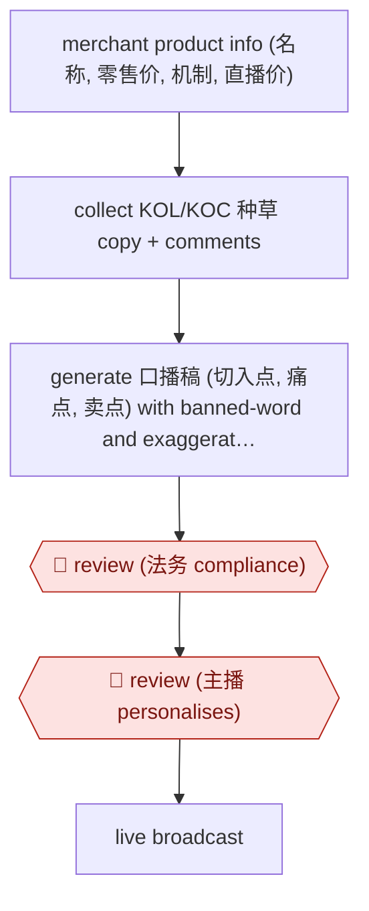

# Live-commerce 口播稿 drafting

`COM › MKT › CONTENT` · checkpointed · evidence B · **draft: needs a reference example** ([how to add one](../../../../../CONTRIBUTING.md#1-add-an-example-run))

**Shape:** `merchant product info (名称, 零售价, 机制, 直播价) → collect KOL/KOC 种草 copy + comments → generate 口播稿 (切入点, 痛点, 卖点) with banned-word and exaggeration filter → 🛑 review (法务 compliance) → 🛑 review (主播 personalises) → live broadcast`
**Variants:** `deepseek` · `doubao` · `douyin-jichuang`

<!-- shape diagram: generated by scripts/build_diagrams.py from `shape`; don't edit -->

<!-- end shape diagram -->

## Background

In Chinese live commerce (直播带货), a host (主播) sells products by speaking to a live audience on a platform such as Douyin, and for every product the host needs a spoken script (口播稿) to work from. A script opens with a reason to stop and listen, names the buyer's problem, then lists what the product offers, at a pace of 40-60 seconds per product. Writing one by hand means gathering the merchant's terms, reading what other people have written about the product and turning it into speech, over and over across a day's product list. The risk is in the wording: advertising law and platform rules forbid exaggerated or false claims and a list of banned words, so a script copied from web copy can break them. The agent drafts the scripts and filters banned wording. 法务 (the company's legal staff) still checks every script for compliance, because the company is liable for what is said on air, and the host adapts each script to their own style, because the host delivers it.

**Terms:**
- **口播稿 / 口播话术**: the spoken script for one product in a live session.
- **SKU**: one specific product variant that is sold and listed separately.
- **机制**: the promotion mechanics for the session, such as discounts, bundles or gifts; **零售价 / 直播价** are the normal price and the price during the live session.
- **种草**: posts or videos that recommend a product to create desire to buy it, literally "planting grass"; **小红书** is a Chinese social platform where many are posted.
- **KOL / KOC**: key opinion leaders, who have large followings, and key opinion consumers, who are ordinary customers with some influence.
- **切入点, 痛点, 卖点**: the three parts of a script: the opening angle, the buyer's problem, and the product's selling points.
- **敏感词 / 违规词**: words the platform or the advertising law bans or flags, such as absolute claims.
- **法务**: the company's legal staff.
- **主播**: the live-stream host.

## Build it with an agent

**Form:** `skill`. A team member prepares one session's product list in the conversation, so a single skill that writes each script and runs the filter is enough; the two reviews are people reading the output.

**You need:** the merchant's product sheet for each SKU (name, retail price, promotion mechanics, live price); 种草 copy and comments for the same products, exported or collected by a person from the platforms (follow each platform's terms); the banned-word and exaggeration list as a reference file, kept current with the platform's rules; a script template with the three parts. Give the agent no access to the live-stream tool.

| Step | Built as |
|---|---|
| merchant product info → collect KOL/KOC 种草 copy + comments | The skill reads the product sheet and the collected copy as files. |
| generate 口播稿 (切入点, 痛点, 卖点) with banned-word and exaggeration filter | The skill drafts one script per SKU in spoken Chinese from the template, using only facts in the product sheet. A script beside the skill matches each draft against the banned-word list, and the skill rewrites what it flags and lists it for the reviewers. |
| 🛑 review (法务 compliance) | See Checkpoints. |
| 🛑 review (主播 personalises) | See Checkpoints. |
| live broadcast | A person runs the session. The agent is not involved. |

**Checkpoints:** `review`, twice. First, the skill stops after listing every script with its filter results, and 法务 marks each one passed or returned; only passed scripts go on. Second, the 主播 edits the passed scripts into their own style. The agent has no tool that sends scripts to a live-stream system, so a script reaches the broadcast only because a person puts it there. The filter is a matcher, not a legal opinion, so it does not replace the first review.

**Since the sources:** Sources date from 2025-03 to 2025-04, so the newest is more than a year older than this check. Neither could be opened in this session, so what they report is taken from the entry text. They describe a team using general chat models (豆包, then DeepSeek, for a more spoken tone) with rules set in advance; no agent that runs the whole process is reported, and this build is a design for one. A 2026-05 report by Xinhua notes that live-commerce platforms are cracking down on AI-made imitations of public figures' likenesses and voices ([news.cn](https://www.news.cn/tech/20260514/404dcffbf8744e3f9592a3beecd6d13c/c.html)), so the compliance review should also confirm that no script borrows a real person's name, voice or image. No newer account of this exact script-drafting workflow was found as of 2026-11. The step that reuses the logic for short-video scripts after breaking down top-selling videos is not part of this build.

*A design based on this entry's steps and the tool documentation as of 2026-11, not a reported run.*

## Steps

*As reported by the sources.*

1. A team member enters the merchant's product information: 名称, 零售价, 机制, 直播价 [[1]](#sources).
2. The agent collects KOL/KOC introductions and comments on the same product from 种草 platforms such as 小红书 [[1]](#sources).
3. The team prompts the model to recombine product facts and collected copy into 口播话术: 切入点, 痛点, 卖点; rules set in advance filter 敏感词, 违规词 and exaggerated or false claims (about 40-60 seconds per script) [[1]](#sources).
4. 🛑 **Review**: 法务 checks each 口播稿 for compliance [[1]](#sources). (Separately, the same platform has AI pre-review merchant qualifications and brand authorisation and output structured review opinions [[2]](#sources).)
5. 🛑 **Review**: the 主播 adapts the script to their own style before going live [[1]](#sources).
6. The script goes into the live broadcast; the same logic is reused for short-video scripts by first breaking down top-selling videos [[1]](#sources).

**Output:** Compliance-checked 口播稿 per product, handed to the host for the live session.
**Failure modes → guards:** Copy too formal, not spoken → switched model (豆包 to DeepSeek) for more colloquial output [1]. Web copy pollutes scripts with violations or exaggeration → rule filter plus 法务 review [1].
**How it differs:** Nearest is AWF-0018 Cluster-brief-draft content: that produces SEO articles with rank tracking. This produces spoken live-commerce scripts per SKU from merchant terms and 种草 copy, with legal compliance review and host personalisation as the checkpoints. Different deliverable and checkpoints.

## Public runs

Coverage as of 2026-11-13: **Weak**: only anonymous, vendor-linked or journalist-told accounts. Collected and re-checked in [Third collection pass](../../../../../research/2026-11-third-pass.md).

- [新榜 / 虎嗅, interview with 交个朋友 VP 刘亚平](https://www.huxiu.com/article/4263055.html) (2025-04-21). AI 口播稿 embedded in 交个朋友's live workflow; 法务 review then host edits. "成功将单条口播稿的时间从人工的20～40分钟缩短至2分钟，单人力单日输出量也从20条提升至100+条". *First-hand: interview; confidence: high.*

## Sources

1. 新榜 / 虎嗅, AI的可用性到什么程度了？我们和几位一线内容从业者聊了聊 (interview with 交个朋友副总裁 刘亚平), 2025-04-21. https://www.huxiu.com/article/4263055.html
2. 银柿财经 / 财闻网, DeepSeek“帮忙”直播带货，交个朋友单日销售额破3.3亿大关, 2025-03-11. https://www.yinsfinance.com/article/1370951.shtml
