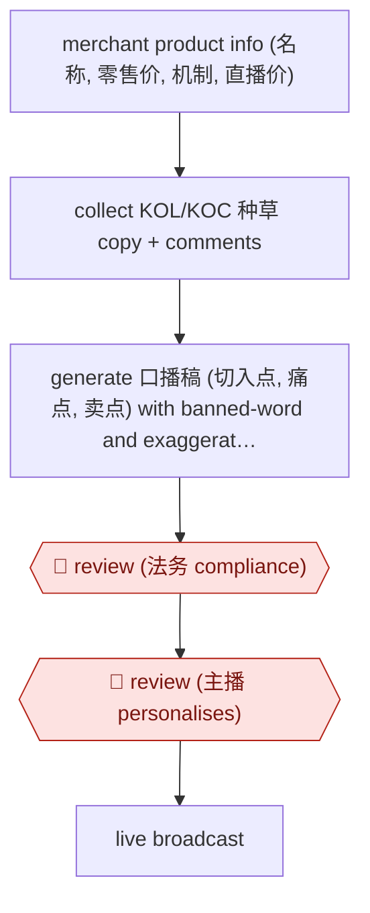

# Live-commerce 口播稿 drafting

`COM › MKT › CONTENT` · checkpointed · evidence B · **draft: needs a reference example** ([how to add one](../../../../../CONTRIBUTING.md#1-add-an-example-run))

**Shape:** `merchant product info (名称, 零售价, 机制, 直播价) → collect KOL/KOC 种草 copy + comments → generate 口播稿 (切入点, 痛点, 卖点) with banned-word and exaggeration filter → 🛑 review (法务 compliance) → 🛑 review (主播 personalises) → live broadcast`
**How it differs:** Nearest is AWF-0018 Cluster-brief-draft content: that produces SEO articles with rank tracking. This produces spoken live-commerce scripts per SKU from merchant terms and 种草 copy, with legal compliance review and host personalisation as the checkpoints. Different deliverable and checkpoints.
**Variants:** `deepseek` · `doubao` · `douyin-jichuang`

<!-- shape diagram: generated by scripts/build_diagrams.py from `shape`; don't edit -->

<!-- end shape diagram -->

## Steps
1. Enter the merchant's product information: 名称, 零售价, 机制, 直播价 [[1]](#sources).
2. Have the agent collect KOL/KOC introductions and comments on the same product from 种草 platforms such as 小红书 [[1]](#sources).
3. Prompt the model to recombine product facts and collected copy into 口播话术: 切入点, 痛点, 卖点; rules set in advance filter 敏感词, 违规词 and exaggerated or false claims (about 40-60 seconds per script) [[1]](#sources).
4. 🛑 **Review**: 法务 checks each 口播稿 for compliance [[1]](#sources). (Separately, the same platform has AI pre-review merchant qualifications and brand authorisation and output structured review opinions [[2]](#sources).)
5. 🛑 **Review**: the 主播 adapts the script to their own style before going live [[1]](#sources).
6. Script goes into the live broadcast; the same logic is reused for short-video scripts by first breaking down top-selling videos [[1]](#sources).

**Output:** Compliance-checked 口播稿 per product, handed to the host for the live session.
**Failure modes → guards:** Copy too formal, not spoken → switched model (豆包 to DeepSeek) for more colloquial output [1]. Web copy pollutes scripts with violations or exaggeration → rule filter plus 法务 review [1].

## Public runs

Coverage as of 2026-11-13: **Weak**: only anonymous, vendor-linked or journalist-told accounts. Collected and re-checked in [Third collection pass](../../../../../research/2026-11-third-pass.md).

- [新榜 / 虎嗅, interview with 交个朋友 VP 刘亚平](https://www.huxiu.com/article/4263055.html) (2025-04-21). AI 口播稿 embedded in 交个朋友's live workflow; 法务 review then host edits. "成功将单条口播稿的时间从人工的20～40分钟缩短至2分钟，单人力单日输出量也从20条提升至100+条". *First-hand: interview; confidence: high.*

## Sources

1. 新榜 / 虎嗅, AI的可用性到什么程度了？我们和几位一线内容从业者聊了聊 (interview with 交个朋友副总裁 刘亚平), 2025-04-21. https://www.huxiu.com/article/4263055.html
2. 银柿财经 / 财闻网, DeepSeek“帮忙”直播带货，交个朋友单日销售额破3.3亿大关, 2025-03-11. https://www.yinsfinance.com/article/1370951.shtml
