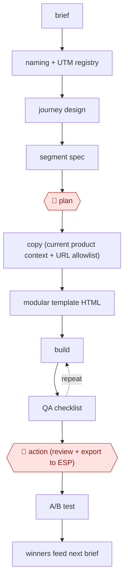

# Guardrailed campaign build

`COM › MKT › LIFECYCLE` · checkpointed · evidence A · **draft: needs a reference example** ([how to add one](../../../../../CONTRIBUTING.md#1-add-an-example-run))

**Shape:** `brief → naming + UTM registry → journey design → segment spec → 🛑 plan → copy (current product context + URL allowlist) → modular template HTML → (build ⟲ QA checklist) → 🛑 action (review + export to ESP) → A/B test → winners feed next brief`
**How it differs:** AWF-0019 Ad variant matrix produces paid ad creative variants. This workflow builds owned-channel journeys in the ESP, with a segment spec, UTM registry and render QA before a manual export.
**Variants:** `claude-code-skills` · `claude-codex-stripo-braze`

<!-- shape diagram: generated by scripts/build_diagrams.py from `shape`; don't edit -->

<!-- end shape diagram -->

## Steps
1. Generate the campaign name, registry slug and full UTM set before building anything, so the campaign is measurable on day one [[1]](#sources).
2. Turn the brief (a PRD in Notion, or a goal) into a journey or campaign design and a segment definition [[1]](#sources)[[2]](#sources).
3. 🛑 **Plan**: a person reviews the brief and segment. Every step produces a file that can be diffed and reviewed before anything touches the sending tool [[1]](#sources).
4. Write the copy from current product context, with a URL allowlist and a product-name dictionary. Build the emails in modular templates (Stripo), with generated images hosted in the ESP [[1]](#sources)[[2]](#sources).
5. Run a QA checklist: links and UTMs diffed against the registry, rendering, segment sanity, guardrails. Fix and repeat until it passes [[1]](#sources).
6. 🛑 **Action**: the marketer reviews, adjusts and approves the final assets at the manual export into Braze before go-live [[2]](#sources). Then A/B test, every two weeks in one program [[1]](#sources).

**Output:** Production-ready emails and journey in the ESP, tracked under a registry slug for attribution.
**Failure modes → guards:** Hallucinated URLs and product names → the first version failed QA with 10.5% render errors; ship the allowlist and dictionary guardrails first [[1]](#sources). Old campaigns repeat year-old claims → pull current product context as an input [[1]](#sources).

## Public runs

Coverage as of 2026-11-06: **Partial**: first-hand runs that cover part of the shape or put checkpoints elsewhere. Collected and re-checked in [New workflows for empty categories](../../../../../research/2026-11-new-workflows.md).

- [sara-beh8, lifecycle-campaign-skills](https://github.com/sara-beh8/lifecycle-campaign-skills) (2026-07-08). Program of 15+ concurrent campaigns rebuilt via skill pipeline; repo uses fictional data, architecture real. "shipped an A/B test every two weeks". *First-hand: yes (repo uses fictional data; result not checkable); confidence: low.*
- [Justin Williames, lifecycle workflow](https://www.linkedin.com/posts/justinwilliames_one-of-the-most-interesting-workflows-ive-activity-7466001243753054209-Bmng) (2026-05-29). At Sophiie AI, Claude builds journey, copy, images and Stripo emails; human approves at Braze export. *First-hand: yes; confidence: med.*

## Sources

1. sara-beh8, lifecycle-campaign-skills (GitHub README), created 2026-07-08. https://github.com/sara-beh8/lifecycle-campaign-skills
2. Justin Williames, Claude, Codex, Stripo and Braze lifecycle workflow (LinkedIn), 2026-05-29. https://www.linkedin.com/posts/justinwilliames_one-of-the-most-interesting-workflows-ive-activity-7466001243753054209-Bmng
