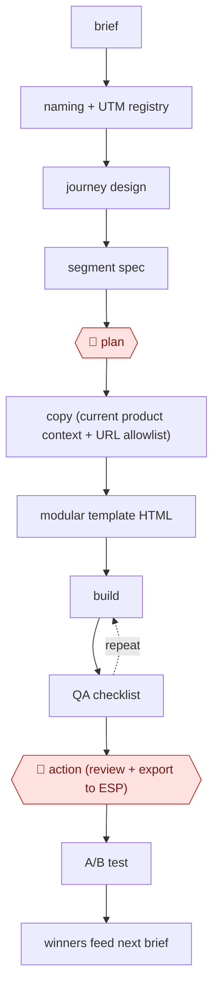

# Guardrailed campaign build

`COM › MKT › LIFECYCLE` · checkpointed · evidence A · **draft: needs a reference example** ([how to add one](../../../../../CONTRIBUTING.md#1-add-an-example-run))

**Shape:** `brief → naming + UTM registry → journey design → segment spec → 🛑 plan → copy (current product context + URL allowlist) → modular template HTML → (build ⟲ QA checklist) → 🛑 action (review + export to ESP) → A/B test → winners feed next brief`
**Variants:** `claude-code-skills` · `claude-codex-stripo-braze`

<!-- shape diagram: generated by scripts/build_diagrams.py from `shape`; don't edit -->

<!-- end shape diagram -->

## Background

Companies that sell to customers they already have (new sign-ups, subscribers, past buyers) send them sequences of emails, called journeys: a welcome series, an onboarding sequence, a win-back reminder. A lifecycle marketer designs each journey, decides which customers enter it, writes every email, builds the emails in the company's email platform and keeps track of which campaign brought which result. By hand most of the time goes on production: writing each email, building it from templates, moving files between tools and checking each link. Mistakes are easy to make and reach real customers: a wrong link, a product name that does not exist, a claim that was true last year. The agent takes the design, copy and template building and checks its own output against fixed lists. A person approves the plan before anything is built and approves the final emails before they go into the sending tool, because a sent email cannot be recalled.

**Terms:**
- **Lifecycle marketing**: communicating with existing customers at each stage of their relationship with the company, mostly by email.
- **ESP (email service provider)**: the platform that stores the audience and sends the emails; Braze is the one in the sources.
- **Journey**: a sequence of emails triggered by what a customer does or by time; also called a campaign or program.
- **Segment**: the rule that decides which customers enter a journey.
- **UTM parameters**: tags added to a link so the analytics tool can tell which campaign a click came from.
- **Registry (slug)**: a list of every campaign's name and UTM tags, so each campaign has one fixed identity.
- **PRD**: product requirements document, here the written brief for the campaign.
- **Modular template**: an email layout made of reusable blocks; Stripo is the email builder in the sources.
- **URL allowlist, product-name dictionary**: the only links and the only product names the copy may use.
- **QA (quality assurance) checklist**: checks run on the finished emails before they go out: links, rendering in mail programs, who receives them.
- **A/B test**: sending two versions to comparable groups to see which does better.

## Build it with an agent

**Form:** `skill`. A marketer builds one campaign at a time in the conversation, so a single skill that holds the procedure, the registry and the QA checklist is enough.

**You need:** the brief for the campaign; the naming rules and the registry file; the URL allowlist and the product-name dictionary; current product context (the latest feature and pricing notes); the modular templates and brand rules; an image tool and a place to host images, if the emails need them; a script that diffs the links in the built HTML against the registry and allowlist. Do not give the agent a tool that writes to the ESP or sends email.

| Step | Built as |
|---|---|
| brief → naming + UTM registry | The skill generates the campaign name, slug and full UTM set and adds them to the registry file first. |
| journey design → segment spec | The skill writes the journey and the segment definition as files. |
| 🛑 plan | See Checkpoints. |
| copy (current product context + URL allowlist) | The skill writes each email from the product context file, using only allowlisted URLs and dictionary names. |
| modular template HTML → (build ⟲ QA checklist) | The skill fills the templates and runs the QA checklist: the link-diff script against the registry, rendering, segment check. It fixes failures and reruns until the list passes. |
| 🛑 action (review + export to ESP) | See Checkpoints. |
| A/B test → winners feed next brief | The marketer runs the test in the ESP. A later session reads the results and writes the next brief from the winners. |

**Checkpoints:** `plan`: every step writes a file, and the skill stops after the journey and segment files so the marketer can read and change them before any copy or HTML exists. `action`: the skill stops after the QA report and the built emails. The agent has no tool that writes to the ESP, so the marketer exports the approved emails into it by hand, as in the sources.

**Since the sources:** Sources date from 2026-05 to 2026-07. Source 1 could not be opened in this session; what it reports is taken from the entry text, and its repository is described there as built on fictional data. Source 2 is one practitioner's post on a workflow built around a marketing-tool connector that also reaches the ESP and the email builder, and says the final export is the one step kept manual. This build keeps that step manual by leaving out any ESP write tool. Neither source is a run that this build repeats; the 10.5% render-error figure in the Steps is the first version's result and is not a claim about this build.

*A design based on this entry's steps and the tool documentation as of 2026-11, not a reported run.*

## Steps

*As reported by the sources.*

1. The agent generates the campaign name, registry slug and full UTM set before building anything, so the campaign is measurable on day one [[1]](#sources).
2. The agent turns the brief (a PRD in Notion, or a goal) into a journey or campaign design and a segment definition [[1]](#sources)[[2]](#sources).
3. 🛑 **Plan**: a person reviews the brief and segment. Every step produces a file that can be diffed and reviewed before anything touches the sending tool [[1]](#sources).
4. The agent writes the copy from current product context, with a URL allowlist and a product-name dictionary. It builds the emails in modular templates (Stripo), with generated images hosted in the ESP [[1]](#sources)[[2]](#sources).
5. The agent runs a QA checklist: links and UTMs diffed against the registry, rendering, segment sanity, guardrails. It fixes failures and repeats until the list passes [[1]](#sources).
6. 🛑 **Action**: the marketer reviews, adjusts and approves the final assets at the manual export into Braze before go-live [[2]](#sources). Then A/B test, every two weeks in one program [[1]](#sources).

**Output:** Production-ready emails and journey in the ESP, tracked under a registry slug for attribution.
**Failure modes → guards:** Hallucinated URLs and product names → the first version failed QA with 10.5% render errors; ship the allowlist and dictionary guardrails first [[1]](#sources). Old campaigns repeat year-old claims → pull current product context as an input [[1]](#sources).
**How it differs:** AWF-0019 Ad variant matrix produces paid ad creative variants. This workflow builds owned-channel journeys in the ESP, with a segment spec, UTM registry and render QA before a manual export.

## Public runs

Coverage as of 2026-11-06: **Partial**: first-hand runs that cover part of the shape or put checkpoints elsewhere. Collected and re-checked in [New workflows for empty categories](../../../../../research/2026-11-new-workflows.md).

- [sara-beh8, lifecycle-campaign-skills](https://github.com/sara-beh8/lifecycle-campaign-skills) (2026-07-08). Program of 15+ concurrent campaigns rebuilt via skill pipeline; repo uses fictional data, architecture real. "shipped an A/B test every two weeks". *First-hand: yes (repo uses fictional data; result not checkable); confidence: low.*
- [Justin Williames, lifecycle workflow](https://www.linkedin.com/posts/justinwilliames_one-of-the-most-interesting-workflows-ive-activity-7466001243753054209-Bmng) (2026-05-29). At Sophiie AI, Claude builds journey, copy, images and Stripo emails; human approves at Braze export. *First-hand: yes; confidence: med.*

## Sources

1. sara-beh8, lifecycle-campaign-skills (GitHub README), created 2026-07-08. https://github.com/sara-beh8/lifecycle-campaign-skills
2. Justin Williames, Claude, Codex, Stripo and Braze lifecycle workflow (LinkedIn), 2026-05-29. https://www.linkedin.com/posts/justinwilliames_one-of-the-most-interesting-workflows-ive-activity-7466001243753054209-Bmng
