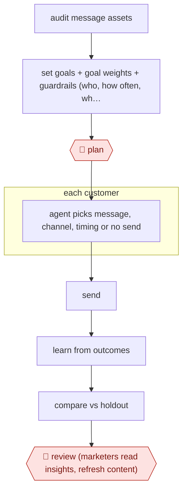

# Guardrailed 1:1 decisioning

`COM › MKT › LIFECYCLE` · sampled · evidence B · **draft: needs a reference example** ([how to add one](../../../../../CONTRIBUTING.md#1-add-an-example-run))

**Shape:** `audit message assets → set goals + goal weights + guardrails (who, how often, which creative, which days) + holdout group → 🛑 plan → each customer: agent picks message, channel, timing or no send → send → learn from outcomes → compare vs holdout → 🛑 review (marketers read insights, refresh content)`
**Variants:** `hightouch-ai-decisioning` · `moengage-campaign-decisioning` · `monocle`

<!-- shape diagram: generated by scripts/build_diagrams.py from `shape`; don't edit -->

<!-- end shape diagram -->

## Background

Marketing teams that message customers by email, text or app notification normally decide in advance who gets which message and when, by building campaigns for segments. One-to-one decisioning replaces that with a decision for each customer: which message, on which channel, at what time, or no message at all, chosen from content the team has already approved. A lifecycle marketer's job is to set the aim and the limits, and to keep supplying good content. Doing the choosing by hand for every customer is impossible, and a system left to optimise on its own can chase the wrong outcome (clicks that never become orders) or over-message people. Here a decisioning system makes each choice inside limits the marketers set, and a held-back group that gets no such treatment shows whether it is helping. People still approve the goals and limits once, before launch, and read the results, because a decisioning system cannot judge brand, offers or fairness to customers.

**Terms:**
- **Message asset**: an approved piece of content (an email, a text, an offer) the system may choose from.
- **Guardrails**: the limits on who may receive what: which customers, how often, which creative, which days; also plain-language rules such as "Exclude VIPs from discounts".
- **Goal weights**: how much each aim counts when they pull in different directions, for example clicks against orders and order value, short term against long term.
- **Holdout group**: customers deliberately left out of the new approach, so their results can be compared with those of the customers it reached.
- **Lift (incrementality)**: the extra result that the approach caused, measured against the holdout.
- **Reinforcement learning, bandit**: methods that learn from each response which choice works best for which kind of customer, while still trying alternatives.
- **Frequency cap, cost cap**: the maximum number of messages per customer in a period, and the maximum spend.

## Build it with an agent

**Form:** `platform`. The per-customer choice that learns from every response and is measured against a holdout needs a decisioning engine with live access to the customer data and the sending channels, which a general agent cannot replace. A general agent can run the preparation and the review as a `skill`: auditing the message assets, drafting the goals and guardrails for sign-off, and reading the results.

**You need:** an inventory of the message assets (the exports from the sending platform); the goals and weights, the guardrails and the holdout share written down for approval; a decisioning product connected to the customer data and the channels; the results export from it. Keep customer-level personal data out of the agent's conversation; give it aggregate results only.

| Step | Built as |
|---|---|
| audit message assets | The skill reads the exported assets and lists each with its channel, offer, expiry and any claim that may be out of date. |
| set goals + goal weights + guardrails + holdout group → 🛑 plan | The skill drafts the goals, weights, guardrails and holdout size as one page for the marketers. The engine is configured by a person with the approved settings. |
| each customer: agent picks message, channel, timing or no send → send → learn from outcomes | The decisioning platform. Nothing in a general agent's tool set does this. |
| compare vs holdout | The platform's report. The skill can read the export and check the result against the approved goals. |
| 🛑 review (marketers read insights, refresh content) | See Checkpoints. |

**Checkpoints:** `plan`: the skill stops after the one-page settings draft; a person enters the approved settings in the platform, and the agent has no access to the platform's configuration. `review`: the skill summarises the aggregate results (which messages, regions and themes performed, and the lift against the holdout) and lists content to add, refresh or retire, then stops. Since no individual send is approved, sampling comes from the marketers reading those results.

**Since the sources:** Sources date from 2025-07 to 2025-10, with two undated vendor pages. All four are vendor material, and the one customer story is the vendor's own; none reports a general-purpose agent doing the per-customer choice. Monocle (source 3) now describes itself as part of OuterSignal. This build therefore covers only the text stages; the decisioning step needs one of the vendor products named in `variants`.

*A design based on this entry's steps and the tool documentation as of 2026-11, not a reported run.*

## Steps

*As reported by the sources.*

1. The marketing team audits every existing and new message asset the agents may use [[1]](#sources).
2. The team defines guardrails: who can receive which messages, how often, which creative, which days; sets weighted short- and long-term goals (e.g. clicks vs orders and order value) [[1]](#sources)[[2]](#sources), and sets a holdout group [[2]](#sources)[[3]](#sources).
3. 🛑 **Plan**: marketing team approves goals, weights and guardrails before launch [[1]](#sources)[[2]](#sources).
4. For each customer the agent chooses message, channel, timing and frequency, including whether to send at all, and learns from each response (reinforcement learning / bandits) [[2]](#sources)[[4]](#sources).
5. The system measures lift against the holdout [[2]](#sources)[[3]](#sources).
6. 🛑 **Review**: marketers read the agent's insights (which messages, regions, themes perform) and add, refresh or retire content [[1]](#sources)[[2]](#sources).

**Output:** A continuously running individualised message stream with measured lift vs holdout and content insights for the team.
**Failure modes → guards:** Agent optimises the wrong outcome → weighted goals including long-term value [1]. Over-messaging or off-brand offers → frequency caps, cost caps and plain-language rules like 'Exclude VIPs from discounts' [3][4].
**How it differs:** Nearest is AWF-0054 Guardrailed campaign build: there each campaign is built, QA'd and approved before export. Here no individual send is approved; people approve the guardrails once and review aggregate results. Autonomy is sampled, not checkpointed.

## Public runs

Coverage as of 2026-11-13: **Weak**: only anonymous, vendor-linked or journalist-told accounts. Collected and re-checked in [Third collection pass](../../../../../research/2026-11-third-pass.md).

- [Hightouch, Fundrise customer story](https://hightouch.com/customers/fundrise) (2025-07-16). Dormant-user win-back run by decisioning agents under audited assets and guardrails. "AI Decisioning delivered a 4x higher amount invested on roughly the same number of orders placed". *First-hand: vendor; confidence: med.*

## Sources

1. Hightouch, Fundrise scales 1:1 personalization with AI agents to drive investment growth, 2025-07-16. https://hightouch.com/customers/fundrise
2. Hightouch, AI Decisioning (product page), undated. https://hightouch.com/platform/ai-decisioning
3. Monocle, How Monocle Works, undated. https://www.usemonocle.com/product/how-it-works
4. Faraaz Peerbhai / MoEngage, Campaign Decisioning, 2025-10-30. https://www.moengage.com/blog/campaign-decisioning-scale-results-by-delivering-relevant-campaigns/
