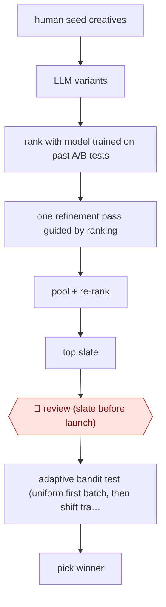

# Ranker-guided creative slate

`COM › MKT › LIFECYCLE` · checkpointed · evidence A · **draft: needs a reference example** ([how to add one](../../../../../CONTRIBUTING.md#1-add-an-example-run))

**Shape:** `human seed creatives → LLM variants → rank with model trained on past A/B tests → one refinement pass guided by ranking → pool + re-rank → top slate → 🛑 review (slate before launch) → adaptive bandit test (uniform first batch, then shift traffic) → pick winner`
**Variants:** `llm` · `thompson-sampling` · `bradley-terry-ranker`

<!-- shape diagram: generated by scripts/build_diagrams.py from `shape`; don't edit -->

<!-- end shape diagram -->

## Background

Campaign teams choose among message variants, but generating more text does not reveal which message real customers will respond to. A model trained on earlier experiments can help screen candidates, while a new controlled test supplies evidence about this campaign. This workflow uses the ranker to guide a limited revision, then puts a reviewed slate into an adaptive experiment. An agent can draft alternatives and organise the evidence. People approve the messages and experimental exposure because customers receive the campaign and an offline score is not a reliable launch decision.

**Terms:**
- **Creative / slate**: the message being tested, and the set of candidates admitted to the test.
- **LLM / ranker / Bradley–Terry**: a text-generating model, a learned predictor of ordering, and a model for pairwise comparisons.
- **A/B test / arm**: a controlled comparison and one candidate in that comparison.
- **Bandit / Thompson sampling**: an experiment adapting allocation from results, and a probabilistic method for choosing that allocation.
- **Proxy / overfitting**: an indirect target, and optimising it in ways that fail on the actual outcome.

## Build it with an agent

**Form:** `platform`. The core scoring step requires a trained campaign-specific predictive model and controlled live experimentation. A general agent can coordinate preparation as a `project`, but cannot replace those components with its own judgment.

**You need:** human seed messages, historical randomised-test data and a validated ranker; generation and scoring interfaces; approved audience rules and an experimentation platform; a reviewable campaign workspace. Keep recipient identifiers out of drafting context. Give the agent no send, launch or traffic-allocation authority.

| Step | Built as |
|---|---|
| human seeds → variants → rank | A Skill drafts candidates; a script calls the trained ranker and records its scores and model version. |
| one refinement → pool + re-rank → slate | The Skill performs the bounded revision; scripts deduplicate and rescore candidates. A Hook prevents additional proxy-optimisation rounds beyond the approved procedure. |
| 🛑 review → adaptive bandit test | The agent prepares messages, evidence and test configuration. A person launches the approved experiment in the specialist platform. |
| pick winner | The experiment platform collects real responses and applies its statistical selection procedure; the Skill reports that result and its limitations. |

**Checkpoints:** `review`: the campaign owner sees the complete slate, source facts, ranker version, proposed audience and experiment configuration. Launch and allocation tools are withheld from the agent; a person approves and starts the live test. The ranker's top score cannot bypass that test or authorise a send.

**Since the sources:** The source dates from 2026-07 and its abstract and full paper were opened in 2026-11. Searches for newer accounts and the named methods found no newer account as of 2026-11. The paper's ranker is trained on historical experiments and is not an interchangeable general-agent critique. Current Skills and Hooks can organise the bounded generation and review steps, while model training and live allocation stay in the specialist system. Preserve the distinction between offline screening and measured online response; neither better prose nor a higher proxy score demonstrates a better campaign.

*A design based on this entry's steps and the tool documentation as of 2026-11, not a reported run.*

## Steps

*As reported by the sources.*

1. The campaign team starts from human-written seed creatives for a promotional email or push campaign [[1]](#sources).
2. A frozen generative model proposes variants; a predictive (Bradley-Terry style) model trained on historical within-campaign A/B tests ranks them [[1]](#sources).
3. The system feeds the ranking back to the LLM for exactly one refinement step (deeper rounds overfit the proxy and regress), then pools and re-ranks all candidates to form the test slate [[1]](#sources).
4. 🛑 **Review**: the candidate slate passes human review before launch [[1]](#sources).
5. The experimentation system deploys the slate in an online adaptive experiment: first batch with equal allocation, later batches shift traffic toward strong arms (Thompson sampling) [[1]](#sources).
6. The experimentation system selects the winner from real user feedback; do not deploy the ranker's offline top pick directly (it finished 43rd of 50 in the main study) [[1]](#sources).

**Output:** The best-performing message creative for the campaign, chosen by live adaptive test; data from the test feeds the ranker for later campaigns.
**Failure modes → guards:** Trusting the offline ranker as a deployment rule (its top pick ranked 43rd) → use it only to build a high-recall slate and let the online test choose. Over-refining against the proxy → stop at one refinement round. Off-brand or wrong copy → human review of the slate before launch.

**How it differs:** Closest are AWF-0054 Guardrailed campaign build (builds one campaign with plan + export approval and a simple A/B test) and AWF-0178 Guardrailed 1:1 decisioning (picks message/channel/timing per customer vs holdout). This one generates and screens a large slate of creative variants for one send, with a single slate-review checkpoint and selection by adaptive experiment. The deliverable (winning creative) and checkpoint (slate review) differ from both.

## Public runs

Coverage as of 2026-11-13: **Strong**: a first-hand, detailed run that matches most of the shape. Collected and re-checked in [Fourth collection pass](../../../../../research/2026-11-fourth-pass.md).

- [Lee et al. (Meta), Offline-to-Online Creative Optimization with Generative Models and Adaptive Testing](https://arxiv.org/abs/2607.23696) (2026-07-26). Deployed at Meta: 50-arm promotional email to 5.1M recipients, plus a push and a second email test. "the best creative generated with this method yielded 45.1% higher engagement than the best human-authored creative". *First-hand: yes; confidence: high.*

## Sources

1. Kevin Lee, Benjamin Letham, Zhiyuan Jerry Lin, Elodie Samson, Eric Onofrey, Poppy Zhang, Shawndra Hill, Eytan Bakshy (University of Michigan, Meta), Offline-to-Online Creative Optimization with Generative Models and Adaptive Testing, arXiv 2607.23696, 2026-07-26. https://arxiv.org/abs/2607.23696
