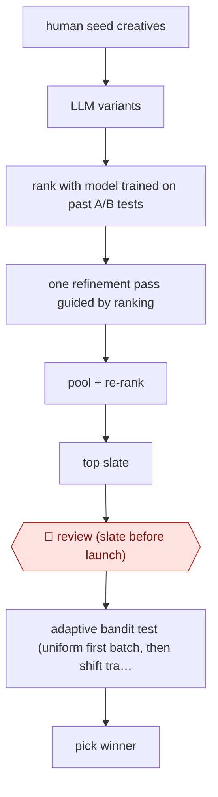

# Ranker-guided creative slate

`COM › MKT › LIFECYCLE` · checkpointed · evidence A · **draft: needs a reference example** ([how to add one](../../../../../CONTRIBUTING.md#1-add-an-example-run))

**Shape:** `human seed creatives → LLM variants → rank with model trained on past A/B tests → one refinement pass guided by ranking → pool + re-rank → top slate → 🛑 review (slate before launch) → adaptive bandit test (uniform first batch, then shift traffic) → pick winner`
**How it differs:** Closest are AWF-0054 Guardrailed campaign build (builds one campaign with plan + export approval and a simple A/B test) and AWF-0178 Guardrailed 1:1 decisioning (picks message/channel/timing per customer vs holdout). This one generates and screens a large slate of creative variants for one send, with a single slate-review checkpoint and selection by adaptive experiment. The deliverable (winning creative) and checkpoint (slate review) differ from both.
**Variants:** `llm` · `thompson-sampling` · `bradley-terry-ranker`

<!-- shape diagram: generated by scripts/build_diagrams.py from `shape`; don't edit -->

<!-- end shape diagram -->

## Steps
1. Start from human-written seed creatives for a promotional email or push campaign [[1]](#sources).
2. A frozen generative model proposes variants; a predictive (Bradley-Terry style) model trained on historical within-campaign A/B tests ranks them [[1]](#sources).
3. Feed the ranking back to the LLM for exactly one refinement step (deeper rounds overfit the proxy and regress); pool and re-rank all candidates to form the test slate [[1]](#sources).
4. 🛑 **Review**: the candidate slate passes human review before launch [[1]](#sources).
5. Deploy the slate in an online adaptive experiment: first batch with equal allocation, later batches shift traffic toward strong arms (Thompson sampling) [[1]](#sources).
6. Select the winner from real user feedback; do not deploy the ranker's offline top pick directly (it finished 43rd of 50 in the main study) [[1]](#sources).

**Output:** The best-performing message creative for the campaign, chosen by live adaptive test; data from the test feeds the ranker for later campaigns.
**Failure modes → guards:** Trusting the offline ranker as a deployment rule (its top pick ranked 43rd) → use it only to build a high-recall slate and let the online test choose. Over-refining against the proxy → stop at one refinement round. Off-brand or wrong copy → human review of the slate before launch.

## Public runs

Coverage as of 2026-11-13: **Strong**: a first-hand, detailed run that matches most of the shape. Collected and re-checked in [Fourth collection pass](../../../../../research/2026-11-fourth-pass.md).

- [Lee et al. (Meta), Offline-to-Online Creative Optimization with Generative Models and Adaptive Testing](https://arxiv.org/abs/2607.23696) (2026-07-26). Deployed at Meta: 50-arm promotional email to 5.1M recipients, plus a push and a second email test. "the best creative generated with this method yielded 45.1% higher engagement than the best human-authored creative". *First-hand: yes; confidence: high.*

## Sources

1. Kevin Lee, Benjamin Letham, Zhiyuan Jerry Lin, Elodie Samson, Eric Onofrey, Poppy Zhang, Shawndra Hill, Eytan Bakshy (University of Michigan, Meta), Offline-to-Online Creative Optimization with Generative Models and Adaptive Testing, arXiv 2607.23696, 2026-07-26. https://arxiv.org/abs/2607.23696
