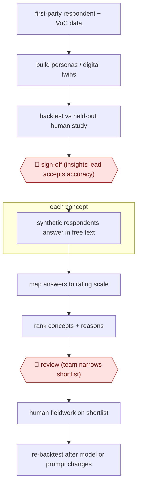

# Backtested synthetic panel

`COM › MKT › MKTRES` · checkpointed · evidence A · **draft: needs a reference example** ([how to add one](../../../../../CONTRIBUTING.md#1-add-an-example-run))

**Shape:** `first-party respondent + VoC data → build personas / digital twins → backtest vs held-out human study → 🛑 sign-off (insights lead accepts accuracy) → each concept: synthetic respondents answer in free text → map answers to rating scale → rank concepts + reasons → 🛑 review (team narrows shortlist) → human fieldwork on shortlist → re-backtest after model or prompt changes`
**How it differs:** Nearest is AWF-0055 Routed competitive digest: that is a weekly digest of external signals routed to PMMs; this produces a concept-test result from simulated customers, gated by a backtest sign-off and followed by human fieldwork. Deliverable and checkpoints differ.
**Variants:** `gemini` · `gpt-4o` · `semantic-similarity-rating`

<!-- shape diagram: generated by scripts/build_diagrams.py from `shape`; don't edit -->

<!-- end shape diagram -->

## Steps
1. Gather the company's own respondent-level research, transactional, segmentation and voice-of-customer data; build one-to-one digital twins or segment personas from it rather than from vendor third-party data [[1]](#sources).
2. Backtest: rerun the tasks of an earlier human study (e.g. a conjoint) with the twins, keeping that study out of the training inputs, and compare to the human result as ground truth [[1]](#sources). 🛑 **Sign-off**: insights lead accepts the panel for use only if it reproduces the key outcomes (Bain reports about 90% for one client) [[1]](#sources).
3. For each new concept, have synthetic respondents (prompted with demographic attributes) answer in free text, then map each answer to a Likert distribution by embedding similarity to anchor statements, instead of asking the model for a number directly [[2]](#sources)[[3]](#sources).
4. Rank concepts by mean purchase intent and collect the synthetic respondents' stated reasons as qualitative feedback [[2]](#sources).
5. 🛑 **Review**: product/insights team uses the ranking to kill weak concepts early and pick a shortlist; human research is focused on the highest-value questions [[1]](#sources).
6. Run human fieldwork on the shortlist; treat subgroup results with caution, since persona conditioning is not yet a reliable proxy for every subpopulation [[2]](#sources). Re-backtest after any model, prompt or anchor change [[1]](#sources)[[2]](#sources).

**Output:** A ranked concept shortlist with synthetic purchase-intent distributions and reasons, handed to the research team for human fieldwork.
**Failure modes → guards:** Direct numeric ratings come out narrow and over-positive → elicit free text and map with anchor sets, averaged across several sets [2]. Off-the-shelf tools lack grounding and validation → build from first-party data and backtest before use [1]. Subgroup results drift → keep human research for segment calls [2].

## Public runs

Coverage as of 2026-11-13: **Strong**: a first-hand, detailed run that matches most of the shape. Collected and re-checked in [Third collection pass](../../../../../research/2026-11-third-pass.md).

- [Bain & Company, Synthetic Customers Earn Their Stripes](https://www.bain.com/insights/synthetic-customers-earn-their-stripes/) (2026-05-04). Digital twins for a consumer-tech client backtested against a prior conjoint study, held out of training. "The digital twins replicated about 90% of key outcomes from the original research". *First-hand: yes; confidence: med.*
- [Maier et al., PyMC Labs + Colgate-Palmolive, arXiv 2510.08338](https://arxiv.org/abs/2510.08338) (2025-10). Synthetic consumers scored against 57 real concept surveys from a personal-care company. "57 personal care product surveys conducted by a leading corporation in that market (9,300 human responses), SSR achieves 90% of human test–retest reliability". *First-hand: yes; confidence: high.*

## Sources

1. Andy Pierce, Laura Beaudin et al. / Bain & Company, Synthetic Customers Earn Their Stripes, 2026-05-04. https://www.bain.com/insights/synthetic-customers-earn-their-stripes/
2. Benjamin F. Maier et al. (PyMC Labs, Colgate-Palmolive), LLMs Reproduce Human Purchase Intent via Semantic Similarity Elicitation of Likert Ratings, arXiv 2510.08338, 2025-10. https://arxiv.org/abs/2510.08338
3. PyMC Labs, semantic-similarity-rating (GitHub package). https://github.com/pymc-labs/semantic-similarity-rating
