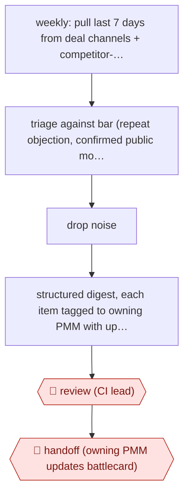

# Routed competitive digest

`COM › MKT › MKTRES` · checkpointed · evidence A · **draft: needs a reference example** ([how to add one](../../../../../CONTRIBUTING.md#1-add-an-example-run))

**Shape:** `weekly: pull last 7 days from deal channels + competitor-news channels + launch hub → triage against bar (repeat objection, confirmed public move, battlecard gap) → drop noise → structured digest, each item tagged to owning PMM with update recommendation → 🛑 review (CI lead) → 🛑 handoff (owning PMM updates battlecard)`
**Variants:** `claude-cowork-skill-slack-notion`

<!-- shape diagram: generated by scripts/build_diagrams.py from `shape`; don't edit -->

<!-- end shape diagram -->

## Background

Competitive-intelligence teams help product marketers understand what competitors are changing and what customers ask during sales discussions. Many messages are isolated anecdotes, while a repeated objection or confirmed product change may require an update to sales guidance. This workflow gathers a bounded period of signals and routes the useful items to their owners. An agent can filter and draft the digest. The competitive-intelligence lead checks the interpretation and product marketers decide how to change their materials because sales teams will rely on them.

**Terms:**
- **CI / PMM**: competitive intelligence, and product marketing manager.
- **Deal room / objection**: a channel supporting a sales opportunity, and a concern raised by a potential customer.
- **Battlecard**: concise sales guidance comparing a product with alternatives.
- **Triage bar / launch hub**: a written rule for what deserves attention, and a record of product releases.

## Build it with an agent

**Form:** `service`. A weekly scan runs unattended; the lead receives a draft and owners receive approved follow-up items.

**You need:** approved read-only Slack and Notion MCP server (connector) tools; the written triage bar; a product-area owner map; existing battlecards; a private review queue. Keep deal and customer details inside approved systems. The scan cannot update sales materials or post to broad channels.

| Step | Built as |
|---|---|
| weekly: last 7 days → triage → drop noise | The scheduler starts `claude -p` (headless). A Skill retrieves the bounded window, deduplicates reports and applies the written evidence bar. |
| structured digest + owner + recommendation | The Skill writes each item with source links, owner, reason it clears the bar and proposed battlecard location. |
| 🛑 review → 🛑 handoff | The service stores the draft in the lead's review queue. Approved items are routed to the owning PMM, who updates the material. |

**Checkpoints:** `review`: the CI lead sees the draft and its source evidence before broad distribution. Posting tools are withheld from the scan; approval starts a separate distribution step. `handoff`: the owning PMM receives the evidence and recommendation and makes the actual battlecard change; the agent cannot edit the sales source of truth.

**Since the sources:** The source dates from 2026-04 and was opened in 2026-11. Searches for newer accounts and the named tool found no newer account as of 2026-11. The original already packages the scan as a Skill; the service supplies scheduling, durable run records and a review queue rather than inventing additional specialist roles. The post says the author remains in the loop, but does not document a strict technical pre-post approval gate. This design makes that guard explicit and retains owner judgment on battlecard changes.

*A design based on this entry's steps and the tool documentation as of 2026-11, not a reported run.*

## Steps

*As reported by the sources.*

1. Each week, the agent pulls from internal Slack channels (competitor news, deal collaboration, active deal rooms) and the Notion product launch hub, filtered to the last 7 days [[1]](#sources).
2. The agent triages against a written bar: an objection appearing in 2+ deals, a confirmed public move by a competitor, or a gap in an existing battlecard. The agent filters out one-off mentions [[1]](#sources).
3. The agent drafts a structured digest and tags each item to the PMM who owns that product area, with a recommendation on what to update and where [[1]](#sources).
4. 🛑 **Review**: the competitive-intel lead stays in the loop on the drafted digest posted to the PMM channel [[1]](#sources).
5. 🛑 **Handoff**: the owning PMM, as subject-matter expert, acts on the item and updates the battlecard [[1]](#sources).

**Output:** A weekly PMM-channel digest with owner-tagged battlecard updates.
**Failure modes → guards:** Noise floods the channel → an explicit triage bar [[1]](#sources). A single person is the bottleneck → route items to owner PMMs instead of a central analyst [[1]](#sources). Context limits on wide source pulls (raised by commenters) → limit the sources per run.

**How it differs:** AWF-0030 Issue-tree research builds a one-off strategy answer. This workflow is a recurring scan of internal deal signals routed to battlecard owners.

## Public runs

Coverage as of 2026-11-06: **Partial**: first-hand runs that cover part of the shape or put checkpoints elsewhere. Collected and re-checked in [New workflows for empty categories](../../../../../research/2026-11-new-workflows.md).

- [Andy McCotter-Bicknell, Apollo competitive intel skill](https://www.linkedin.com/posts/andrewmccotterbicknell_i-used-to-be-apollos-competitive-intel-bottleneck-activity-7447707923620724736-e1t7) (2026-04-08). Weekly Claude Cowork scan of Slack/Notion; digest routed to owning PMMs. "if an objection is showing up in 2+ deals". *First-hand: yes; confidence: med.*

## Sources

1. Andy McCotter-Bicknell (Apollo), I used to be Apollo's competitive intel bottleneck (LinkedIn), 2026-04-08. https://www.linkedin.com/posts/andrewmccotterbicknell_i-used-to-be-apollos-competitive-intel-bottleneck-activity-7447707923620724736-e1t7
