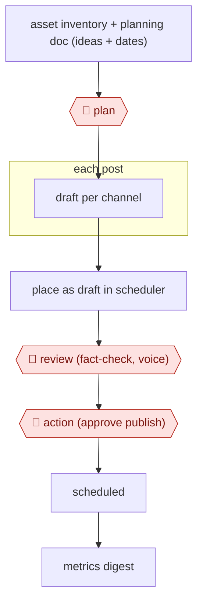

# Plan-to-calendar drafting

`COM › MKT › SOCIAL` · checkpointed · evidence A · **draft: needs a reference example** ([how to add one](../../../../../CONTRIBUTING.md#1-add-an-example-run))

**Shape:** `asset inventory + planning doc (ideas + dates) → 🛑 plan → each post: draft per channel → place as draft in scheduler → 🛑 review (fact-check, voice) → 🛑 action (approve publish) → scheduled → metrics digest`
**Variants:** `claude-oktopost` · `multi-agent-linkedin-x` · `openclaw-deepseek-wechat`

<!-- shape diagram: generated by scripts/build_diagrams.py from `shape`; don't edit -->

<!-- end shape diagram -->

## Background

Social-media teams turn existing material and planned events into posts suited to different channels. The work includes choosing dates, adapting wording and entering drafts into a calendar, but the repeated formatting can obscure factual mistakes or an unsuitable tone. This workflow lets an agent draft and place the approved ideas while a person controls the editorial decisions. Every post still receives factual and voice review before scheduling, because publishing makes the organisation accountable for the message.

**Terms:**
- **Asset inventory / buyer stage**: a list of available material, and where a potential customer is in deciding what to buy.
- **Scheduler / draft calendar**: a tool that sends posts later, and proposed posts arranged by date.
- **草稿箱 / 人工定时发送**: the draft folder and a person scheduling the final send on a Chinese publishing platform.
- **Metrics digest / platform risk controls**: a summary of observed results, and the platform's rules limiting unwanted automated activity.

## Build it with an agent

**Form:** `skill`. One editor plans and reviews a calendar in conversation; parallel drafting roles can be instructions within one Skill.

**You need:** the approved asset inventory and planning document; source facts and voice examples; draft-only scheduler MCP server (connector) tools or a local calendar export; read-only metrics exports. Keep private campaign information in approved storage and provide no immediate-publish or send tool.

| Step | Built as |
|---|---|
| inventory + planning doc → 🛑 plan | The Skill lists source material, planned topics, dates and gaps; the editor approves what will be drafted. |
| each post: channel draft → scheduler draft | The Skill adapts the approved material and writes draft records through scoped MCP server (connector) tools; scripts check required fields and dates. |
| 🛑 review → 🛑 action → scheduled | The Skill stops with draft previews and fact-check links. The editor reviews each message and schedules it in the publishing system. |
| metrics digest | The Skill summarises a read-only metrics export on a later request and records questions for the next plan. |

**Checkpoints:** `plan`: the editor approves ideas and dates. `review`: the Skill presents every post with its supporting facts and channel context. `action`: publishing and scheduling remain in the editor's own account; the agent only has draft access. A combined draft/publish API must be wrapped or blocked so a draft operation cannot silently schedule a send.

**Since the sources:** Sources date from 2026-03 to 2026-07; all opened in 2026-11. Searches found [Oktopost's plugin update](https://www.oktopost.com/blog/oktopost-claude-plugin-v1-2-0/), dated 2026-09 and opened in 2026-11, adding calendar events, media organisation and targeting controls. The build can use that connector rather than recreate scheduler integration, while still keeping publishing outside the agent. The sources span an interactive editor and recurring multi-agent loops; the smallest calendar-drafting build needs one Skill, with metrics supplied when requested. Historical platform-risk observations do not establish today's posting policy; confirm the chosen platform's current supported permissions before connecting it.

*A design based on this entry's steps and the tool documentation as of 2026-11, not a reported run.*

## Steps

*As reported by the sources.*

1. The content team keeps an inventory of existing assets mapped to vertical, use case and buyer stage, and finds coverage gaps [[2]](#sources). The agent turns source posts into several distinct angles per post [[1]](#sources).
2. 🛑 **Plan**: a person sets the planning document (post ideas and publish dates) and approves the calendar plan; the agent does not decide what to publish [[1]](#sources)[[2]](#sources).
3. The agent drafts the posts for each channel and places them on the right dates in the scheduling tool (Oktopost, or the WeChat 草稿箱) as drafts [[1]](#sources)[[3]](#sources).
4. 🛑 **Review**: a person reviews, fact-checks and edits every post so it sounds human [[1]](#sources). The team adds an automated compliance check for exaggerated titles and sensitive words before human review [[3]](#sources).
5. 🛑 **Action**: a human approves and publishes or schedules. On Chinese platforms, the agent writes to drafts and a person schedules the send (人工定时发送) [[1]](#sources)[[3]](#sources).
6. The system pulls daily metrics (reads, likes, comment keywords) into a report that steers the next topics [[3]](#sources).

**Output:** A month of approved posts slotted into the social scheduler, plus a metrics digest that feeds the next plan.
**Failure modes → guards:** Generic or AI-sounding copy → a human edit is mandatory [[1]](#sources). Platform risk control throttles or bans accounts on fully automated posting (小红书) → semi-automatic publishing with human review [[3]](#sources). Facts are wrong → fact-check every post [[1]](#sources).

**How it differs:** AWF-0018 Cluster-brief-draft content makes long-form SEO articles. AWF-0019 Ad variant matrix makes paid ad variants for testing. This workflow fills an organic, date-slotted social calendar with a per-post publish approval.

## Public runs

Coverage as of 2026-11-06: **Partial**: first-hand runs that cover part of the shape or put checkpoints elsewhere. Collected and re-checked in [New workflows for empty categories](../../../../../research/2026-11-new-workflows.md).

- [Oktopost, I gave an AI the keys to Oktopost](https://www.oktopost.com/blog/i-gave-an-ai-the-keys-to-oktopost/) (2026-07-28). Content manager has Claude draft and slot LinkedIn calendar into Oktopost; every post human-approved. "A task that would usually take me a couple of days was finished in around an hour.". *First-hand: vendor (Oktopost staff using Oktopost); confidence: high.*
- [Alberto Farronato, Content Marketing Agent Loop](https://www.linkedin.com/posts/albertofarronato_agenticai-gtmengineering-marketingops-activity-7475624768231133184-zWjj) (2026-06-24). Librarian/Scout/Strategist/Drafter/Scheduler agents; human sign-off at every stage. "Mapping 200+ assets across 15 campaigns". *First-hand: yes; confidence: med.*
- [见实, 用OpenClaw跑通内容自动化](https://www.woshipm.com/ai/6361404.html) (2026-03-23). 选题→创作→审核Agent→半自动发布→复盘; 公众号 drafts with manual timed send. "以前这需要一个5人团队（编辑、设计、运营、数据分析）". *First-hand: interview; confidence: med.*

## Sources

1. Dafna Sheinberg / Oktopost, Less than 2 weeks in: I gave an AI the keys to Oktopost, 2026-07-28. https://www.oktopost.com/blog/i-gave-an-ai-the-keys-to-oktopost/
2. Alberto Farronato, Content Marketing Agent Loop (Part 1) (LinkedIn), 2026-06-24. https://www.linkedin.com/posts/albertofarronato_agenticai-gtmengineering-marketingops-activity-7475624768231133184-zWjj
3. 见实 / 张子良, 用OpenClaw跑通内容自动化：一位技术博主的实测与踩坑 (人人都是产品经理), 2026-03-23. https://www.woshipm.com/ai/6361404.html
