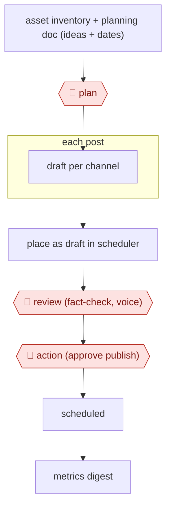

# Plan-to-calendar drafting

`COM › MKT › SOCIAL` · checkpointed · evidence A · **draft: needs a reference example** ([how to add one](../../../../../CONTRIBUTING.md#1-add-an-example-run))

**Shape:** `asset inventory + planning doc (ideas + dates) → 🛑 plan → each post: draft per channel → place as draft in scheduler → 🛑 review (fact-check, voice) → 🛑 action (approve publish) → scheduled → metrics digest`
**How it differs:** AWF-0018 Cluster-brief-draft content makes long-form SEO articles. AWF-0019 Ad variant matrix makes paid ad variants for testing. This workflow fills an organic, date-slotted social calendar with a per-post publish approval.
**Variants:** `claude-oktopost` · `multi-agent-linkedin-x` · `openclaw-deepseek-wechat`

<!-- shape diagram: generated by scripts/build_diagrams.py from `shape`; don't edit -->

<!-- end shape diagram -->

## Steps
1. Keep an inventory of existing assets mapped to vertical, use case and buyer stage, and find coverage gaps [[2]](#sources). Turn source posts into several distinct angles per post [[1]](#sources).
2. 🛑 **Plan**: a person sets the planning document (post ideas and publish dates) and approves the calendar plan; the agent does not decide what to publish [[1]](#sources)[[2]](#sources).
3. Draft the posts for each channel and place them on the right dates in the scheduling tool (Oktopost, or the WeChat 草稿箱) as drafts [[1]](#sources)[[3]](#sources).
4. 🛑 **Review**: a person reviews, fact-checks and edits every post so it sounds human [[1]](#sources). Add an automated compliance check for exaggerated titles and sensitive words before human review [[3]](#sources).
5. 🛑 **Action**: a human approves and publishes or schedules. On Chinese platforms, the agent writes to drafts and a person schedules the send (人工定时发送) [[1]](#sources)[[3]](#sources).
6. Pull daily metrics (reads, likes, comment keywords) into a report that steers the next topics [[3]](#sources).

**Output:** A month of approved posts slotted into the social scheduler, plus a metrics digest that feeds the next plan.
**Failure modes → guards:** Generic or AI-sounding copy → a human edit is mandatory [[1]](#sources). Platform risk control throttles or bans accounts on fully automated posting (小红书) → semi-automatic publishing with human review [[3]](#sources). Facts are wrong → fact-check every post [[1]](#sources).

## Public runs

Coverage as of 2026-11-06: **Partial**: first-hand runs that cover part of the shape or put checkpoints elsewhere. Collected and re-checked in [New workflows for empty categories](../../../../../research/2026-11-new-workflows.md).

- [Oktopost, I gave an AI the keys to Oktopost](https://www.oktopost.com/blog/i-gave-an-ai-the-keys-to-oktopost/) (2026-07-28). Content manager has Claude draft and slot LinkedIn calendar into Oktopost; every post human-approved. "A task that would usually take me a couple of days was finished in around an hour.". *First-hand: vendor (Oktopost staff using Oktopost); confidence: high.*
- [Alberto Farronato, Content Marketing Agent Loop](https://www.linkedin.com/posts/albertofarronato_agenticai-gtmengineering-marketingops-activity-7475624768231133184-zWjj) (2026-06-24). Librarian/Scout/Strategist/Drafter/Scheduler agents; human sign-off at every stage. "Mapping 200+ assets across 15 campaigns". *First-hand: yes; confidence: med.*
- [见实, 用OpenClaw跑通内容自动化](https://www.woshipm.com/ai/6361404.html) (2026-03-23). 选题→创作→审核Agent→半自动发布→复盘; 公众号 drafts with manual timed send. "以前这需要一个5人团队（编辑、设计、运营、数据分析）". *First-hand: interview; confidence: med.*

## Sources

1. Dafna Sheinberg / Oktopost, Less than 2 weeks in: I gave an AI the keys to Oktopost, 2026-07-28. https://www.oktopost.com/blog/i-gave-an-ai-the-keys-to-oktopost/
2. Alberto Farronato, Content Marketing Agent Loop (Part 1) (LinkedIn), 2026-06-24. https://www.linkedin.com/posts/albertofarronato_agenticai-gtmengineering-marketingops-activity-7475624768231133184-zWjj
3. 见实 / 张子良, 用OpenClaw跑通内容自动化：一位技术博主的实测与踩坑 (人人都是产品经理), 2026-03-23. https://www.woshipm.com/ai/6361404.html
