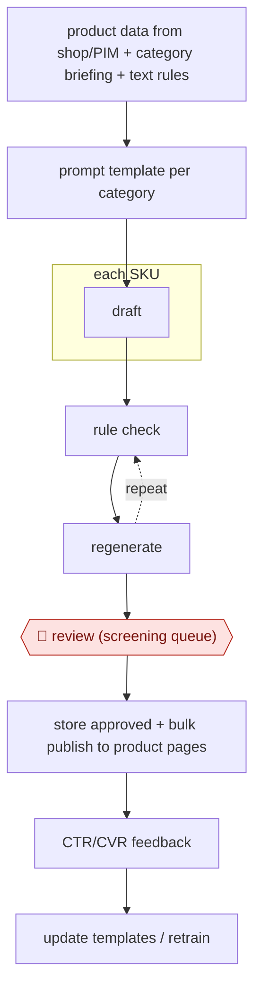

# Catalog copy factory

`COM › RET › CATALOG` · checkpointed · evidence A · **draft: needs a reference example** ([how to add one](../../../../../CONTRIBUTING.md#1-add-an-example-run))

**Shape:** `product data from shop/PIM + category briefing + text rules → prompt template per category → each SKU: draft → (rule check ⟲ regenerate) → 🛑 review (screening queue) → store approved + bulk publish to product pages → CTR/CVR feedback → update templates / retrain`
**Variants:** `chatgpt-api` · `claude-api` · `shopify-graphql` · `jd-apcg`

<!-- shape diagram: generated by scripts/build_diagrams.py from `shape`; don't edit -->

<!-- end shape diagram -->

## Background

An online shop has to describe every product it sells, and a catalogue with tens of thousands of items needs a title, a description, a feature list and often a structured summary for each one. Merchandisers write them by hand from the supplier's data: what the item is made of, what it fits, how big it is. The work is repetitive, and the two ways to fail are opposite. Copy that says too little sells nothing; copy that says too much invents a fact — a material, a warranty, a compatibility — and the invented fact becomes a legal problem when the customer relies on it. Here a batch process writes the copy per product from the catalogue record and a per-category brief, checks each draft against word rules (length, required sections, claims the record does not support) and regenerates the failures before any person looks. Reviewers then screen the queue and approve what goes live, and the effect is measured against the old copy. The review is not there to polish prose: it is the only step that can judge whether a sentence is true of the actual product, which is why the approved text, not the generated text, is what gets stored and published.

**Terms:**
- **PIM** (product information management): the system holding the structured record of every product — attributes, dimensions, materials.
- **SKU**: one sellable item; a size or colour variant is a separate SKU.
- **category brief**: the merchandiser's instruction for a product family: tone, what to include, what not to claim.
- **rule check**: a program that tests a draft — length, required fields, banned phrases, numbers that do not appear in the record.
- **unsupported claim**: a statement the catalogue record does not back, which is where liability starts.
- **screening queue**: the list where drafts wait for a person to approve, edit or reject.
- **bulk publish**: writing the approved copy to the live product pages in one operation.
- **CTR / CVR**: click-through and conversion rates, measured against the previous copy.

## Build it with an agent

**Form:** `service`. The work is a queue of thousands of items processed in batches with nobody starting each one; people appear as a screening queue, not as authors.

**You need:** the product records as structured data, with the fields the brief depends on actually populated; the per-category briefs and the text rules as versioned files; the rule checker as code, not as instructions to the model; a staging store where drafts live until approved, kept apart from the live pages; the publishing interface, which must only accept text that carries an approval; the analytics that compare the new copy with the old. The agent must have no write access to live product pages.

| Step | Built as |
|---|---|
| product data + category briefing + text rules | The run starts from an export of the SKUs whose records are complete; rows missing a field the brief needs are held back rather than padded. |
| prompt template per category | Templates are files with a version number, so every published sentence can be traced to the template and the record that produced it. |
| each SKU: draft | The Skill drafts one item at a time, with the record's own fields as its only facts; a missing field becomes a placeholder, never an inference. |
| rule check ⟲ regenerate | A checker script runs the length, structure and unsupported-claim tests; failures go back for one bounded regeneration, and a second failure goes to the queue flagged rather than retried forever. |
| 🛑 review (screening queue) | Reviewers see the draft beside the record, with every flagged line marked; approving writes to the staging store and editing records the change against the template for the next round. |
| store approved + bulk publish | A publish script moves only approved rows, in one operation per category, and logs the batch. |
| CTR/CVR feedback → update templates | Analytics arrive on a schedule; the Skill compares variants, proposes template or prompt changes, and the change goes live only after a person accepts it. |

**Checkpoints:** `review`: publishing is a separate tool that refuses rows without an approval record, so no draft can reach a product page by way of the agent, and the reviewer's screen shows the source fields next to each claim. The claim checker is code rather than a prompt instruction, because an invented warranty is a legal exposure, not a style fault.

**Since the sources:** Sources date from 2022-06 to 2026-03; the 2026 account was opened this month, the two older papers were not re-opened. What has changed since: the guardrail layer has been written down as a pattern. A 2026 practitioner guide puts the split at [rule-based validation catching most factual errors before a person reads anything, with human sampling of a share of each batch and a legal audit of the high-risk categories](http://theneuralbase.com/ai-for-ecommerce/learn/intermediate/quality-guardrails), and adds two things this entry's build takes up: the guardrail rules need version numbers, so a batch can be traced to the rules in force when it was generated, and a claim that touches health, safety or a warranty should not pass on a rule check alone. The screening queue stays as it is; what the newer material changes is what the queue is asked to judge.

*A design based on this entry's steps and the tool documentation as of 2026-11, not a reported run.*

## Steps

*As reported by the sources.*

1. Pull SKUs and their structured product data from the shop database or PIM. Collect the specialist department's briefing and product-text rules [[1]](#sources)[[2]](#sources).
2. Turn the briefing into prompt templates. Turn the same rules into discrete checks for a rule checker [[2]](#sources).
3. Generate descriptions in batch for each SKU, then post-process [[1]](#sources)[[2]](#sources).
4. Run automatic checks (rule compliance, length, required sections, claims not supported by the input data). Regenerate failures before a human sees them [[1]](#sources)[[2]](#sources)[[3]](#sources).
5. 🛑 **Review**: human screening of the generated copy. Only approved texts are stored for publishing [[1]](#sources). In one 6,000-SKU run, reviewers made meaningful edits to about 8% [[3]](#sources).
6. Publish approved copy to product pages in bulk [[3]](#sources). Retrain or update models and templates on new data; JD retrains daily for selected domains [[1]](#sources).

**Output:** Approved product descriptions stored and published to product detail pages; CTR/CVR measured against the old copy.
**Failure modes → guards:** Sparse SKU data leads to invented specs → limit the run to SKUs with complete data, add an unsupported-claim check, and have reviewers check facts [[3]](#sources). Copy breaks the department's text spec → rule checker built from the same briefing [[2]](#sources).
**How it differs:** AWF-0018 Cluster-brief-draft content: that produces SEO articles one at a time, each with a SERP brief and SME input. This one produces structured per-SKU listing copy at catalog volume through a rule check and screening queue. The deliverable and checkpoint arrangement are different.

## Public runs

Coverage as of 2026-11-06: **Strong**: a first-hand, detailed run that matches most of the shape. Collected and re-checked in [Second collection pass](../../../../../research/2026-11-second-pass.md).

- [JD.com, Automatic Product Copywriting for E-commerce](https://arxiv.org/html/2112.11915v1) (2022-06-28). Generate → human screening → store approved; deployed since Feb 2021. "Daily uploads to the descriptions database can reach up to 28,570 generated descriptions, with an average daily acceptance rate of 80%". *First-hand: yes; confidence: high.*
- [Troy Morgan, Shopify description pipeline](https://www.tdmorgan.com/blog/building-ai-product-description-pipeline-shopify) (2026-03-28). Retailer with ~8,000 SKUs: validation, regenerate, human review queue, bulk publish. "The human review step catches about 8% of descriptions that need meaningful edits". *First-hand: anon (store not named); confidence: med.*

## Sources

1. Zhang et al. (JD.com), Automatic Product Copywriting for E-commerce, AAAI 2022. https://arxiv.org/abs/2112.11915 (details: https://arxiv.org/html/2112.11915v1)
2. Kalla, Jäger, Krause (OTTO), ProductGPT – automating the creation of product texts with ChatGPT, 2023-08-16. https://www.otto.de/jobs/en/blogs/techblog/productgpt-automating-the-creation-of-product-texts-with-chatgpt/
3. Troy Morgan, AI Product Descriptions for Shopify: Automated Pipeline, 2026-03-28. https://www.tdmorgan.com/blog/building-ai-product-description-pipeline-shopify
