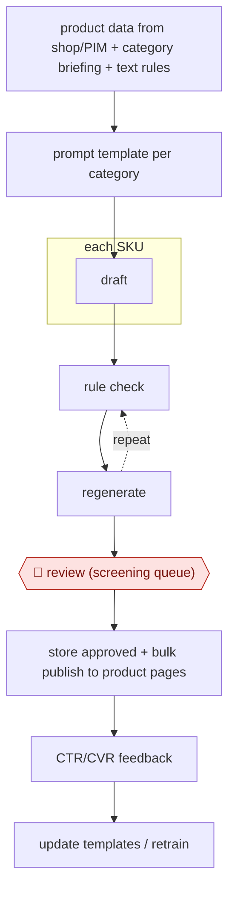

# Catalog copy factory

`COM › RET › CATALOG` · checkpointed · evidence A · **draft: needs a reference example** ([how to add one](../../../../../CONTRIBUTING.md#1-add-an-example-run))

**Shape:** `product data from shop/PIM + category briefing + text rules → prompt template per category → each SKU: draft → (rule check ⟲ regenerate) → 🛑 review (screening queue) → store approved + bulk publish to product pages → CTR/CVR feedback → update templates / retrain`
**How it differs:** AWF-0018 Cluster-brief-draft content: that produces SEO articles one at a time, each with a SERP brief and SME input. This one produces structured per-SKU listing copy at catalog volume through a rule check and screening queue. The deliverable and checkpoint arrangement are different.
**Variants:** `chatgpt-api` · `claude-api` · `shopify-graphql` · `jd-apcg`

<!-- shape diagram: generated by scripts/build_diagrams.py from `shape`; don't edit -->

<!-- end shape diagram -->

## Steps
1. Pull SKUs and their structured product data from the shop database or PIM. Collect the specialist department's briefing and product-text rules [[1]](#sources)[[2]](#sources).
2. Turn the briefing into prompt templates. Turn the same rules into discrete checks for a rule checker [[2]](#sources).
3. Generate descriptions in batch for each SKU, then post-process [[1]](#sources)[[2]](#sources).
4. Run automatic checks (rule compliance, length, required sections, claims not supported by the input data). Regenerate failures before a human sees them [[1]](#sources)[[2]](#sources)[[3]](#sources).
5. 🛑 **Review**: human screening of the generated copy. Only approved texts are stored for publishing [[1]](#sources). In one 6,000-SKU run, reviewers made meaningful edits to about 8% [[3]](#sources).
6. Publish approved copy to product pages in bulk [[3]](#sources). Retrain or update models and templates on new data; JD retrains daily for selected domains [[1]](#sources).

**Output:** Approved product descriptions stored and published to product detail pages; CTR/CVR measured against the old copy.
**Failure modes → guards:** Sparse SKU data leads to invented specs → limit the run to SKUs with complete data, add an unsupported-claim check, and have reviewers check facts [[3]](#sources). Copy breaks the department's text spec → rule checker built from the same briefing [[2]](#sources).

## Public runs

Coverage as of 2026-11-06: **Strong**: a first-hand, detailed run that matches most of the shape. Collected and re-checked in [Second collection pass](../../../../../research/2026-11-second-pass.md).

- [JD.com, Automatic Product Copywriting for E-commerce](https://arxiv.org/html/2112.11915v1) (2022-06-28). Generate → human screening → store approved; deployed since Feb 2021. "Daily uploads to the descriptions database can reach up to 28,570 generated descriptions, with an average daily acceptance rate of 80%". *First-hand: yes; confidence: high.*
- [Troy Morgan, Shopify description pipeline](https://www.tdmorgan.com/blog/building-ai-product-description-pipeline-shopify) (2026-03-28). Retailer with ~8,000 SKUs: validation, regenerate, human review queue, bulk publish. "The human review step catches about 8% of descriptions that need meaningful edits". *First-hand: anon (store not named); confidence: med.*

## Sources

1. Zhang et al. (JD.com), Automatic Product Copywriting for E-commerce, AAAI 2022. https://arxiv.org/abs/2112.11915 (details: https://arxiv.org/html/2112.11915v1)
2. Kalla, Jäger, Krause (OTTO), ProductGPT – automating the creation of product texts with ChatGPT, 2023-08-16. https://www.otto.de/jobs/en/blogs/techblog/productgpt-automating-the-creation-of-product-texts-with-chatgpt/
3. Troy Morgan, AI Product Descriptions for Shopify: Automated Pipeline, 2026-03-28. https://www.tdmorgan.com/blog/building-ai-product-description-pipeline-shopify
