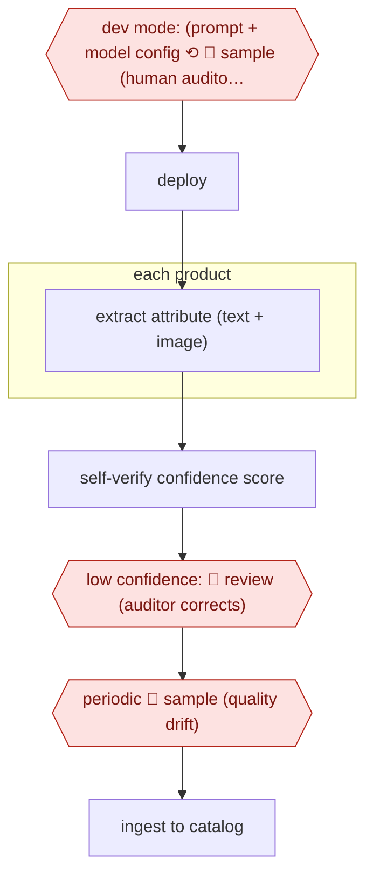

# Confidence-sampled attribute extraction

`COM › RET › CATALOG` · sampled · evidence A · **draft: needs a reference example** ([how to add one](../../../../../CONTRIBUTING.md#1-add-an-example-run))

**Shape:** `dev mode: (prompt + model config ⟲ 🛑 sample (human auditors label gold values) + LLM judge) → deploy → each product: extract attribute (text + image) → self-verify confidence score → low confidence: 🛑 review (auditor corrects) → periodic 🛑 sample (quality drift) → ingest to catalog`
**How it differs:** Zalando copilot (above) has a person approve every value. Here people see only low-confidence items and samples. AWF-0063 Diff-proven dbt migration is checked against production data, not human gold labels.
**Variants:** `instacart-parse` · `walmart-qc-llm`

<!-- shape diagram: generated by scripts/build_diagrams.py from `shape`; don't edit -->

<!-- end shape diagram -->

## Background

A product record is a set of named facts: material, pattern, closure, fit, colour, capacity. Retailers receive those facts from suppliers who format them differently or leave them out, so someone has to read the photography and the copy and fill the fields. Doing it by hand across a catalogue of hundreds of thousands is impossible, and doing it by model alone is dangerous, because a wrong attribute is worse than an empty one: it is shown to a customer as fact, it drives a filter or a comparison, and an agent shopping on someone's behalf will read it literally. This workflow extracts each attribute from the text and the images and gives every value a confidence score. Values above a threshold go straight into the catalogue; the uncertain tail goes to a person who corrects it, and a periodic sample of everything else is checked to catch the moment the extraction starts drifting. The people in this loop are auditors, not authors: they see the proposed value, the evidence it was read from and a confidence, and their corrections become the labelled data that sets the thresholds. The machine writes to a staging area, never straight to the master record, so a bad run can be rolled back rather than repaired.

**Terms:**
- **attribute**: one named field of a product, such as material or closure type.
- **extraction**: reading a value for an attribute out of the supplier's text and photography.
- **confidence score**: a number attached to each proposed value, either from a scoring prompt or from a model trained on human labels.
- **gold value**: the correct answer, as labelled by a person, used to measure extraction quality.
- **LLM judge**: a second model call that checks the first one's answer.
- **threshold**: the confidence above which a value is published without review.
- **drift**: the slow loss of accuracy as the catalogue's products and photography change.
- **staging store**: a table where proposals wait, separate from the master catalogue.

## Build it with an agent

**Form:** `service`. Extraction runs over batches of products with nobody starting each one; people meet it as a correction queue and as a sampling programme.

**You need:** the supplier text and images for each product, with the attribute schema and its allowed values written down; a staging table with one row per proposal, carrying the value, the confidence, the model version, and the evidence — which image, which sentence — it was read from; a correction queue sorted by confidence; an evaluation set of labelled products; the master catalogue, which the agent must not write to. The schema matters as much as the model: a value outside the allowed set is a defect, not a synonym.

| Step | Built as |
|---|---|
| dev mode: prompt + model config ⟲ 🛑 sample (human auditors label gold values) + LLM judge | A labelled set of a few hundred products per category, built once, then re-used: every prompt or model change is scored against it before deployment, and the judge model runs beside the human labels as a second opinion rather than as a substitute. |
| deploy | The deployment carries a model version and a prompt version into every row it writes, so a bad batch can be identified by version instead of by guessing. |
| each product: extract attribute (text + image) | A script batches the products through the extractor; attributes that need the photograph and attributes that need the text are extracted separately, so a mismatch between them becomes a flag rather than a silent choice. |
| self-verify confidence score | The scoring call is separate from the extraction call, and the score is calibrated against the labelled set before it is trusted — a raw self-reported score is only loosely related to correctness. |
| low confidence: 🛑 review (auditor corrects) | The correction queue shows each proposal with its evidence and the schema's allowed values; the auditor's fix writes back to the staging row, and the disagreement is kept as training data. |
| periodic 🛑 sample (quality drift) | A fixed share of published values is sampled every period and checked against source, with the result reported per attribute and category; a drop pauses the automatic path for that attribute. |
| ingest to catalog | Only rows marked promoted are moved to the master catalogue, and the move is logged with the batch id. |

**Checkpoints:** `review`: the low-confidence path is the auditor's queue and nothing else, and the agent has no write access to the master catalogue, so an unreviewed value cannot be published by accident. `sample`: the sampling programme is configured outside the agent and runs on a schedule it cannot change; the sample's result decides whether an attribute keeps its automatic threshold. Fields that carry a safety, legal or compatibility claim are routed to `review` whatever their score, in the promotion policy rather than in the prompt.

**Since the sources:** Sources date from 2025-05 and 2025-08: two first-hand engineering accounts from large retailers; both are older than twelve months and were not re-opened on this pass. What has changed since: the staging-table architecture has become the published default. A 2026 practitioner write-up argues that [model output must never write to the master catalogue, that the promotion policy should be explicit — confidence plus no conflict, or review; legal and safety attributes reviewed regardless of confidence — and that the threshold should be set from your own labelled sample rather than a vendor default](https://paragraph.com/@techcirkle/building-a-product-catalogue-enrichment-pipeline-that-doesnt-corrupt-your-data). It also warns that self-reported confidence is only loosely correlated with correctness, which the build above answers by calibrating the score before it gates anything. The sources' "self-verify" step is unchanged; what is new is the requirement that the verification be measured before it is trusted.

*A design based on this entry's steps and the tool documentation as of 2026-11, not a reported run.*

## Steps

*As reported by the sources.*

1. In development mode, teams iterate prompts and models on a small sample; human auditors label gold values, alongside an LLM judge [[1]](#sources).
2. In production, each product's attribute is extracted from text and images [[1]](#sources)[[2]](#sources).
3. Confidence comes from a second 'scoring prompt' (Instacart) or a separate QC model trained on human labels (Walmart) [[1]](#sources)[[2]](#sources).
4. 🛑 **Review**: low-confidence values go to human auditors for correction [[1]](#sources).
5. 🛑 **Sample**: a periodic sample of new products is evaluated to detect quality drops [[1]](#sources).

**Output:** Attribute values ingested into the catalog data pipeline.
**Failure modes → guards:** Silent drift as the catalog changes → periodic sampling. Plausible but wrong values → independent verifier/QC model.

## Public runs

Coverage as of 2026-11-06: **Partial**: first-hand runs that cover part of the shape or put checkpoints elsewhere. Collected and re-checked in [Second collection pass](../../../../../research/2026-11-second-pass.md).

- [Instacart, PARSE](https://tech.instacart.com/multi-modal-catalog-attribute-extraction-platform-at-instacart-b9228754a527) (2025-08-01). Self-serve platform with production human-in-the-loop correction. "our initial prompt for organic extraction gave us a 95% accuracy"; "one day of effort, compared to one week previously". *First-hand: yes; confidence: med.*

## Sources

1. Shih-Ting Lin, Instacart, Scaling Catalog Attribute Extraction with Multi-modal LLMs, 2025-08-01. https://tech.instacart.com/multi-modal-catalog-attribute-extraction-platform-at-instacart-b9228754a527
2. Walmart Global Tech, How Walmart uses LLMs to manage its massive product catalogs, 2025-05-20. https://tech.walmart.com/content/walmart-global-tech/en_us/blog/post/using-llms-to-manage-product-catalogs.html
