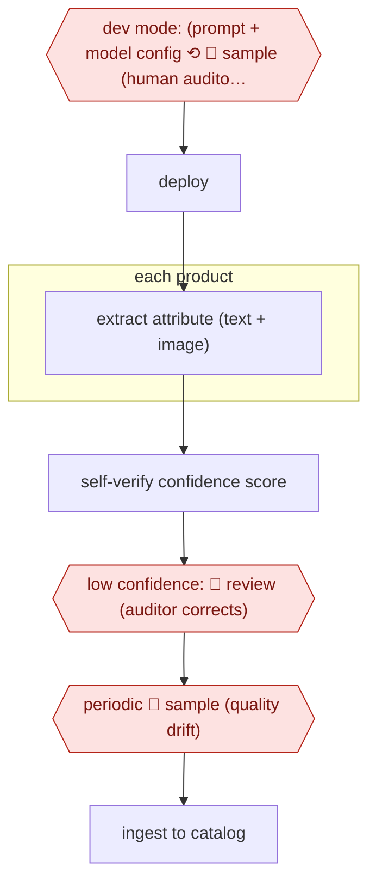

# Confidence-sampled attribute extraction

`COM › RET › CATALOG` · sampled · evidence A · **draft: needs a reference example** ([how to add one](../../../../../CONTRIBUTING.md#1-add-an-example-run))

**Shape:** `dev mode: (prompt + model config ⟲ 🛑 sample (human auditors label gold values) + LLM judge) → deploy → each product: extract attribute (text + image) → self-verify confidence score → low confidence: 🛑 review (auditor corrects) → periodic 🛑 sample (quality drift) → ingest to catalog`
**How it differs:** Zalando copilot (above) has a person approve every value. Here people see only low-confidence items and samples. AWF-0063 Diff-proven dbt migration is checked against production data, not human gold labels.
**Variants:** `instacart-parse` · `walmart-qc-llm`

<!-- shape diagram: generated by scripts/build_diagrams.py from `shape`; don't edit -->

<!-- end shape diagram -->

## Steps
1. In development mode, teams iterate prompts and models on a small sample; human auditors label gold values, alongside an LLM judge [[1]](#sources).
2. In production, each product's attribute is extracted from text and images [[1]](#sources)[[2]](#sources).
3. Confidence comes from a second 'scoring prompt' (Instacart) or a separate QC model trained on human labels (Walmart) [[1]](#sources)[[2]](#sources).
4. 🛑 **Review**: low-confidence values go to human auditors for correction [[1]](#sources).
5. 🛑 **Sample**: a periodic sample of new products is evaluated to detect quality drops [[1]](#sources).

**Output:** Attribute values ingested into the catalog data pipeline.
**Failure modes → guards:** Silent drift as the catalog changes → periodic sampling. Plausible but wrong values → independent verifier/QC model.

## Public runs

Coverage as of 2026-11-06: **Partial**: first-hand runs that cover part of the shape or put checkpoints elsewhere. Collected and re-checked in [Second collection pass](../../../../../research/2026-11-second-pass.md).

- [Instacart, PARSE](https://tech.instacart.com/multi-modal-catalog-attribute-extraction-platform-at-instacart-b9228754a527) (2025-08-01). Self-serve platform with production human-in-the-loop correction. "our initial prompt for organic extraction gave us a 95% accuracy"; "one day of effort, compared to one week previously". *First-hand: yes; confidence: med.*

## Sources

1. Shih-Ting Lin, Instacart, Scaling Catalog Attribute Extraction with Multi-modal LLMs, 2025-08-01. https://tech.instacart.com/multi-modal-catalog-attribute-extraction-platform-at-instacart-b9228754a527
2. Walmart Global Tech, How Walmart uses LLMs to manage its massive product catalogs, 2025-05-20. https://tech.walmart.com/content/walmart-global-tech/en_us/blog/post/using-llms-to-manage-product-catalogs.html
