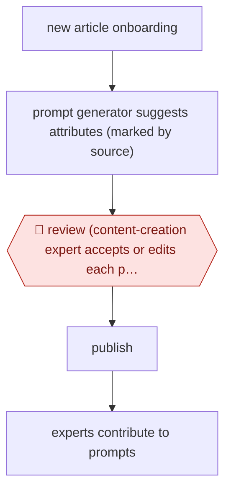

# Copilot attribute suggestions

`COM › RET › CATALOG` · assist · evidence A · **draft: needs a reference example** ([how to add one](../../../../../CONTRIBUTING.md#1-add-an-example-run))

**Shape:** `new article onboarding → prompt generator suggests attributes (marked by source) → 🛑 review (content-creation expert accepts or edits each pre-selected value) → publish → experts contribute to prompts`
**How it differs:** AWF-0048 Gap-match knowledge upkeep produces knowledge-base articles. Here the deliverable is structured product data, approved field by field (assist), not drafted and reviewed as a document.
**Variants:** `gpt-4o`

<!-- shape diagram: generated by scripts/build_diagrams.py from `shape`; don't edit -->

<!-- end shape diagram -->

## Steps
1. Before building, domain experts reviewed model predictions on a large article sample to choose the model [[1]](#sources).
2. In the content creation tool, GPT-4o-generated attribute suggestions are pre-selected and marked with a purple dot showing their source [[1]](#sources).
3. 🛑 **Review**: the content-creation user makes the final decision on every attribute [[1]](#sources).
4. Users contribute to prompt improvements; rollout can include or exclude products and attributes [[1]](#sources).

**Output:** Article attributes live in the shop, which shortens time to online.
**Failure modes → guards:** About 25% of suggestions are wrong → every value is approved by a person. Niche categories are weaker → controlled rollout by category.

## Public runs

Coverage as of 2026-11-06: **Strong**: a first-hand, detailed run that matches most of the shape. Collected and re-checked in [Second collection pass](../../../../../research/2026-11-second-pass.md).

- [Zalando, Content Creation Copilot](https://engineering.zalando.com/posts/2024/09/content-creation-copilot-ai-assited-product-onboarding.html) (2024-09-17). In production with content-creation experts. "enriching around 50,000 attributes on average per week". *First-hand: yes; confidence: high.*

## Sources

1. Michal Kubacki, Zalando Engineering, Content Creation Copilot, 2024-09-17. https://engineering.zalando.com/posts/2024/09/content-creation-copilot-ai-assited-product-onboarding.html
