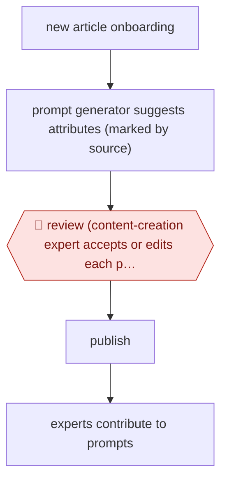

# Copilot attribute suggestions

`COM › RET › CATALOG` · assist · evidence A · **draft: needs a reference example** ([how to add one](../../../../../CONTRIBUTING.md#1-add-an-example-run))

**Shape:** `new article onboarding → prompt generator suggests attributes (marked by source) → 🛑 review (content-creation expert accepts or edits each pre-selected value) → publish → experts contribute to prompts`
**Variants:** `gpt-4o`

<!-- shape diagram: generated by scripts/build_diagrams.py from `shape`; don't edit -->

<!-- end shape diagram -->

## Background

When a shop takes on a new brand or a new line, every article arrives with a title and a picture and very little else. The fields that make a catalogue usable — material, pattern, fit, care — have to be filled before the item goes online, and they are filled by content specialists who look at the photography and the supplier's description and type the values in. It is unglamorous work with a real effect on when a product can be sold. Here a copilot suggests a value for each field before the specialist starts, and every suggestion is pre-selected and marked so the reader can see it came from a model rather than from a person. The specialist then accepts or edits each one: the click through the form is the approval, and nothing publishes that a person has not confirmed field by field. That is the whole trade — the suggestions save typing, not judgement, and the specialists who use the tool also feed the prompts, so the parts of the catalogue where the model is weak get fixed by the people who know them.

**Terms:**
- **article**: one product as the shop holds it — the record plus its attributes.
- **attribute**: a named field such as material, pattern or fit, usually chosen from a fixed list of allowed values.
- **onboarding**: the process of taking a supplier's product into the catalogue.
- **pre-selected value**: a suggestion already filled into the form, awaiting the specialist's confirmation.
- **provenance mark**: the visible marker showing which values were proposed by the model.
- **controlled rollout**: switching the copilot on for some categories or attributes and not others.
- **prompt contribution**: the specialists' edits feeding back into how suggestions are generated.

## Build it with an agent

**Form:** `skill`. One content specialist works through one article at a time with the form in front of them; what the build adds is the suggestion pass and the provenance, not a pipeline.

**You need:** the article's own text and images, plus the supplier material; the attribute schema with each field's allowed values, because a suggestion outside the list creates work rather than saving it; a place to record which values were proposed, accepted or edited, per model and prompt version; the category-by-category rollout list. The agent needs no publish rights: publishing is what the specialist does after the review.

| Step | Built as |
|---|---|
| new article onboarding | The Skill starts from the article record the specialist has open, with the images and supplier text as its only sources of facts. |
| prompt generator suggests attributes (marked by source) | A suggestion pass constrained to the allowed values per field, writing one proposal per field with the evidence it used — the image region or the supplier sentence — and a provenance mark for the form. |
| 🛑 review (content-creation expert accepts or edits each pre-selected value) | The form is the checkpoint: every field arrives pre-filled and unchecked, and only a person's click accepts it; the Skill has no tool that publishes an article. |
| publish | Outside the agent, in the shop's own tooling. |
| experts contribute to prompts | Accepted and edited values are stored against the field and the prompt version, so the specialist team can see where suggestions are wrong and change the prompts or withhold a category. |

**Checkpoints:** `review`: a suggestion is only ever a pre-filled field. Publication is a separate act in the shop's tooling that the build cannot reach, and the provenance mark makes an unconfirmed value visible in review, so the failure the sources report — roughly a quarter of suggestions being wrong — costs an edit rather than a wrong listing. Withholding a category is the other half of the control: where suggestions are weak, the copilot is switched off for that category instead of being reviewed harder.

**Since the sources:** Sources date from 2024-09: one first-hand engineering account, which is also the public run. It is older than twelve months, so the practice was searched again; the account's page was not re-opened on this pass. What has changed since: the same company now publishes figures for attribute enrichment that no longer pass through a person field by field. Its Q1 2026 results say generative image processing [enriches around 6,000 articles a day with missing material composition data, and that up to 85% of articles are ready to go online in under three days](https://corporate.zalando.com/en/financials/zalando-q1-2026-results). That is one attribute on one path, not a replacement for this copilot, but it marks the line this entry sits on: fields that are verifiable from a single source move to automatic enrichment with sampling, and fields that need a judgement about the product stay with a person. The build above keeps every field on the human side, which is the conservative reading of the newer account.

*A design based on this entry's steps and the tool documentation as of 2026-11, not a reported run.*

## Steps

*As reported by the sources.*

1. Before building, domain experts reviewed model predictions on a large article sample to choose the model [[1]](#sources).
2. In the content creation tool, GPT-4o-generated attribute suggestions are pre-selected and marked with a purple dot showing their source [[1]](#sources).
3. 🛑 **Review**: the content-creation user makes the final decision on every attribute [[1]](#sources).
4. Users contribute to prompt improvements; rollout can include or exclude products and attributes [[1]](#sources).

**Output:** Article attributes live in the shop, which shortens time to online.
**Failure modes → guards:** About 25% of suggestions are wrong → every value is approved by a person. Niche categories are weaker → controlled rollout by category.
**How it differs:** AWF-0048 Gap-match knowledge upkeep produces knowledge-base articles. Here the deliverable is structured product data, approved field by field (assist), not drafted and reviewed as a document.

## Public runs

Coverage as of 2026-11-06: **Strong**: a first-hand, detailed run that matches most of the shape. Collected and re-checked in [Second collection pass](../../../../../research/2026-11-second-pass.md).

- [Zalando, Content Creation Copilot](https://engineering.zalando.com/posts/2024/09/content-creation-copilot-ai-assited-product-onboarding.html) (2024-09-17). In production with content-creation experts. "enriching around 50,000 attributes on average per week". *First-hand: yes; confidence: high.*

## Sources

1. Michal Kubacki, Zalando Engineering, Content Creation Copilot, 2024-09-17. https://engineering.zalando.com/posts/2024/09/content-creation-copilot-ai-assited-product-onboarding.html
