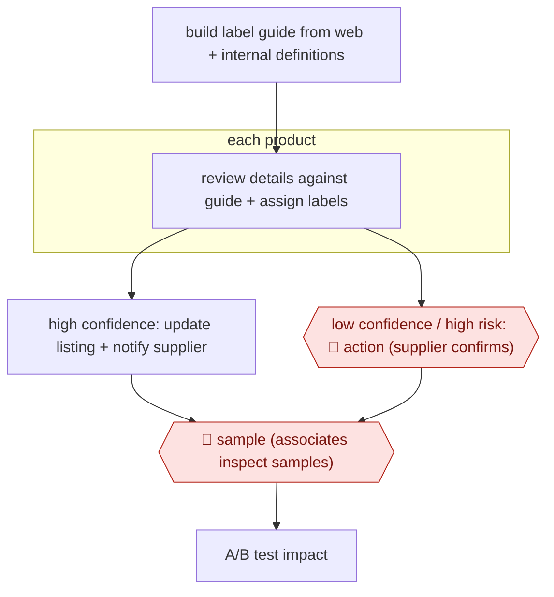

# Supplier-confirmed catalog fixes

`COM › RET › CATALOG` · sampled · evidence B · **draft: needs a reference example** ([how to add one](../../../../../CONTRIBUTING.md#1-add-an-example-run))

**Shape:** `build label guide from web + internal definitions → each product: review details against guide + assign labels → high confidence: update listing + notify supplier | low confidence / high risk: 🛑 action (supplier confirms) → 🛑 sample (associates inspect samples) → A/B test impact`
**How it differs:** Instacart/Walmart (above) route doubts to internal auditors. Here the external supplier is the approver for risky changes and live listings are edited in place, so the checkpoint owner and the deliverable differ.
**Variants:** `openai`

<!-- shape diagram: generated by scripts/build_diagrams.py from `shape`; don't edit -->

<!-- end shape diagram -->

## Steps
1. Generate a guide explaining what each label means, using web information and Wayfair's internal definitions [[1]](#sources).
2. Models review product information against the guide and assign labels (color, material, size) [[1]](#sources).
3. High confidence: update content directly and notify the supplier. 🛑 **Action**: low-confidence or high-risk changes need supplier confirmation first [[1]](#sources).
4. 🛑 **Sample**: associates inspect product samples in a structured audit [[1]](#sources).

**Output:** Corrected live listings; impact measured by A/B test.
**Failure modes → guards:** Wrong edits to supplier content → confidence and risk routing to supplier confirmation.

## Public runs

Coverage as of 2026-11-06: **Weak**: only anonymous, vendor-linked or journalist-told accounts. Collected and re-checked in [Second collection pass](../../../../../research/2026-11-second-pass.md).

- [OpenAI, Wayfair](https://openai.com/index/wayfair/) (2026-09-25). Over a million products processed; A/B test showed more impressions and clicks. "has processed more than 1 million products". *First-hand: vendor; confidence: med.*

## Sources

1. OpenAI, Wayfair boosts catalog accuracy and support speed with OpenAI, 2026-09-25. https://openai.com/index/wayfair/
